# Motion library

The motion library: Mixamo clips on our rig (Assets/MusicVideo/Motion/Humanoid@mx_*.fbx), each watched at real speed through `mv lab` renders (front and three-quarter, 30 fps) and stepped frame by frame. Written by hand after watching; `node Director/tools/motion_lib.mjs gallery` turns it into gallery.md. Times are clip seconds at speed 1. `speed140`/`speed100` put the clip's own pulse on the beat at those tempos (beat 0.4286 s / 0.6 s). `masks` are the layer masks worth taking. Verdict A build on it, B a moment or a masked part, C don't use.

**For staging acting, start from the clip catalog** (`catalog.md`, `catalog.html`, `mv clips <use>`): every clip in `Assets/MusicVideo/Motion` previewed on the native path and graded by use (2026-11-07). The notes below were watched on the old path; where they disagree with the catalog (mx_shrug is no longer a T-pose, mx_sit_point is a shade-the-eyes look, not a point), the catalog is newer.

92 clips watched. Verdicts: **A** build on it, **B** usable for a moment or with a mask, **C** don't use. Times are seconds of clip time at speed 1. Speeds are the clip `speed` that puts its own beat on the song's beat, for 140 and for 100 BPM. Masks are the `layer` masks worth taking from it. Strips: `strips/<clip>.jpg` every frame at 15 fps, `renders/<clip>_front.mp4` and `_three.mp4` the real thing.

## Grooves on the spot

### `mx_african_rainbow` — ?

****  
Admission: rejected (joint limits moved RightFoot 61.4 deg; foot slide 4.85 cm/frame), 7.333 s.  

Good parts: . Masks: whole body. Speed at 140: ?, at 100: ?.  
Tags: groove.

### `mx_charleston` — ?

****  
Admission: rejected (joint limits moved LeftFoot 94.5 deg; foot slide 4.35 cm/frame), 20.9 s.  

Good parts: . Masks: whole body. Speed at 140: ?, at 100: ?.  
Tags: groove.

### `mx_hh_arm_wave` — ?

****  
Admission: rejected (foot slide 4.24 cm/frame), 5.2 s.  

Good parts: . Masks: whole body. Speed at 140: ?, at 100: ?.  
Tags: groove.

### `mx_hh_arms` — ?

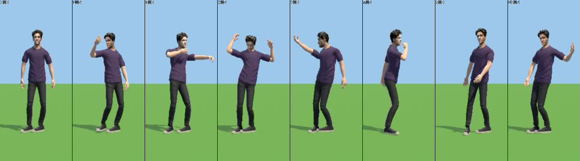

****  
Admission: rejected (foot slide 4.56 cm/frame), 21.967 s.  

Good parts: . Masks: whole body. Speed at 140: ?, at 100: ?.  
Tags: groove.

### `mx_hh_listening_2` — ?

****  
Admission: rejected (foot slide 4.6 cm/frame), 18.567 s.  

Good parts: . Masks: whole body. Speed at 140: ?, at 100: ?.  
Tags: groove.

### `mx_hh_running_man` — ?

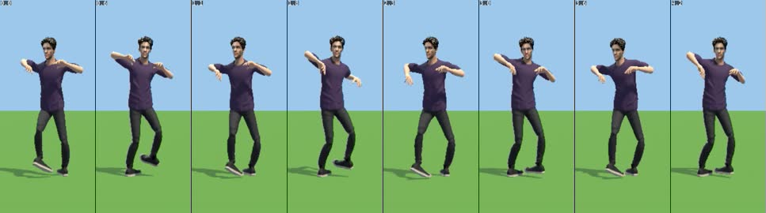

****  
Admission: rejected (joint limits moved RightFoot 49.7 deg), 4.733 s.  

Good parts: . Masks: whole body. Speed at 140: ?, at 100: ?.  
Tags: groove.

### `mx_jazz_around_world` — ?

****  
Admission: rejected (joint limits moved LeftFoot 79.9 deg; foot slide 3.66 cm/frame), 2.267 s.  

Good parts: . Masks: whole body. Speed at 140: ?, at 100: ?.  
Tags: groove.

### `mx_maraschino` — ?

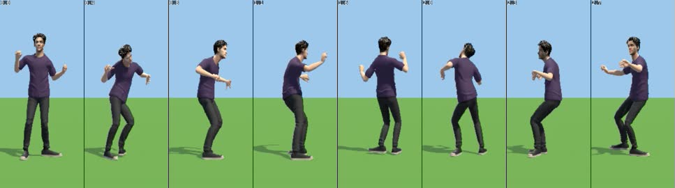

****  
Admission: rejected (joint limits moved LeftLowerArm 47.3 deg), 3.233 s.  

Good parts: . Masks: whole body. Speed at 140: ?, at 100: ?.  
Tags: groove.

### `mx_samba_pagode` — ?

****  
Admission: rejected (foot slide 4.98 cm/frame), 21.8 s.  

Good parts: . Masks: whole body. Speed at 140: ?, at 100: ?.  
Tags: groove.

### `mx_shim_sham` — ?

****  
Admission: rejected (foot slide 4.98 cm/frame), 24.7 s.  

Good parts: . Masks: whole body. Speed at 140: ?, at 100: ?.  
Tags: groove.

### `mx_thriller_1` — ?

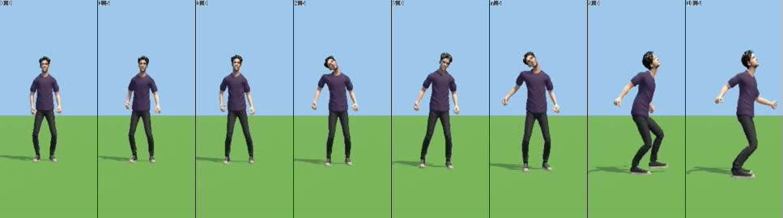

****  
Admission: rejected (foot slide 3.56 cm/frame; self-clip 9 cm shinL/shinR at 15.87s), 29.833 s.  

Good parts: . Masks: whole body. Speed at 140: ?, at 100: ?.  
Tags: groove.

### `mx_hh_raise_roof` — A

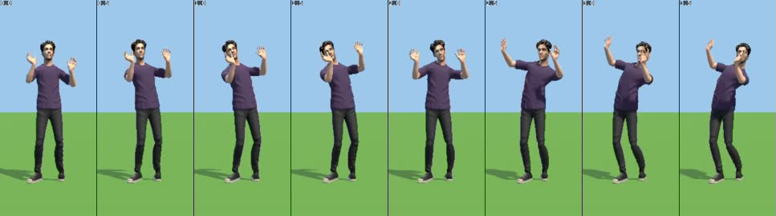

**Hands up by the head pumping at the sky, a lean back and a hip bounce under it**  
Admission: rejected (joint limits moved LeftFoot 40.7 deg; foot slide 3.91 cm/frame), 4.1 s.  

| start | stop | bars | what | use |
|---|---|---|---|---|
| 0.2 | 2.3 | 1.2 | two pumps | hands up; loop 0.2-2.3 |

Good parts: arms, chest, the lean; the feet shuffle. Masks: `upper`. Speed at 140: 1.24, at 100: 0.88.  
Tags: hands-up, groove, in-place, high-energy.

### `mx_twist` — A

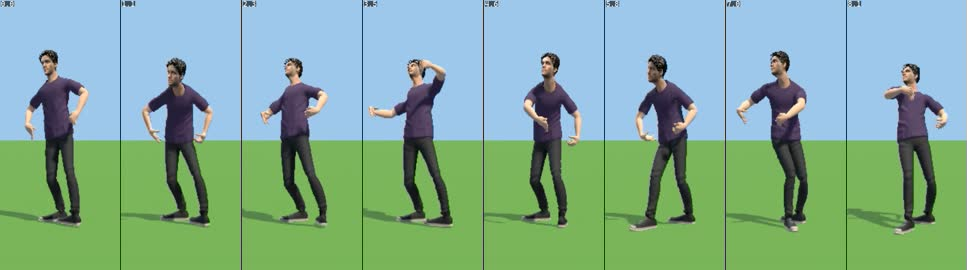

**The twist: knees together, hips twisting, arms pumping low at the waist; a lean-back with one arm up in the middle**  
Admission: rejected (joint limits moved LeftFoot 42.5 deg), 9.433 s.  

| start | stop | bars | what | use |
|---|---|---|---|---|
| 0.5 | 2.3 | 1 | the twist | retro groove, arms stay in |
| 4 | 5.5 | 0.9 | twist again, arms low | loop with the first |
| 2.3 | 3.8 | 0.9 | lean back, arm up | a pose on a hit, B |

Good parts: hips, knees, arms. Masks: `lower`, `arms`. Speed at 140: 1.71, at 100: 1.22.  
Avoid: the lean back unless it is the point.  
Tags: twist, retro, groove, in-place.

### `mx_hh_robot` — B

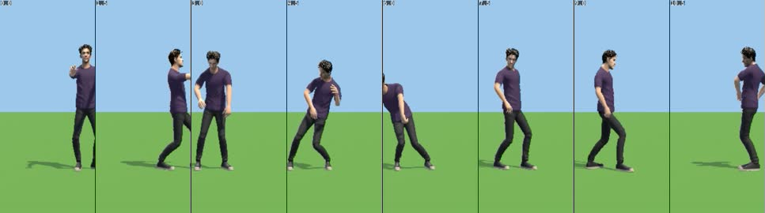

**Robot: an arm locked out forward, a crouch, hands to the face, then a stiff bend with arms hanging**  
Admission: rejected (foot slide 3.54 cm/frame), 15.433 s.  

| start | stop | bars | what | use |
|---|---|---|---|---|
| 2 | 3.5 | 0.9 | hands to the face then out | a robot moment, once |

Good parts: arms. Masks: `arms`. Speed at 140: 1.47, at 100: 1.05.  
Avoid: the bend at 5-6 s.  
Tags: robot, hip-hop, in-place.

### `mx_hh_timid` — B

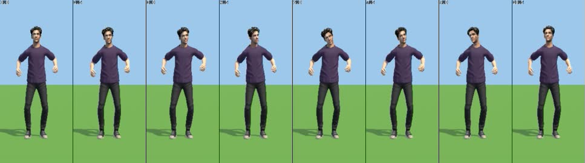

**A shy bounce on the spot: knees give on the beat, head bobs, hands hang at the hips, elbows a little out**  
Admission: admitted, 13.033 s.  

| start | stop | bars | what | use |
|---|---|---|---|---|
| 0 | 4 | 2.3 | the bounce | a quiet verse under-layer, or lower only under a gesture |

Good parts: legs, hips, head. Masks: `lower`, `head`. Speed at 140: 1.71, at 100: 1.22.  
Avoid: as a chorus: nothing happens above the waist.  
Tags: hip-hop, groove, in-place, quiet, loop.

### `mx_house_4` — B

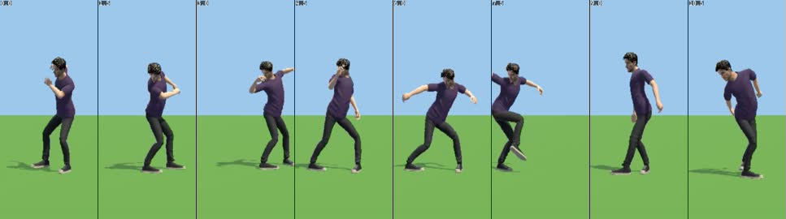

**Travelling house: jacking chest, deep steps and lunges, arms thrown up to shoulder height, the body angled off front**  
Admission: admitted, 19.8 s.  

| start | stop | bars | what | use |
|---|---|---|---|---|
| 1 | 4 | 1.7 | house footwork | legs only under a tighter upper body; he turns to profile |

Good parts: legs and hips. Masks: `lower`. Speed at 140: 1.63, at 100: 1.17.  
Avoid: the arms past 4 s (wide) and the whole body facing off front.  
Tags: house, groove, travelling.

### `mx_salsa_f` — B

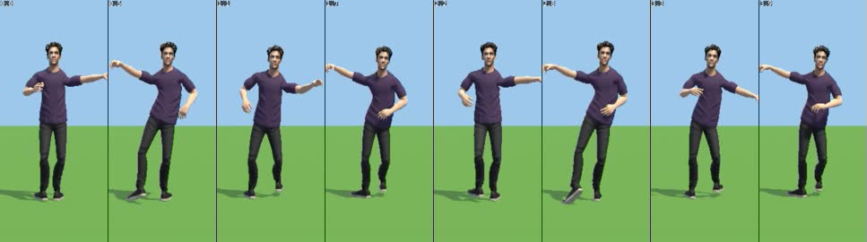

**Female salsa: shifting steps with arms sweeping across at chest height and out to the side**  
Admission: rejected (joint limits moved RightFoot 41.6 deg; foot slide 4.78 cm/frame), 4.5 s.  

| start | stop | bars | what | use |
|---|---|---|---|---|
| 0 | 2.3 | 1.3 | the step | lower only; the arms sweep wide |

Good parts: hips and feet. Masks: `lower`. Speed at 140: 1.4, at 100: 1.  
Avoid: the arms at 1.0-1.5 and 3.0-3.5.  
Tags: salsa, groove, in-place.

### `mx_salsa_side` — B

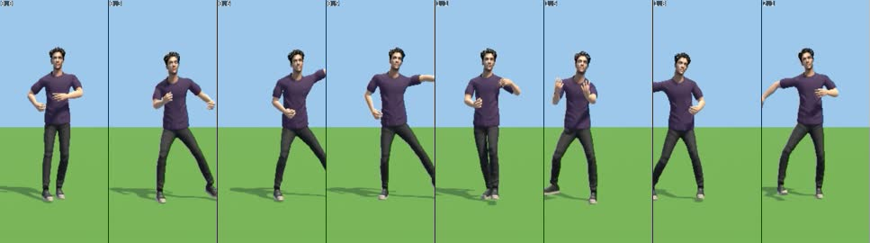

**Side-to-side salsa steps, hands sweeping at waist and chest height, one big lunge**  
Admission: admitted, 2.267 s.  

| start | stop | bars | what | use |
|---|---|---|---|---|
| 0 | 2.27 | 1.3 | the loop | a Latin side step; arms go wide at 0.5-1.0 so mask them if arms must stay in |

Good parts: legs and hips. Masks: `lower`. Speed at 140: 1.32, at 100: 0.95.  
Avoid: the wide arms at 0.5-1.0.  
Tags: salsa, step, in-place, loop.

### `mx_samba_pocoto` — B

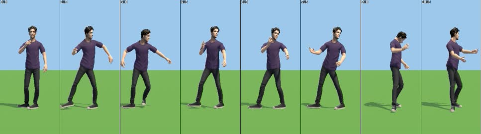

**Samba: bouncing feet and hips, with arms sweeping wide at shoulder height in the first two seconds and throws after**  
Admission: admitted, 27.867 s.  

| start | stop | bars | what | use |
|---|---|---|---|---|
| 2 | 5 | 1.7 | the hips and feet | lower only; the arms are the wide look the brief rules out |

Good parts: hips and feet. Masks: `lower`. Speed at 140: 1.17, at 100: 0.83.  
Avoid: arms 0-2 s (wide) and the throws after 5 s.  
Tags: samba, groove, in-place, loop.

### `mx_hh_quake` — C

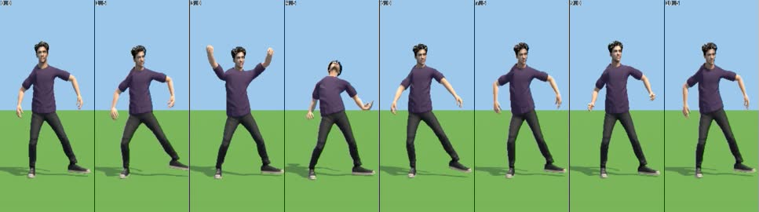

**Wide stance with arms raised and out through the whole clip**  
Admission: rejected (foot slide 4.76 cm/frame), 15.767 s.  

Good parts: . Masks: whole body. Speed at 140: ?, at 100: ?.  
Avoid: it.  
Tags: hip-hop, wide.

### `mx_hh_tut` — C

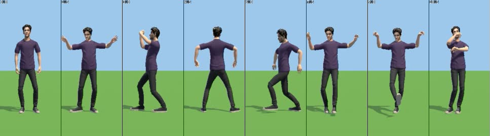

**Tutting with the arms out at shoulder height, then he turns his back from 3 s**  
Admission: rejected (foot slide 4.71 cm/frame), 16.933 s.  

Good parts: . Masks: whole body. Speed at 140: ?, at 100: ?.  
Avoid: it.  
Tags: hip-hop, wide.

### `mx_hh_wave_1` — C

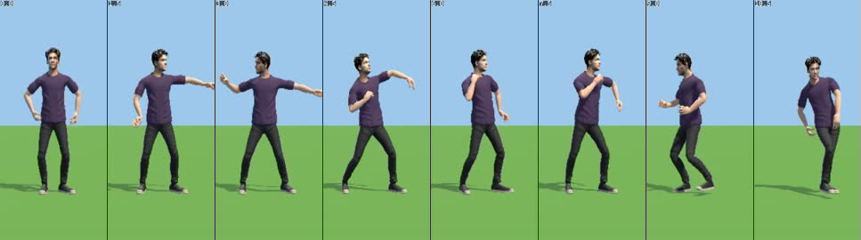

**An arm wave that runs through both arms held out at shoulder height: the wide-armed look**  
Admission: rejected (foot slide 4.59 cm/frame), 16.833 s.  

Good parts: . Masks: whole body. Speed at 140: ?, at 100: ?.  
Avoid: it.  
Tags: hip-hop, wide.

## Steps, slides and travel

### `mx_moonwalk` — ?

****  
Admission: rejected (joint limits moved LeftFoot 44.6 deg; foot slide 4.85 cm/frame), 1.033 s.  

Good parts: . Masks: whole body. Speed at 140: ?, at 100: ?.  
Tags: step.

### `mx_side_step` — ?

****  
Admission: admitted, 1.467 s.  

Good parts: . Masks: whole body. Speed at 140: ?, at 100: ?.  
Tags: step.

### `mx_slide_walk` — ?

****  
Admission: rejected (foot slide 4.83 cm/frame), 0.967 s.  

Good parts: . Masks: whole body. Speed at 140: ?, at 100: ?.  
Tags: step.

## Turns and spins

### `mx_catwalk_seq02` — ?

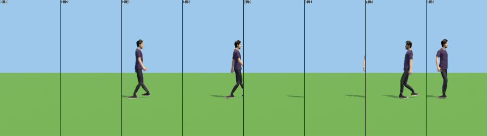

**Female sequence: twist left and right, then a walking 360 spin**  
Admission: rejected (pop: LeftToes kinks 0.324 m at 10.03s; foot slide 4.95 cm/frame), 12.167 s.  

Good parts: . Masks: whole body. Speed at 140: ?, at 100: ?.  
Avoid: ungraded; render with `dist` set.  
Tags: turn, catwalk, travelling.

### `mx_turn_180_l` — A

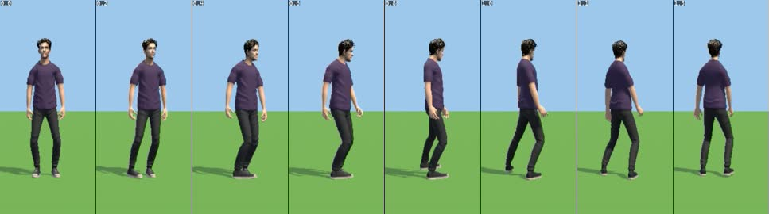

**The left-hand 180, same as turn_180_r**  
Admission: rejected (foot slide 4.37 cm/frame), 1.633 s.  

| start | stop | bars | what | use |
|---|---|---|---|---|
| 0.2 | 1.4 | 0.7 | the turn | turn away to the left |

Good parts: . Masks: `lower`. Speed at 140: 1, at 100: 1.  
Tags: turn, in-place.

### `mx_turn_180_r` — A

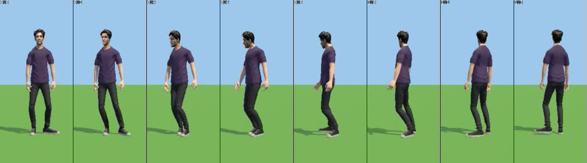

**A clean 180 to the right by two steps**  
Admission: rejected (foot slide 4.98 cm/frame), 1.633 s.  

| start | stop | bars | what | use |
|---|---|---|---|---|
| 0.2 | 1.4 | 0.7 | the turn | turn away, `root:1` |

Good parts: whole body. Masks: `lower`. Speed at 140: 1, at 100: 1.  
Tags: turn, in-place.

### `mx_turn_90_l` — A

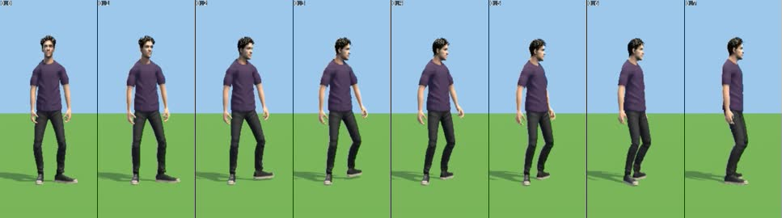

**The left-hand quarter turn**  
Admission: rejected (foot slide 4.31 cm/frame), 0.933 s.  

| start | stop | bars | what | use |
|---|---|---|---|---|
| 0.1 | 0.9 | 0.5 | the turn | a quarter turn on a beat |

Good parts: . Masks: `lower`. Speed at 140: 1, at 100: 1.  
Tags: turn, in-place.

### `mx_turn_90_r` — A

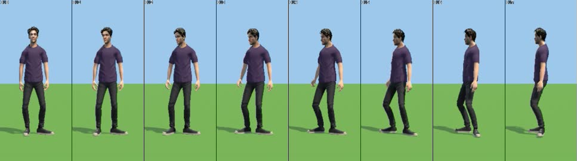

**A quick quarter turn to the right, one step**  
Admission: rejected (foot slide 3.98 cm/frame), 0.933 s.  

| start | stop | bars | what | use |
|---|---|---|---|---|
| 0.1 | 0.9 | 0.5 | the turn | a quarter turn on a beat |

Good parts: . Masks: `lower`. Speed at 140: 1, at 100: 1.  
Tags: turn, in-place.

### `mx_turn_f` — A

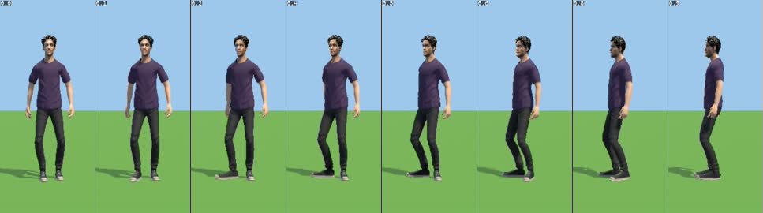

**A smooth female quarter turn to the right**  
Admission: admitted, 1.067 s.  

| start | stop | bars | what | use |
|---|---|---|---|---|
| 0 | 1 | 0.6 | the turn | a quarter turn |

Good parts: . Masks: `lower`. Speed at 140: 1, at 100: 1.  
Tags: turn, in-place.

### `mx_turn_happy` — A

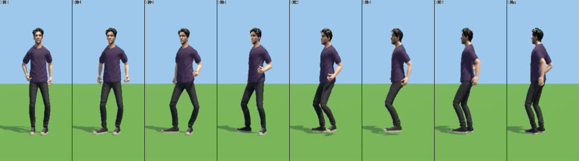

**A perky quarter turn with elbows bent, 0.7 s**  
Admission: admitted, 0.733 s.  

| start | stop | bars | what | use |
|---|---|---|---|---|
| 0 | 0.7 | 0.4 | the turn | a bright turn on a beat |

Good parts: . Masks: `lower`, `upper`. Speed at 140: 1, at 100: 1.  
Tags: turn, happy, in-place.

### `mx_walk_turn_180` — A

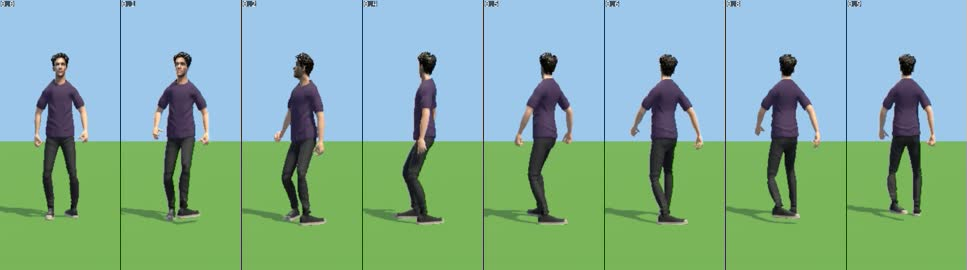

**A walking about-turn in one second**  
Admission: admitted, 1 s.  

| start | stop | bars | what | use |
|---|---|---|---|---|
| 0 | 1 | 0.6 | the turn | turn round mid-walk, `root:1` |

Good parts: . Masks: `lower`, `upper`. Speed at 140: 1, at 100: 1.  
Tags: turn, walk, travelling.

### `mx_ns_spin` — B

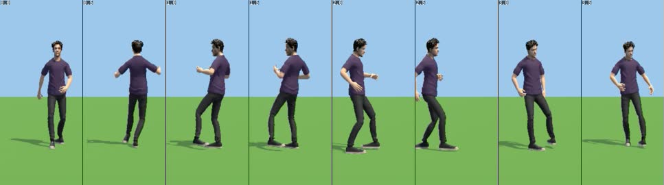

**Northern soul spin: a fast 360 on one foot with the arms out at shoulder height, then settling steps**  
Admission: rejected (foot slide 5 cm/frame), 4.033 s.  

| start | stop | bars | what | use |
|---|---|---|---|---|
| 0.3 | 1.4 | 0.65 | the spin | a real one-second spin; mask the arms with something held in |

Good parts: legs and the turn. Masks: `lower`. Speed at 140: 1, at 100: 1.  
Avoid: the arms (wide) and the shuffle after 2 s.  
Tags: spin, turn, in-place.

### `mx_turn_in_place` — B

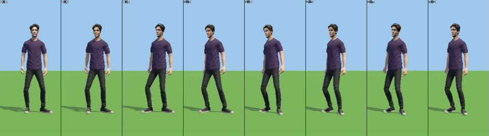

**A slow turn to the left by small steps, 90 degrees over two seconds**  
Admission: admitted, 3.667 s.  

| start | stop | bars | what | use |
|---|---|---|---|---|
| 0.5 | 2.5 | 1.2 | the turn | a lazy pivot; `root:1` for the heading |

Good parts: legs. Masks: `lower`. Speed at 140: 1, at 100: 1.  
Tags: turn, in-place.

### `mx_turn_quick_180` — B

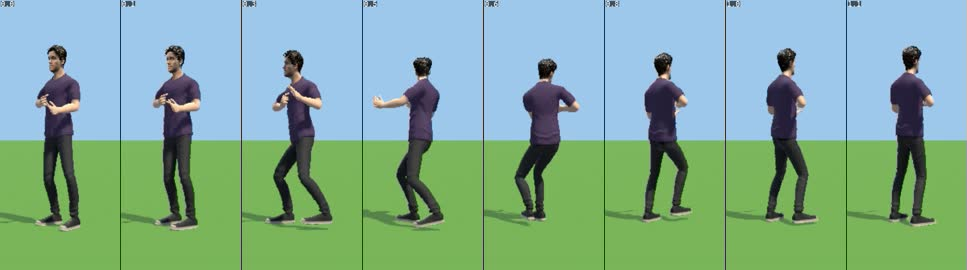

**A snappy 180 with the hands up at the chest like a guard**  
Admission: admitted, 1.3 s.  

| start | stop | bars | what | use |
|---|---|---|---|---|
| 0.2 | 1.1 | 0.5 | the turn | legs only; the hands are a boxing guard |

Good parts: . Masks: `lower`. Speed at 140: 1, at 100: 1.  
Avoid: the arms.  
Tags: turn, in-place.

## Poses and freezes

### `mx_bboy_pose_to_idle` — ?

****  
Admission: rejected (joint limits moved RightFoot 52.6 deg), 2.333 s.  

Good parts: . Masks: whole body. Speed at 140: ?, at 100: ?.  
Tags: pose.

### `mx_catwalk_idle` — ?

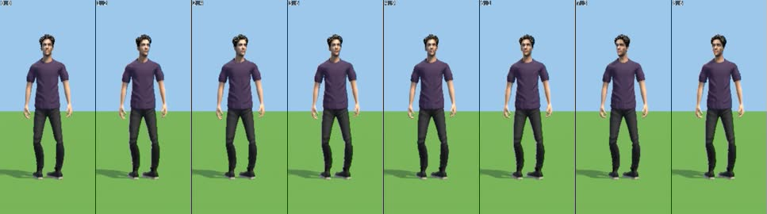

****  
Admission: admitted, 10 s.  

Good parts: . Masks: whole body. Speed at 140: ?, at 100: ?.  
Tags: pose.

### `mx_catwalk_to_twist_r` — ?

****  
Admission: admitted, 2.167 s.  

Good parts: . Masks: whole body. Speed at 140: ?, at 100: ?.  
Tags: pose.

### `mx_catwalk_twist_l` — ?

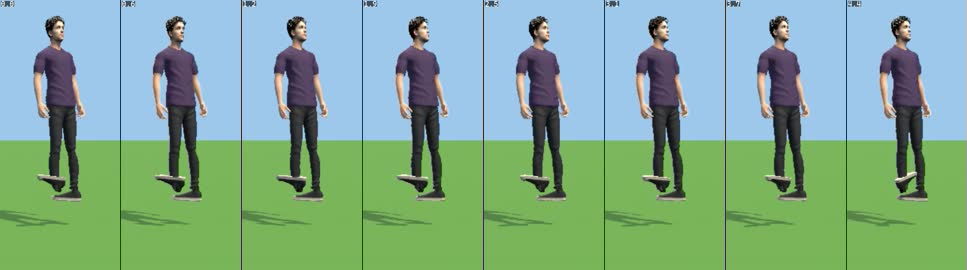

****  
Admission: rejected (joint limits moved RightFoot 94 deg; pop: RightToes kinks 0.492 m at 3.44s), 5.167 s.  

Good parts: . Masks: whole body. Speed at 140: ?, at 100: ?.  
Tags: pose.

### `mx_catwalk_twist_r` — ?

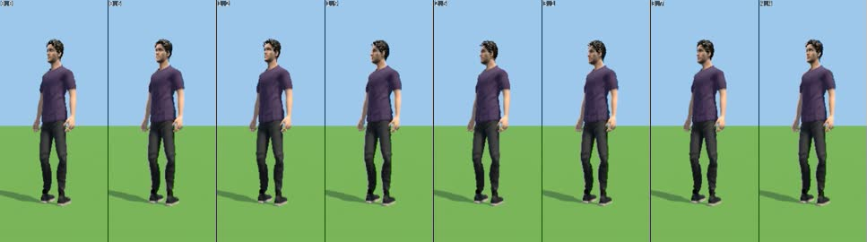

****  
Admission: admitted, 5.167 s.  

Good parts: . Masks: whole body. Speed at 140: ?, at 100: ?.  
Tags: pose.

### `mx_catwalk_twist_r_l` — ?

****  
Admission: rejected (joint limits moved RightLowerLeg 60.1 deg), 2.167 s.  

Good parts: . Masks: whole body. Speed at 140: ?, at 100: ?.  
Tags: pose.

### `mx_idle_weight_shift` — ?

****  
Admission: admitted, 16.633 s.  

Good parts: . Masks: whole body. Speed at 140: ?, at 100: ?.  
Tags: pose.

### `mx_weight_shift` — ?

****  
Admission: admitted, 9.433 s.  

Good parts: . Masks: whole body. Speed at 140: ?, at 100: ?.  
Tags: pose.

## Walks

### `mx_catwalk_seq05` — ?

****  
Admission: rejected (foot slide 4.08 cm/frame), 10.167 s.  

Good parts: . Masks: whole body. Speed at 140: ?, at 100: ?.  
Tags: walk.

### `mx_catwalk_stop_twist` — ?

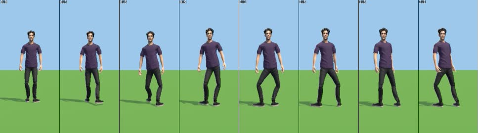

****  
Admission: rejected (foot slide 4.9 cm/frame), 2.5 s.  

Good parts: . Masks: whole body. Speed at 140: ?, at 100: ?.  
Tags: walk.

### `mx_catwalk_crossed` — A

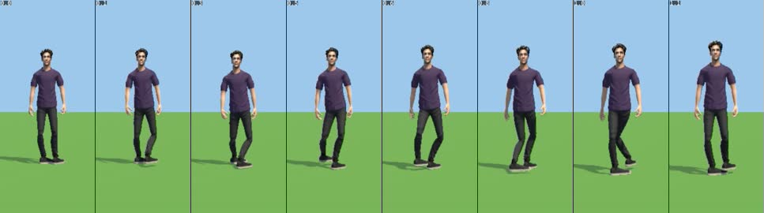

**Female runway walk with the legs crossing hard, hips rolling**  
Admission: rejected (foot slide 4.49 cm/frame), 1.2 s.  

| start | stop | bars | what | use |
|---|---|---|---|---|
| 0 | null | loop | one stride | through `walk` with the stride measured, or `root:1` |

Good parts: whole body. Masks: `lower`, `upper`. Speed at 140: 1.4, at 100: 1.  
Tags: walk, travelling, loop.

### `mx_catwalk_fwd` — A

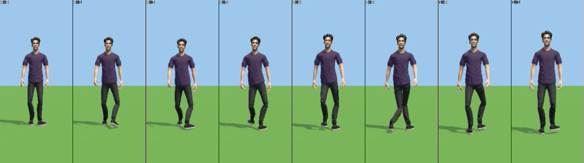

**Female runway walk, one stride, feet crossing**  
Admission: rejected (foot slide 4.68 cm/frame), 1.2 s.  

| start | stop | bars | what | use |
|---|---|---|---|---|
| 0 | null | loop | one stride | through `walk` with the stride measured, or `root:1` |

Good parts: whole body. Masks: `lower`, `upper`. Speed at 140: 1.4, at 100: 1.  
Tags: walk, travelling, loop.

### `mx_catwalk_start` — A

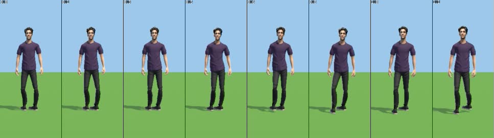

**From a stand into the first runway step**  
Admission: rejected (foot slide 4.67 cm/frame), 1.333 s.  

| start | stop | bars | what | use |
|---|---|---|---|---|
| 0 | 1.3 | 0.75 | the first step | the start of a walk-in; follow with mx_catwalk_fwd |

Good parts: whole body. Masks: `lower`, `upper`. Speed at 140: 1, at 100: 0.9.  
Tags: walk, start, transition, travelling.

### `mx_catwalk_stop` — A

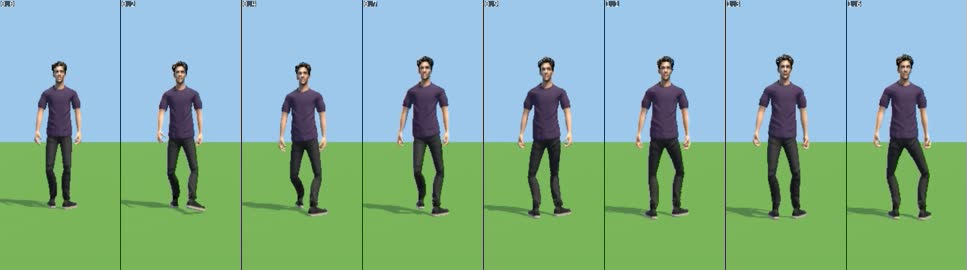

**Two runway steps into a stop with the feet apart and the arms settling**  
Admission: rejected (foot slide 4.81 cm/frame), 1.933 s.  

| start | stop | bars | what | use |
|---|---|---|---|---|
| 0 | 1.9 | 1.1 | walk to a stop | the end of a walk-in, feet planted by 1.3 |

Good parts: whole body. Masks: `lower`, `upper`. Speed at 140: 1, at 100: 0.9.  
Tags: walk, stop, transition, travelling.

### `mx_catwalk_walk` — A

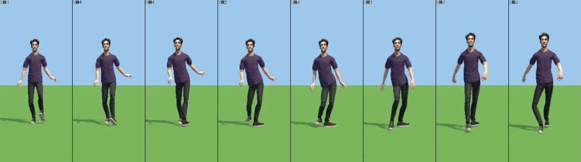

**Runway walk: feet cross, arms swing behind, shoulders back**  
Admission: rejected (joint limits moved LeftFoot 55.6 deg), 1.167 s.  

| start | stop | bars | what | use |
|---|---|---|---|---|
| 0 | null | loop | one stride | through `walk` with the stride measured, or `root:1` |

Good parts: whole body. Masks: `lower`, `upper`. Speed at 140: 1.35, at 100: 0.97.  
Tags: walk, travelling, loop.

### `mx_feminine_walk` — A

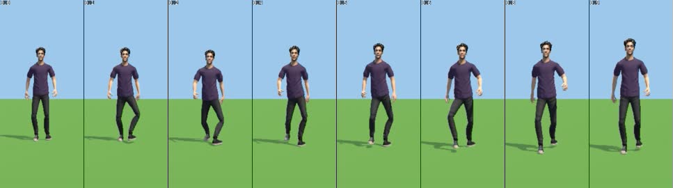

**Feminine walk: feet cross the centre line, hips roll, small arm swing, chin up**  
Admission: rejected (foot slide 3.69 cm/frame), 0.967 s.  

| start | stop | bars | what | use |
|---|---|---|---|---|
| 0 | null | loop | one stride | through `walk` with the stride measured, or `root:1` |

Good parts: whole body. Masks: `lower`, `upper`. Speed at 140: 1.12, at 100: 0.8.  
Tags: walk, travelling, loop.

### `mx_happy_walk` — A

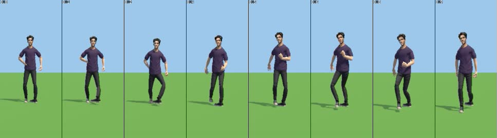

**Happy walk: bouncy, chest up, elbows bent and swinging**  
Admission: rejected (foot slide 4.91 cm/frame), 1.1 s.  

| start | stop | bars | what | use |
|---|---|---|---|---|
| 0 | null | loop | one stride | through `walk` with the stride measured, or `root:1` |

Good parts: whole body. Masks: `lower`, `upper`. Speed at 140: 1.28, at 100: 0.92.  
Tags: walk, travelling, loop.

### `mx_sad_walk` — A

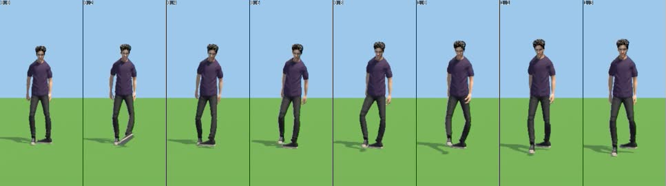

**Sad walk: head down, shoulders slumped, slow dragging steps**  
Admission: rejected (foot slide 4.88 cm/frame), 1.467 s.  

| start | stop | bars | what | use |
|---|---|---|---|---|
| 0 | null | loop | one stride | through `walk` with the stride measured, or `root:1` |

Good parts: whole body. Masks: `lower`, `upper`. Speed at 140: 1.7, at 100: 1.22.  
Tags: walk, sad, travelling, loop.

### `mx_tough_walk` — B

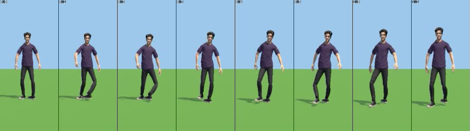

**Cowgirl swagger: wide steps, arms held a touch out, shoulders rolling**  
Admission: rejected (foot slide 4.69 cm/frame), 1.267 s.  

| start | stop | bars | what | use |
|---|---|---|---|---|
| 0 | null | loop | one stride | through `walk` with the stride measured, or `root:1` |

Good parts: whole body. Masks: `lower`, `upper`. Speed at 140: 1.47, at 100: 1.05.  
Avoid: arms if they read wide in frame.  
Tags: walk, travelling, loop.

### `mx_walk_f` — B

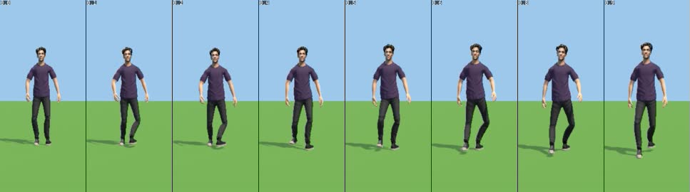

**Plain female walk, relaxed arms; nothing wrong, nothing said**  
Admission: rejected (foot slide 4.96 cm/frame), 1.167 s.  

| start | stop | bars | what | use |
|---|---|---|---|---|
| 0 | null | loop | one stride | through `walk` with the stride measured, or `root:1` |

Good parts: whole body. Masks: `lower`, `upper`. Speed at 140: 1.35, at 100: 0.97.  
Tags: walk, travelling, loop.

### `mx_walk_start` — B

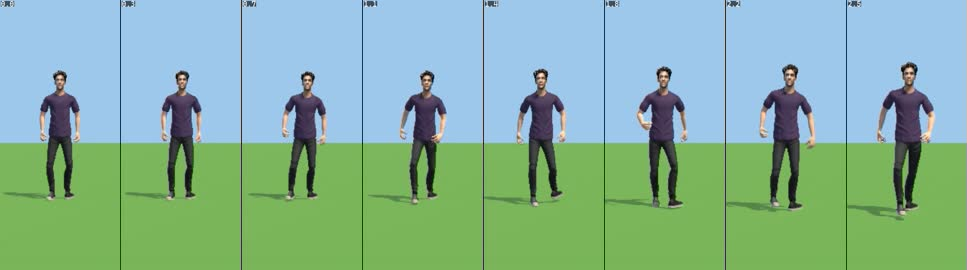

**A plain start from standing: the push-off is at 0.8 s, then an ordinary stride**  
Admission: rejected (foot slide 4.92 cm/frame), 2.933 s.  

| start | stop | bars | what | use |
|---|---|---|---|---|
| 0.6 | 2.2 | 0.9 | push off and the first stride | a plain walk-in |

Good parts: legs. Masks: `lower`. Speed at 140: 1, at 100: 0.85.  
Tags: walk, start, transition, travelling.

### `mx_walk_stop` — B

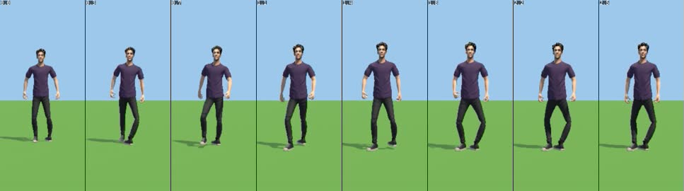

**A plain walk to a stop at 1.3 s with a shuffle as it settles**  
Admission: rejected (foot slide 4.04 cm/frame), 3 s.  

| start | stop | bars | what | use |
|---|---|---|---|---|
| 0.3 | 1.8 | 0.9 | the stop | a plain walk-out end; cut before the shuffle |

Good parts: legs. Masks: `lower`. Speed at 140: 1, at 100: 0.85.  
Avoid: the shuffle after 1.8.  
Tags: walk, stop, transition, travelling.

## Sits, stands and kneels

### `mx_kneel_down` — ?

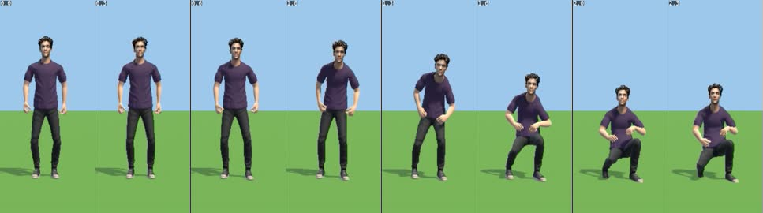

****  
Admission: admitted, 2.767 s.  

Good parts: . Masks: whole body. Speed at 140: ?, at 100: ?.  
Tags: sit.

### `mx_kneel_idle` — ?

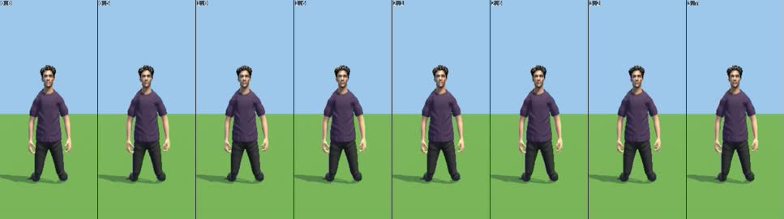

****  
Admission: rejected (joint limits moved RightFoot 67 deg), 4.267 s.  

Good parts: . Masks: whole body. Speed at 140: ?, at 100: ?.  
Tags: sit.

### `mx_kneel_up` — ?

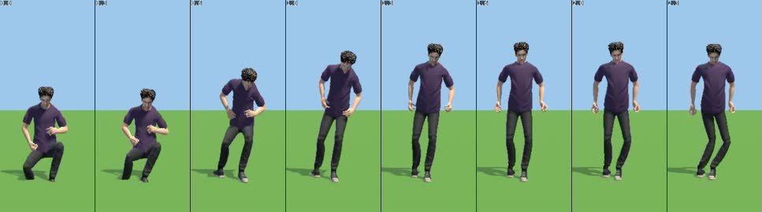

****  
Admission: rejected (joint limits moved RightLowerLeg 41.8 deg; feet 0.131 m under the floor), 2.767 s.  

Good parts: . Masks: whole body. Speed at 140: ?, at 100: ?.  
Tags: sit.

### `mx_sit_floor` — ?

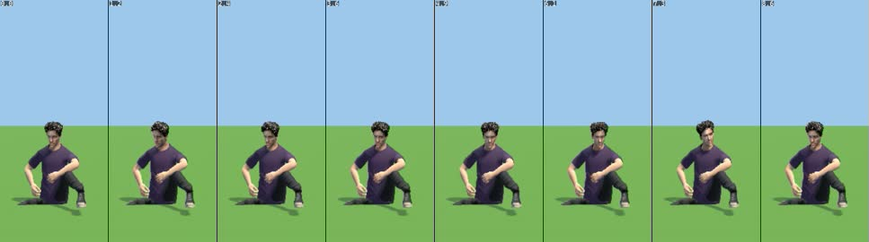

****  
Admission: rejected (joint limits moved RightLowerLeg 49.9 deg; feet 0.311 m under the floor), 10.867 s.  

Good parts: . Masks: whole body. Speed at 140: ?, at 100: ?.  
Tags: sit.

### `mx_sit_to_stand_pump` — ?

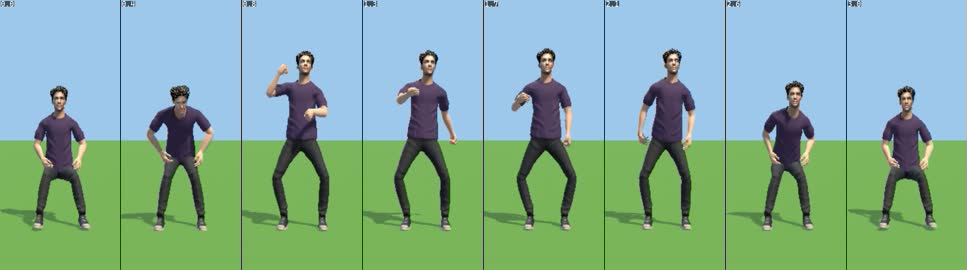

****  
Admission: admitted, 3.433 s.  

Good parts: . Masks: whole body. Speed at 140: ?, at 100: ?.  
Tags: sit.

### `mx_sit_idle` — A

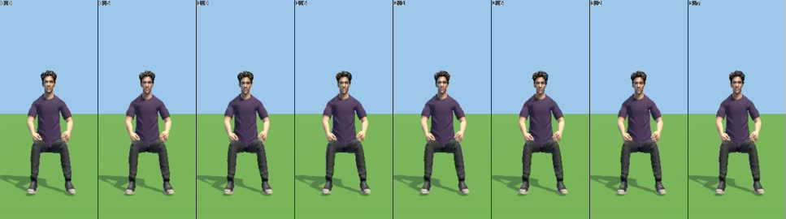

**Seated breathing, hands on the thighs, knees a little apart, small weight shifts**  
Admission: admitted, 4.3 s.  

| start | stop | bars | what | use |
|---|---|---|---|---|
| 0 | 4.3 | loop | the sit | a quiet seated hold under gestures |

Good parts: whole body. Masks: `upper`. Speed at 140: 1, at 100: 1.  
Tags: sit, idle, loop, quiet.

### `mx_sit_look` — A

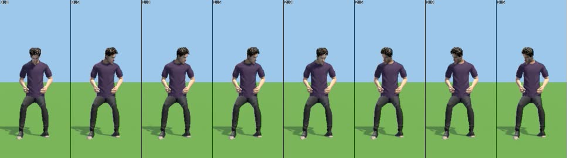

**Seated, head and chest turning side to side, a hand on the knee**  
Admission: admitted, 4 s.  

| start | stop | bars | what | use |
|---|---|---|---|---|
| 0 | 4 | 2.3 | the look round | a seated look-around; head and spine as a layer over another sit |

Good parts: head, spine. Masks: `head`, `spine`. Speed at 140: 1, at 100: 1.  
Tags: sit, look, reaction.

### `mx_sit_point` — A

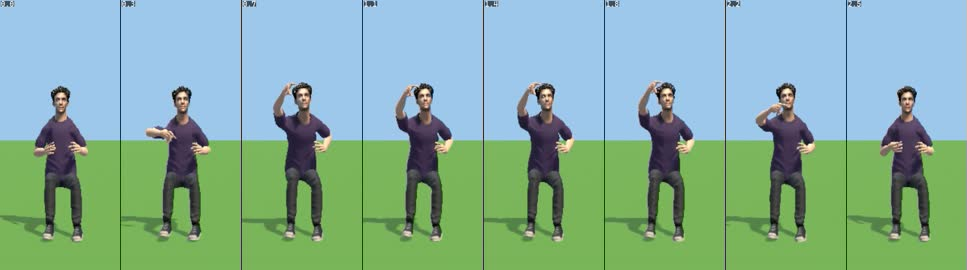

**Seated, the right hand comes up and points forward with a wag of the finger**  
Admission: admitted, 3 s.  

| start | stop | bars | what | use |
|---|---|---|---|---|
| 0.4 | 1.8 | 0.8 | the point | a seated point on a lyric; rightArm over any sit |

Good parts: right arm. Masks: `rightArm`. Speed at 140: 1, at 100: 1.  
Tags: sit, point, gesture.

### `mx_sit_still` — A

**Seated with the hands on the knees, breathing, knees apart**  
Admission: admitted, 2.967 s.  

| start | stop | bars | what | use |
|---|---|---|---|---|
| 0 | 3 | loop | the sit | the stillest seat; put life on top with layers |

Good parts: whole body. Masks: `upper`. Speed at 140: 1, at 100: 1.  
Tags: sit, idle, loop, quiet.

### `mx_sit_to_stand_2` — A

**A plain stand from a chair: leans in, rises by 1.5 s, settles standing**  
Admission: admitted, 4.833 s.  

| start | stop | bars | what | use |
|---|---|---|---|---|
| 0 | 2 | 1.2 | the rise | stand up from a seat mark |

Good parts: whole body. Masks: `lower`, `upper`. Speed at 140: 1, at 100: 0.9.  
Tags: sit, stand, transition, in-place.

### `mx_stand_to_sit` — A

**Turns a quarter to the left while sitting down, hands feeling for the seat behind, seated by 1.7 s**  
Admission: admitted, 2.233 s.  

| start | stop | bars | what | use |
|---|---|---|---|---|
| 0.2 | 2.2 | 1.2 | the sit | sit on a chair mark; he turns left as he goes down, so face the mark 90 right of the chair |

Good parts: whole body. Masks: `lower`, `upper`. Speed at 140: 1, at 100: 0.9.  
Tags: sit, transition, in-place.

### `mx_sit_disbelief` — B

**Seated, both hands fly to the head and he leans right back**  
Admission: admitted, 4.767 s.  

| start | stop | bars | what | use |
|---|---|---|---|---|
| 0.5 | 2.5 | 1.2 | hands to the head, lean back | a drama reaction, once |

Good parts: upper body. Masks: `upper`. Speed at 140: 1, at 100: 1.  
Avoid: the hold with the hands on the head past 3 s.  
Tags: sit, disbelief, reaction.

### `mx_sit_laugh` — B

**A broad seated laugh: head thrown back, then forward with the hands to the knees, the body rocking**  
Admission: admitted, 8.333 s.  

| start | stop | bars | what | use |
|---|---|---|---|---|
| 2 | 4.5 | 1.5 | the laugh | a reaction, once; it is big |

Good parts: upper body. Masks: `upper`. Speed at 140: 1, at 100: 1.  
Avoid: looping it.  
Tags: sit, laugh, reaction.

### `mx_sit_to_stand` — B

**Up from the floor: rolls onto hands and knees and pushes up, 6 s; a floor rise, not a chair**  
Admission: rejected (joint limits moved RightUpperLeg 122.1 deg; pop: RightLowerLeg kinks 0.804 m at 2.39s), 6.067 s.  

| start | stop | bars | what | use |
|---|---|---|---|---|
| 1.5 | 4.5 | 1.7 | hands down, push up, straighten | rise from sitting on the ground |

Good parts: whole body. Masks: `lower`, `upper`. Speed at 140: 1, at 100: 1.  
Avoid: as a chair stand (use mx_sit_to_stand_2); admission says feet under the floor, which the ground pass handles.  
Tags: sit, floor, transition, in-place.

## Lyric gestures

### `mx_blow_kiss` — A

**Hand to the lips, a kiss blown out to the side, arm opens, drops**  
Admission: admitted, 4.567 s.  

| start | stop | bars | what | use |
|---|---|---|---|---|
| 0.6 | 1.9 | 0.75 | hand at the mouth | finger to lips, shh, with the hand shut to one finger |
| 0.6 | 3.4 | 1.6 | the whole kiss | blow a kiss |

Good parts: right arm and head; the arm opens wide at 2.6-3.0 so cut before that for a small moment. Masks: `rightArm`, `head`. Speed at 140: 1, at 100: 0.9.  
Avoid: the open-arm end if arms must stay in.  
Tags: kiss, shh, gesture, in-place.

### `mx_bow_formal` — A

**A quick bow from the waist, about 30 degrees, hands at the sides, up again**  
Admission: admitted, 2.733 s.  

| start | stop | bars | what | use |
|---|---|---|---|---|
| 0.3 | 1.8 | 0.9 | down 0.5-0.9, hold to 1.2, up by 1.6 | a stage bow on a hit |

Good parts: spine and head; the legs do nothing. Masks: `upper`. Speed at 140: 1, at 100: 0.85.  
Tags: bow, gesture, in-place.

### `mx_head_no` — A

**A shake of the head, no, with a little turn of the chest**  
Admission: admitted, 1.8 s.  

| start | stop | bars | what | use |
|---|---|---|---|---|
| 0.2 | 1.4 | 0.7 | the shake | no |

Good parts: head and a little spine. Masks: `head`. Speed at 140: 1, at 100: 1.  
Tags: no, head, gesture, in-place.

### `mx_nod` — A

**A slow yes: chin up, then down**  
Admission: admitted, 2.6 s.  

| start | stop | bars | what | use |
|---|---|---|---|---|
| 0.4 | 1.8 | 0.8 | up 0.5-0.9, down 1.0-1.6 | yes, a nod on a word |

Good parts: head. Masks: `head`. Speed at 140: 1, at 100: 1.  
Tags: yes, nod, head, gesture, in-place.

### `mx_point_bent` — A

**A bent-arm point at the lens, right hand, elbow stays bent, no weight shift**  
Admission: admitted, 2.767 s.  

| start | stop | bars | what | use |
|---|---|---|---|---|
| 0.4 | 2.3 | 1 at 140 | hand up, aims, holds, drops | the point on a lyric; cut at 2.1 to hold it |

Good parts: right arm and the small head lift. Masks: `rightArm`, `head`. Speed at 140: 1, at 100: 1.  
Tags: point, gesture, in-place.

### `mx_thankful` — A

**Right hand to the heart, a bow of the head, a second of holding it, release**  
Admission: admitted, 3 s.  

| start | stop | bars | what | use |
|---|---|---|---|---|
| 0.4 | 2.4 | 1.2 | hand to chest 0.5-0.9, hold 1.0-1.9, release | hand on heart |

Good parts: right arm, head, a little chest. Masks: `rightArm`, `head`. Speed at 140: 1, at 100: 0.85.  
Tags: heart, gesture, in-place.

### `mx_thinking` — A

**Right hand to the chin and cheek, head tilts into it, holds, releases**  
Admission: admitted, 4.233 s.  

| start | stop | bars | what | use |
|---|---|---|---|---|
| 0.7 | 3.3 | 1.5 | hand to chin 0.9-1.1, hold to 2.8, release | hand to cheek, thinking, coy |

Good parts: right arm and head. Masks: `rightArm`, `head`. Speed at 140: 1, at 100: 0.9.  
Tags: cheek, chin, gesture, in-place.

### `mx_wave_aj` — A

**A big quick hello wave with the shoulders in it, 1.5 s**  
Admission: admitted, 1.467 s.  

| start | stop | bars | what | use |
|---|---|---|---|---|
| 0.2 | 1.5 | 0.75 | arm up 0.3-0.5, wave 0.5-1.0, down | wave to the lens |

Good parts: right arm, shoulders, head. Masks: `rightArm`, `head`, `spine`. Speed at 140: 1, at 100: 0.9.  
Tags: wave, gesture, in-place, high-energy.

### `mx_excited` — B

**Fists pumping at the chest, bouncing, turning side to side**  
Admission: admitted, 6.567 s.  

| start | stop | bars | what | use |
|---|---|---|---|---|
| 0.5 | 3 | 1.5 | fist pumps | an upper layer for excitement; the feet travel 1.6 m if the whole body plays |

Good parts: arms and chest. Masks: `upper`. Speed at 140: 1, at 100: 1.  
Avoid: the legs; he turns away about 2 s.  
Tags: excited, reaction, in-place, high-energy.

### `mx_greeting` — B

**Right hand rises open beside the head and holds there, a hello or a hand through the hair**  
Admission: admitted, 5.1 s.  

| start | stop | bars | what | use |
|---|---|---|---|---|
| 1.3 | 3.8 | 1.5 | hand up 1.3-1.7, held at head height to 3.4, drops | hello; at speed 1.5 from 1.2 s it is the nearest thing to a hair flick |

Good parts: right arm and head. Masks: `rightArm`, `head`. Speed at 140: 1, at 100: 1.  
Avoid: the first 1.3 s of standing.  
Tags: hello, hair, gesture, in-place.

### `mx_point_vegas` — B

**A big showman point with a step into it; feet travel 0.8 m and the lab found 4 pops**  
Admission: rejected (foot slide 3.58 cm/frame), 1.967 s.  

| start | stop | bars | what | use |
|---|---|---|---|---|
| 0.3 | 1.9 | 0.9 | step and point | a big point with root motion, after a look at the bake |

Good parts: right arm. Masks: `rightArm`. Speed at 140: 1, at 100: 1.  
Avoid: unbaked; pops in the hand.  
Tags: point, gesture, travelling.

### `mx_secret` — B

**Leans in with a cupped hand at the mouth, as if whispering, for six seconds, then back**  
Admission: admitted, 10.9 s.  

| start | stop | bars | what | use |
|---|---|---|---|---|
| 1.6 | 3 | 0.8 | lean in and hand to mouth | a whispered line; the lean is big, shoot front-on |

Good parts: right arm and the lean of the spine. Masks: `rightArm`, `spine`, `head`. Speed at 140: 1, at 100: 1.  
Avoid: the long hold past 3 s; the lean reads as leaning on something.  
Tags: whisper, secret, gesture, in-place.

### `mx_sigh` — B

**Shoulders rise and drop, a small head turn; barely reads from the front**  
Admission: admitted, 3 s.  

| start | stop | bars | what | use |
|---|---|---|---|---|
| 0.4 | 1.8 | 0.8 | breath in, shoulders drop | an additive upper layer under a sung line |

Good parts: shoulders and chest only. Masks: `upper`. Speed at 140: 1, at 100: 1.  
Avoid: as a whole-body cue; too small.  
Tags: sigh, reaction, in-place, quiet.

### `mx_shrug` — C

**Imports as a T-pose on our rig (the FBX plays nothing). Use Idle1HaveNoClue for a shrug**  
Admission: rejected (no such clip in the project), undefined s.  

Good parts: . Masks: whole body. Speed at 140: ?, at 100: ?.  
Avoid: it until re-exported.  
Tags: shrug, broken.

### `mx_wave` — C

**Half a second of a wave; too short to read, two pops**  
Admission: admitted, 0.533 s.  

Good parts: nothing a longer wave does not do better. Masks: `rightArm`. Speed at 140: ?, at 100: ?.  
Avoid: it.  
Tags: wave, gesture.

## Reactions and idles

### `mx_neck_stretch` — ?

****  
Admission: admitted, 3.2 s.  

Good parts: . Masks: whole body. Speed at 140: ?, at 100: ?.  
Tags: reaction.

### `mx_shake_off` — ?

****  
Admission: admitted, 5.833 s.  

Good parts: . Masks: whole body. Speed at 140: ?, at 100: ?.  
Tags: reaction.

## Stairs and transitions

### `mx_stairs_down` — ?

****  
Admission: rejected (joint limits moved LeftFoot 73.5 deg), 0.933 s.  

Good parts: . Masks: whole body. Speed at 140: ?, at 100: ?.  
Tags: transition.

### `mx_stairs_up` — ?

****  
Admission: admitted, 1.367 s.  

Good parts: . Masks: whole body. Speed at 140: ?, at 100: ?.  
Tags: transition.

### `mx_stairs_up_2` — ?

****  
Admission: admitted, 1.2 s.  

Good parts: . Masks: whole body. Speed at 140: ?, at 100: ?.  
Tags: transition.
