# Performance gallery

Judged against `Director/review/STANDARD.md` by reading every frame at 30 fps on the sheets in `sheets/` (silhouettes, side or front), plus the shaded renders in `renders/` (faces in `*_close_front.mp4`, only for the ones the notes say). Only PASS entries are usable. Written by `node Director/tools/perf_gallery.mjs` from `verdicts.json`; edit that, not this.

PASS: 65. FAIL: 37.

## Usable

### bolt_away: PASS

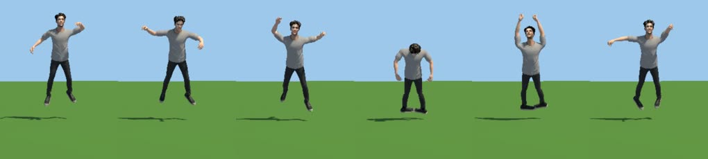

The getaway: a coil (crouch, with anticipation) and then the whole body shoots into the superman (arms over the head, legs together) with overshoot. The flight across the sky is the card's; this is the body. A grin. No ground. Ends in fly_fast's pose.

`fly` to `fly`, 1.1s, at least 0.8s. Params: .

Standard: Made for Hawkes Punch (2026-11-07), lab-tested on the greener scene at every 2nd frame (renders play at 2x), judged on the sheets and 30 fps strips. Coil with anticipation, then the superman with overshoot. Pops in the lab are the snap itself.

Tools: pops 7, left 0.000 m, right 0.000 m, reverse 0.

### bowl_planet: PASS

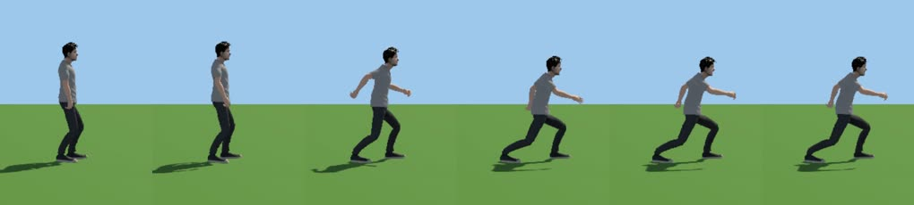

Bowling a planet: the wind-up (a lean, the right arm swung back, the left out for balance, the hips low in a lunge) held a beat, then the release at `release`: the arm swings through low and forward with overshoot and the fingers open, the head following the ball down the lane, and he holds the follow-through watching it go. The planet is the card's: in the right hand until `release`. Standing or flying. Ends in the follow-through.

`any` to `any`, 2.8s, at least 2s. Params: `release` 1.3.

Standard: Made for Hawkes Punch (2026-11-07), lab-tested on the greener scene at every 2nd frame (renders play at 2x), judged on the sheets and 30 fps strips. Wind-up lunge with the arm back, the low forward swing with overshoot, the follow-through watching it go. Side sheet watched; the arm swing is smaller than a real bowl (B).

Tools: pops 4, left 0.756 m, right 0.450 m, reverse 0.

### breathe_deep: PASS

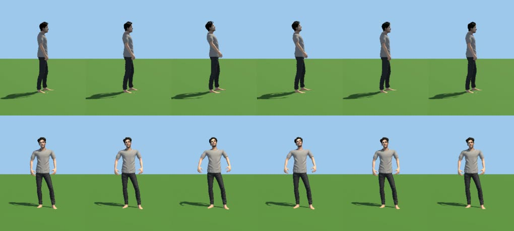

Stops, closes his eyes, fills his chest with air, holds, lets it go. Almost a smile.

`stand` to `stand`, 4.4s, at least 3.6s.

Standard: Hold and move: slow rise, hold, fall. Face: eyes shut fully and the mouth softens. Close-up watched. A tiny pink sliver at the closed lid's outer corner in hard sun (C).

Tools: pops 0, left 0.062 m, right 0.061 m, reverse 0.

### catch_planet: PASS

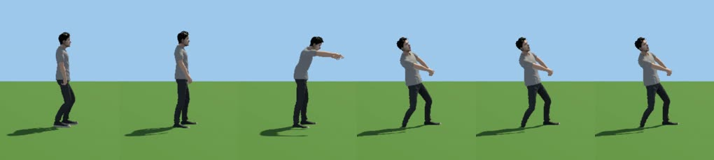

Catching a planet in the gut: arms out open to take it, then at `hit` the body folds round it (the heavy front hit frame), hips back, the hands clamped to the belly, the air knocked out: jaw wide, eyes shut, then winded breathing from the chest (an additive IdleBreathe, fast) over the held fold. The planet is the card's: attach it to his chest at `hit`. No ground. Ends folded.

`any` to `any`, 2.6s, at least 1.6s. Params: `hit` 0.7.

Standard: Made for Hawkes Punch (2026-11-07), lab-tested on the greener scene at every 2nd frame (renders play at 2x), judged on the sheets and 30 fps strips. Arms out open, then the fold round the hit, hands clamped to the belly, winded breathing on the chest. Side sheet watched.

Tools: pops 3, left 0.073 m, right 0.477 m, reverse 0.

### doctor_examine: PASS

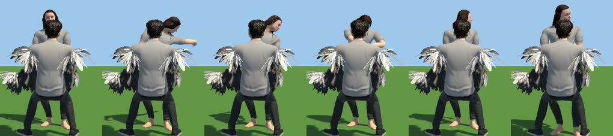

The doctor looks him over, standing in front of the seated patient (`patient`, an actor): leans in to his eyes (the eyes dart left and right between his), the left hand lifts his chin, then the right hand holds the stethoscope on his chest while her head tilts to listen, then she straightens, holds the pad up in the left hand and writes with the right. Props (stethoscope, pad, pen) are the set's, attached to her hands by the card. Calm and kind: small smile, slow blinks.

`stand` to `stand`, 9s, at least 5s. Params: `patient` "person".

Standard: Made for Hawkes Punch (2026-11-07), lab-tested on the greener scene at every 2nd frame (renders play at 2x), judged on the sheets and 30 fps strips. Watched with a seated patient 1 m in front (renders doctor_examine_three/front): lean in, the hand to his chin, the hand to his chest with the head tilted to listen, then the pad up and the pen strokes. The props are the card's. Reaches are to the patient's bones, so a different seat height just works. Bake alone: 0 across after cleaning.

Tools: no test yet.

### doctor_fist_offscreen: PASS

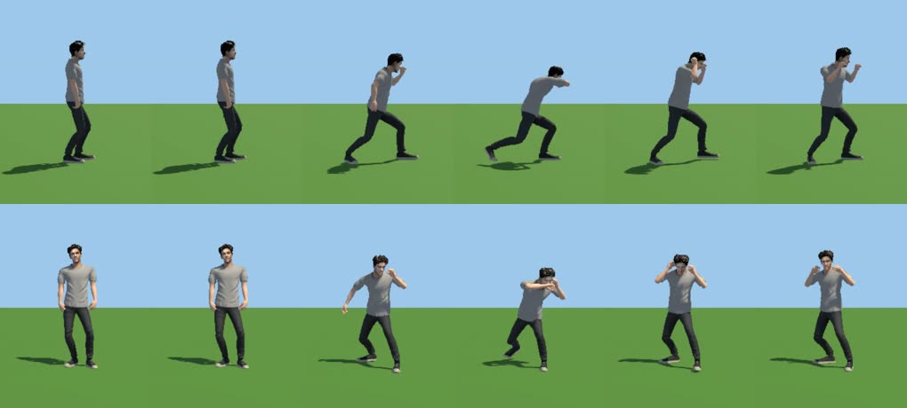

The button: a short right hook from the guard, for a fist that enters from off screen. RightHook1 trimmed to its last 0.8 s, the hit at `hit` seconds from the start (the clip hits 0.57 s in), fists closed from the first frame; holds the last frame. Frame her out and let the arm come in.

`any` to `any`, 1.2s, at least 0.7s. Params: `hit` 0.4.

Standard: Made for Hawkes Punch (2026-11-07), lab-tested on the greener scene at every 2nd frame (renders play at 2x), judged on the sheets and 30 fps strips. RightHook1 from 0.2 s in, hit at `hit`, holds the last frame. Frame her out: only the arm is meant to be seen. The clip is rejected by admission for foot slide, which the bake cleans.

Tools: pops 7, left 0.781 m, right 0.165 m, reverse 0.

### doctor_punch: PASS

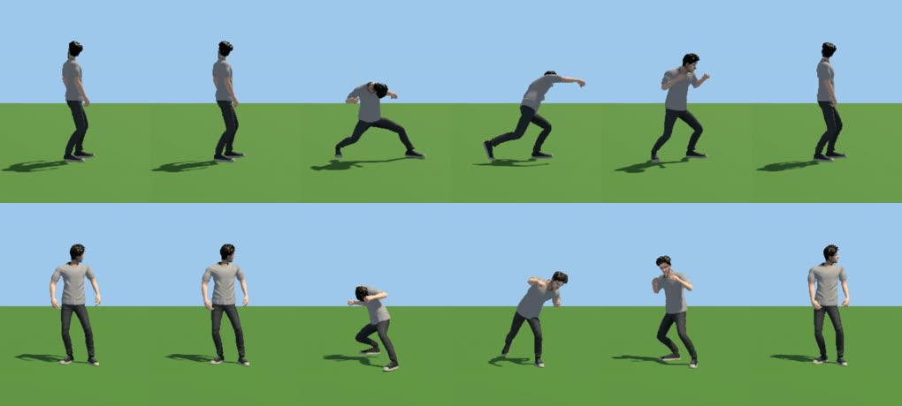

One clean right hand. From the cold stand: the clip PowerRightHandCombat winds up (the right arm back, weight onto the back foot), lands at `hit` seconds from the start (the clip hits 1.05 s in, so the clip starts at hit-1.05) and follows through, the fists closed just before; then IdleBreathe comes back over half a second and the stance returns, hands soft. The face never changes: the same stare. Put `hit` on the beat.

`stand` to `stand`, 3.4s, at least 2.6s. Params: `hit` 1.4, `clip` "PowerRightHandCombat", `patient` "person".

Standard: Made for Hawkes Punch (2026-11-07), lab-tested on the greener scene at every 2nd frame (renders play at 2x), judged on the sheets and 30 fps strips. Weight: PowerRightHandCombat: a real wind-up onto the back foot, the right hand lands at `hit`, follow-through, guard, then IdleBreathe and the stance back. 30 fps strip watched. The clip drops the head in the wind-up (joint limits moved the head 45 degrees in the lab): a boxer's head, keep it. Bake alone: snaps 57>1, elbow flips 6>1, ankle 78>40.

Tools: pops 6, left 1.032 m, right 0.727 m, reverse 0.

### doctor_slide_can: PASS

She looks down at the can on the desk (`can`), lays her right hand on it, and slides it across to him by `dx`, `dz` metres (world axes, from where it stands), the hand riding on it, then lets go and looks up at him with a kind smile. The can really moves: the card that follows finds it there.

`stand` to `stand`, 3s, at least 2.4s. Params: `can` "can", `patient` "person", `dx` 0, `dz` 0.55.

Standard: Made for Hawkes Punch (2026-11-07), lab-tested on the greener scene at every 2nd frame (renders play at 2x), judged on the sheets and 30 fps strips. Hand lands on the can and rides it as it moves (plant), lets go, looks up with a smile. Tested on a stand-in can actor at desk height; the move is a real `move` on the can.

Tools: no test yet.

### doctor_turn_cold: PASS

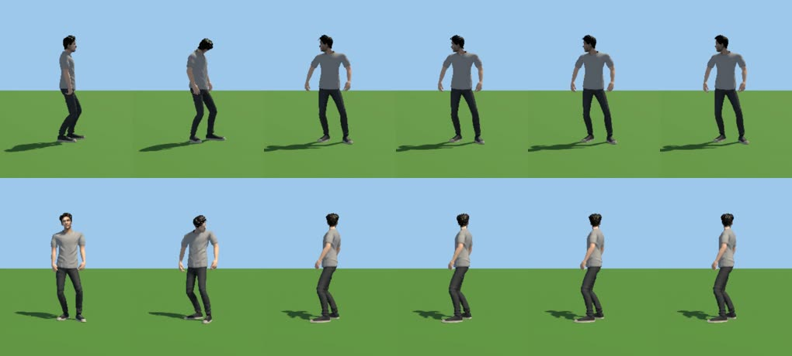

The turn and the stare. She pivots `turn` degrees to face him (positive is to her right) over a slow second, the arms come to her sides, the sway stops, and she holds dead still: no blink, lids a touch wide, the head perfectly level. From `talkAt` the lips move for `talk` seconds on a placeholder mouth (the jaw, in a speech rhythm). Ends in the cold stand; doctor_punch starts from it.

`stand` to `stand`, 4.5s, at least 2.5s. Params: `turn` 90, `talkAt` 1.6, `talk` 2.2, `patient` "person".

Standard: Made for Hawkes Punch (2026-11-07), lab-tested on the greener scene at every 2nd frame (renders play at 2x), judged on the sheets and 30 fps strips. The 90 degree turn takes a second (root keys alone; a `successive` or bones on the same keys made it snap, now separate), dead still after, no blink, lips move on the jaw. Feet pivot (slide) under the turn: the bake cleans it (bake alone: 0 across). At 30 fps the head and chest dip forward through the middle of the turn (a keys root-rotation path, B): if it shows in the shot, swap the turn for `{"do":"rotate","rot":[0,90,0],"rel":1,"for":"1.1s","ease":"inout","lint":"slide"}` or the admitted clip mx_turn_f (104 degrees, root:1).

Tools: pops 3, left 0.446 m, right 0.147 m, reverse 0.

### drift_space: PASS

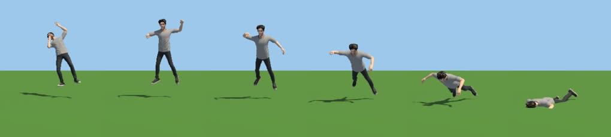

Alone in space: Falling at a quarter speed with the limbs loose on overlap, a slow tumble of `rate` degrees a second about his side axis (and a third of that about his length), no ground. The face is calm and lost: slow blinks, lips a little apart, the eyes wander off and back. Ends flying.

`fly` to `fly`, 6s, at least 2s. Params: `rate` 18.

Standard: Made for Hawkes Punch (2026-11-07), lab-tested on the greener scene at every 2nd frame (renders play at 2x), judged on the sheets and 30 fps strips. Falling at a quarter speed, limbs loose on overlap, a slow tumble from root keys, slow blinks and eye wander. Quiet by design.

Tools: pops 0, left 0.000 m, right 0.022 m, reverse 0.

### drink_can: PASS

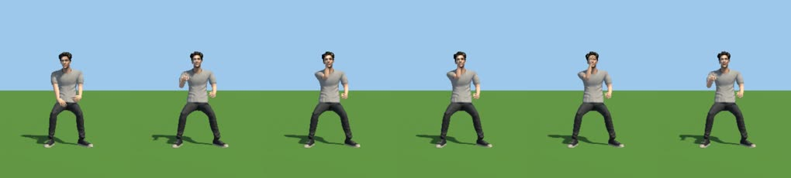

A drink from the can, seated: the can is in the right hand (attached on the first frame, the cup grip; `me` is the actor). The hand comes to the mouth, the head tips back, three swallows on the jaw with the lids down, then the hand comes down to the chest and the face comes back to the lens with an "ahh" and the big smile. Ends seated with the can.

`sit_chair` to `sit_chair_can`, 3.6s, at least 2.8s. Params: `can` "can", `me` "person", `cam` [0,1.25,3.2].

Standard: Made for Hawkes Punch (2026-11-07), lab-tested on the greener scene at every 2nd frame (renders play at 2x), judged on the sheets and 30 fps strips. The can hand to the mouth, head back, three swallows on the jaw with the lids down, down to the chest, the ahh and the smile. Tested without the can actor (warning only). Bake alone: 0 across.

Tools: pops 3, left 0.064 m, right 0.067 m, reverse 0.

### flinch_small: PASS

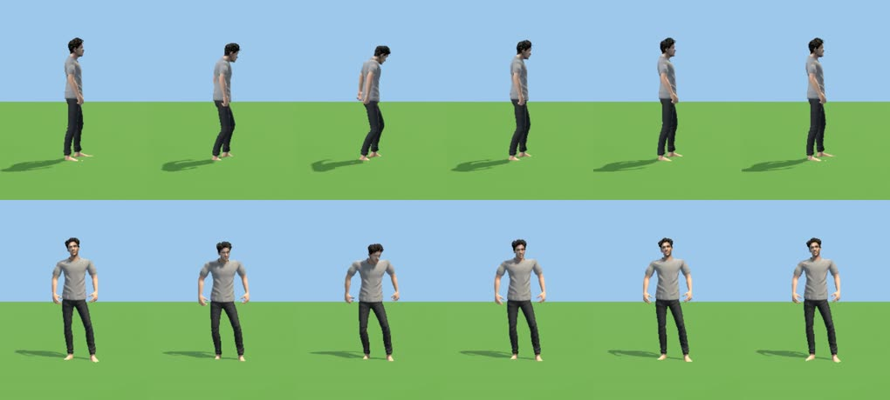

Something small makes him jump: shoulders up, head ducks away from the sound, eyes wide, then he comes down feeling silly. side 1 ducks away from his right, -1 from his left.

`stand` to `stand`, 1.9s, at least 1.5s. Params: `side` 1.

Standard: Weight: snaps down and in within 0.14 s with no anticipation, holds, then comes down slowly with a settle. Clear pose: shoulders up, head ducks away, hands half curl. Feet planted. Side and front watched at 30 fps; side -1 mirrors it. Face in the shot, medium and close. Made for Touch Grass.

Tools: pops 0, left 0.025 m, right 0.025 m, reverse 0.

### float_close: PASS

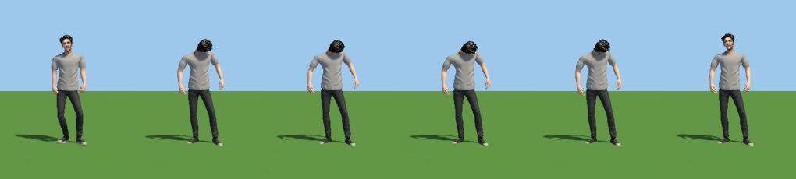

Out of breath, close: the chest heaving (an additive IdleBreathe, fast and big, calming over the take), shoulders riding up and down with it, the head dropped forward toward the other one (`other`, an actor: forehead to forehead is the card's spacing), lips apart, lids half down. The breathing settles, a small smile, and at `look` both eyes go to the lens (`cam`, a point in his own frame). No ground. Ends looking at the lens.

`any` to `any`, 4.5s, at least 2.5s. Params: `other` "person", `look` 3.4, `cam` [0.3,1.55,2.6].

Standard: Made for Hawkes Punch (2026-11-07), lab-tested on the greener scene at every 2nd frame (renders play at 2x), judged on the sheets and 30 fps strips. Chest heaving on an additive breath, head dropped toward the other one, calms, smile, then the eyes to the lens. Front sheet watched.

Tools: pops 0, left 0.105 m, right 0.100 m, reverse 0.

### fly_fast: PASS

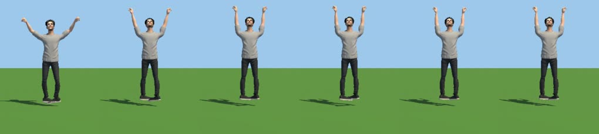

The superman with life in it: arms over the head (mx_hanging_idle's frame), legs together, the head up, and a slow wobble through the whole body every half second (the keys alternate sides, successive so the hips lead), fists, eyes narrowed into the wind with a small grin. The card pitches him level; no ground. Any length.

`fly` to `fly`, 4s, at least 1s. Params: `amp` 1.

Standard: Made for Hawkes Punch (2026-11-07), lab-tested on the greener scene at every 2nd frame (renders play at 2x), judged on the sheets and 30 fps strips. Arms over the head (mx_hanging_idle's frame), fists, a slow alternating wobble through hips, chest and head; the card pitches him level. The wobble is subtle at amp 1: raise `amp` for a shot that holds on him. Bake alone: 0 across.

Tools: pops 1, left 0.049 m, right 0.045 m, reverse 0.

### g_bow: PASS

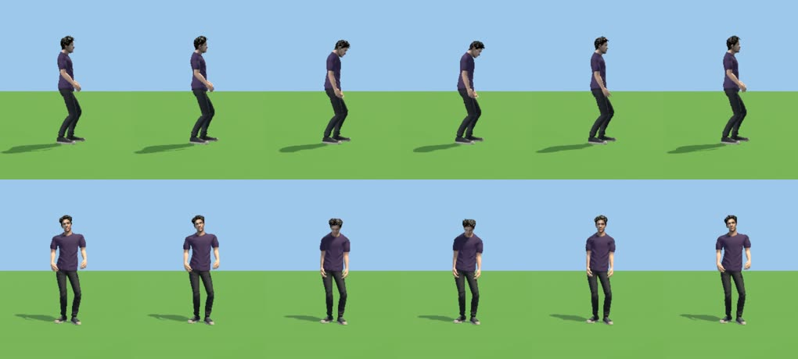

A quick formal bow from the waist, hands at the sides, from mx_bow_formal (0.3-1.8 s). Legs stay as they are.

`any` to `any`, 1.5s, at least 0.8s. Params: `clip` "mx_bow_formal", `mask` "upper", `weight` 1.

Standard: Quick formal bow from the waist on upper, legs stay. Bake gate passed (13 snaps to 0).

Tools: pops 0, left 0.026 m, right 0.021 m, reverse 0.

### g_finger_lips: PASS

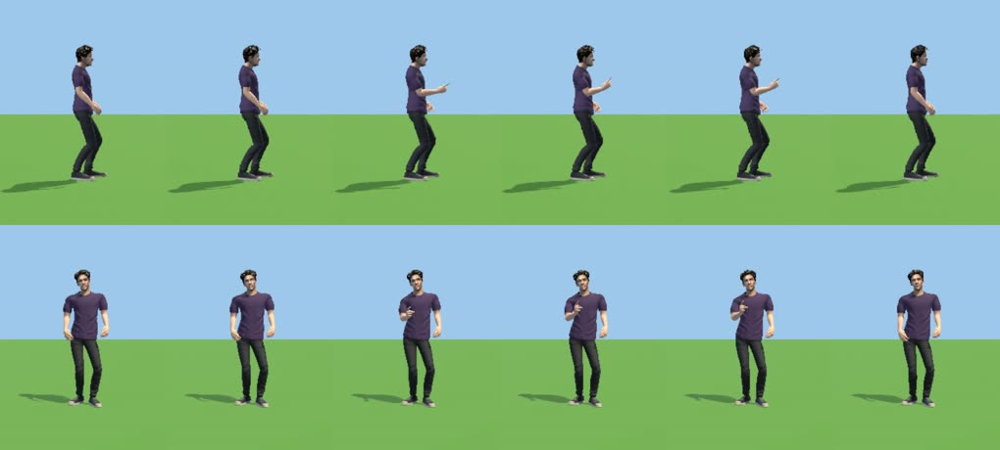

One finger to the lips, from the first half of mx_blow_kiss (0.6-1.9 s): the hand comes to the mouth and stays; the kiss is cut off. The hand is shut to one finger.

`any` to `any`, 1.4s, at least 0.8s. Params: `clip` "mx_blow_kiss", `mask` "rightArm", `weight` 1.

Standard: First half of mx_blow_kiss with the hand shut to one finger; the finger sits at chin to lip height, a little low. Check in a close-up before the cut uses it. Bake gate passed.

Tools: pops 2, left 0.024 m, right 0.020 m, reverse 0.

### g_hair_flick: PASS

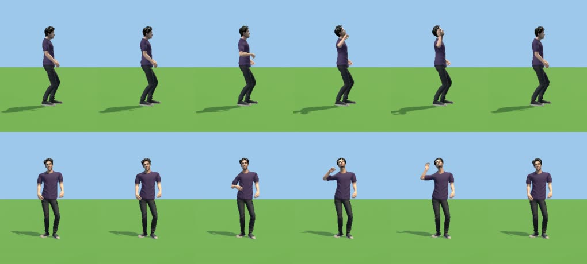

The right hand goes up past the ear and through the hair, from mx_greeting (1.2-2.3 s) run fast. No real hair-flick clip exists on Mixamo by name; this is the nearest hand-to-head move.

`any` to `any`, 1.1s, at least 0.8s. Params: `clip` "mx_greeting", `mask` "rightArm,head", `weight` 1, `speed` 1.5.

Standard: Note: No hair-flick clip exists on Mixamo by name: this is mx_greeting (hand up beside the head) at speed 1.5 on rightArm,head. It reads as a hand through the hair, not a flick. Bake left 1 snap and cleared an elbow flip.

Tools: pops 5, left 0.019 m, right 0.015 m, reverse 0.

### g_hand_cheek: PASS

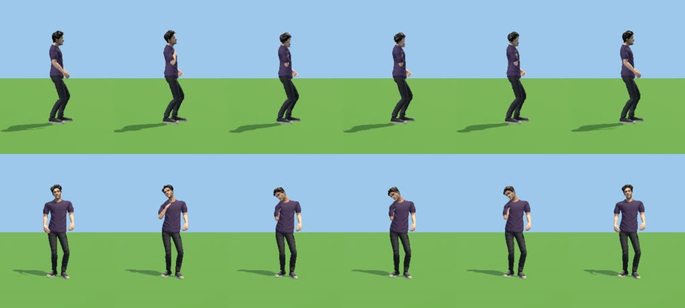

Right hand to the chin and cheek, head tilted, from mx_thinking (0.7-3.3 s).

`any` to `any`, 2.6s, at least 0.8s. Params: `clip` "mx_thinking", `mask` "rightArm,head", `weight` 1.

Standard: Hand to chin and cheek with the head tilted, from mx_thinking. Bake gate passed.

Tools: pops 6, left 0.038 m, right 0.034 m, reverse 0.

### g_hand_heart: PASS

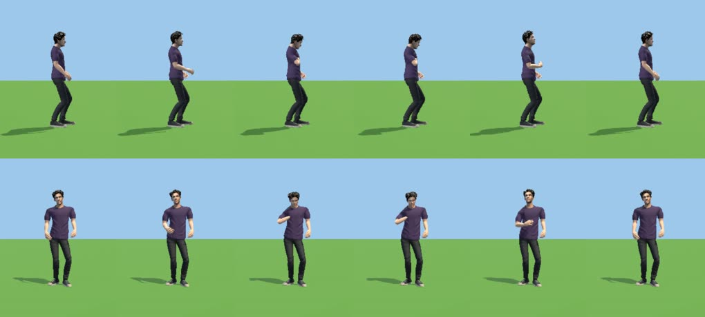

Right hand to the heart with a small bow of the head, from mx_thankful (0.4-2.4 s).

`any` to `any`, 2s, at least 0.8s. Params: `clip` "mx_thankful", `mask` "rightArm,head", `weight` 1.

Standard: Hand to the heart with a head bow, from mx_thankful. Reads clearly at 10 fps. Bake gate passed (wrist 58 to 0).

Tools: pops 4, left 0.034 m, right 0.029 m, reverse 0.

### g_hands_up: PASS

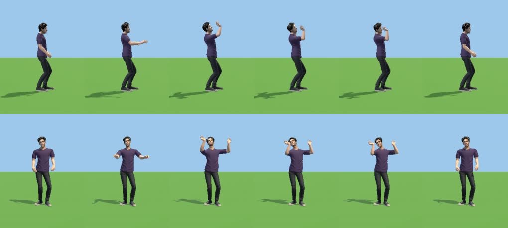

Both hands up by the head and pumping at the sky, a lean back with it, from mx_hh_raise_roof (0.2-2.3 s).

`any` to `any`, 2.1s, at least 0.8s. Params: `clip` "mx_hh_raise_roof", `mask` "upper", `weight` 1.

Standard: Note: Both hands up pumping with a lean back, from mx_hh_raise_roof on upper. The arms drop fast at the end of the layer (0.15 s blend): give it a longer blend or cut on the last pump. Bake gate passed (wrist 307 to 0, snaps 18 to 0).

Tools: pops 11, left 0.036 m, right 0.031 m, reverse 0.

### g_head_no: PASS

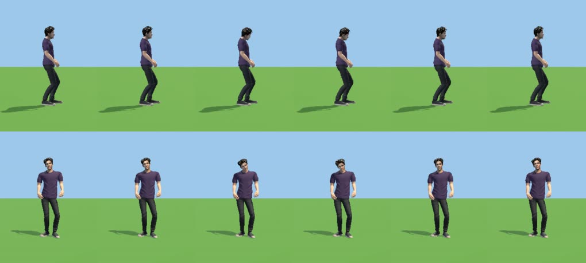

A shake of the head, no, with a little of the chest, from mx_head_no (0.2-1.4 s).

`any` to `any`, 1.2s, at least 0.8s. Params: `clip` "mx_head_no", `mask` "head", `weight` 1.

Standard: Head shake on head only, from mx_head_no. Bake 2 snaps to 0.

Tools: pops 0, left 0.021 m, right 0.017 m, reverse 0.

### g_nod: PASS

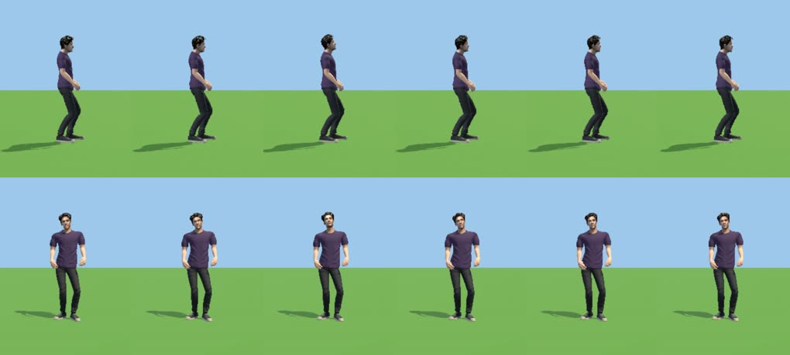

A slow nod, chin up then down, from mx_nod (0.4-1.8 s).

`any` to `any`, 1.4s, at least 0.8s. Params: `clip` "mx_nod", `mask` "head", `weight` 1.

Standard: Slow nod on head only, from mx_nod. Bake 1 snap to 0.

Tools: pops 0, left 0.024 m, right 0.020 m, reverse 0.

### g_point: PASS

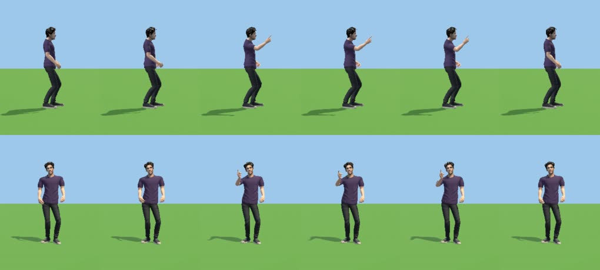

A bent-arm point at the lens, right hand, from mx_point_bent (0.4-2.3 s): the hand comes up on a bent elbow, aims and holds, then drops. Index finger out.

`any` to `any`, 1.9s, at least 0.8s. Params: `clip` "mx_point_bent", `mask` "rightArm", `weight` 1.

Standard: Bent-arm point, right hand, from mx_point_bent over dress_stand. Index out, hand relaxes at the end. Watched in the lab render at 10 fps, front; baked through bake.mjs with the gate passing (snaps 0, ankle 0).

Tools: pops 7, left 0.032 m, right 0.027 m, reverse 0.

### g_shrug: PASS

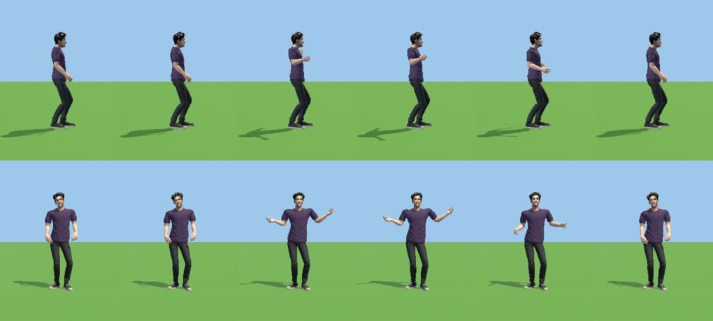

A shrug: both hands open wide and come back, from Idle1HaveNoClue (0.3-1.5 s). mx_shrug imports as a T-pose on our rig, so the local clip stands in.

`any` to `any`, 1.3s, at least 0.8s. Params: `clip` "Idle1HaveNoClue", `mask` "upper", `weight` 1.

Standard: Idle1HaveNoClue on upper over dress_stand; mx_shrug plays as a T-pose on our rig so the local clip stands in. Bake gate passed (17 snaps to 0).

Tools: pops 4, left 0.023 m, right 0.018 m, reverse 0.

### g_wave: PASS

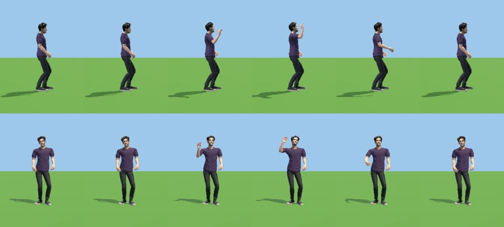

A big quick wave, right hand, with the shoulders in it, from mx_wave_aj (0.2-1.5 s).

`any` to `any`, 1.3s, at least 0.8s. Params: `clip` "mx_wave_aj", `mask` "rightArm,head", `weight` 1.

Standard: Big quick wave with the shoulders, from mx_wave_aj. Bake left 1 snap of 10. Lively; keep for a hello, not a sung line.

Tools: pops 3, left 0.023 m, right 0.018 m, reverse 0.

### hide_peek: PASS

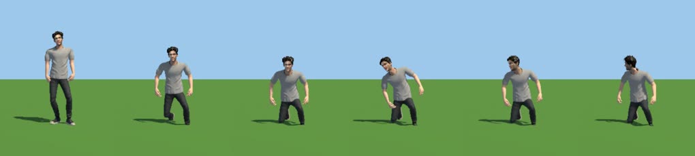

Behind the moon: a crouch (CrouchIdleLookAround1Unarmed), then at `peek` he leans out to `side` (1 his right), the head popping out with overshoot, eyes wide and a grin, holds `hold` seconds, and snaps back in. The moon is the card's. Ends crouched.

`any` to `crouch`, 3s, at least 1.8s. Params: `side` 1, `peek` 0.9, `hold` 0.6.

Standard: Made for Hawkes Punch (2026-11-07), lab-tested on the greener scene at every 2nd frame (renders play at 2x), judged on the sheets and 30 fps strips. Crouch, lean out to the side with the head popping with overshoot, eyes wide, snap back. Front sheet watched.

Tools: pops 1, left 0.195 m, right 0.000 m, reverse 0.

### jump_scare: PASS

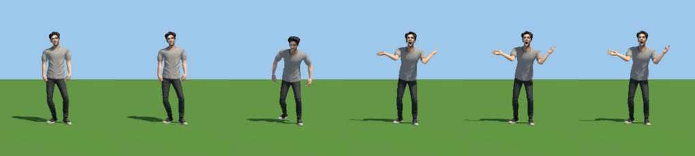

Boo: from a coil he explodes at `boom`: arms thrown wide and forward (Idle1Yell's yell frame, opened out), fingers spread, jaw wide, eyes wide, with anticipation and overshoot, and holds the shape `hold` seconds. Any length over 1.2 s; no ground needed. Ends in the shape.

`any` to `any`, 1.6s, at least 1s. Params: `boom` 0.3, `hold` 0.8.

Standard: Made for Hawkes Punch (2026-11-07), lab-tested on the greener scene at every 2nd frame (renders play at 2x), judged on the sheets and 30 fps strips. Coil then the explosion: arms thrown wide and forward, fingers spread, jaw and eyes wide, holds. Bake alone: snaps 53>0.

Tools: pops 12, left 0.023 m, right 0.000 m, reverse 0.

### kick_spin: PASS

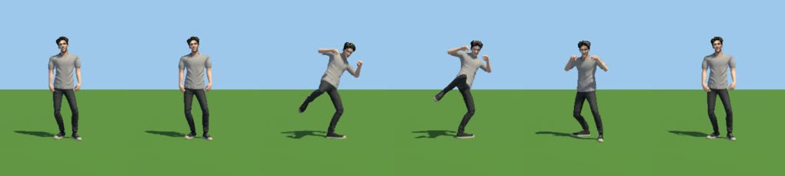

The kicker: RightSpinningKick once, the foot landing at `hit` (the clip hits 0.43 s in), then back to the stand over half a second, a grin. The victim spins with spin_top.

`stand` to `stand`, 2.2s, at least 1.6s. Params: `hit` 0.7.

Standard: Made for Hawkes Punch (2026-11-07), lab-tested on the greener scene at every 2nd frame (renders play at 2x), judged on the sheets and 30 fps strips. RightSpinningKick lands at `hit`, then the stand. Front sheet watched.

Tools: pops 10, left 0.812 m, right 0.173 m, reverse 0.

### knee_tap_react: PASS

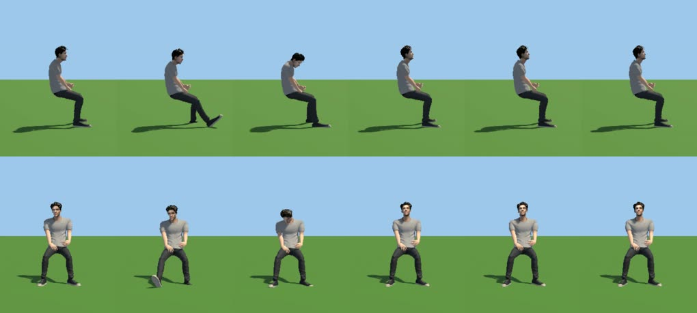

The hammer lands and the right leg kicks out on its own: a snap of the lower leg with overshoot, the foot flexing, then it swings back. He looks down at it, eyes wide, then up at her with a small amused smile. Seated. `leg` -1 does the left.

`sit_chair` to `sit_chair`, 1.8s, at least 1.4s. Params: `leg` 1, `kick` 40.

Standard: Made for Hawkes Punch (2026-11-07), lab-tested on the greener scene at every 2nd frame (renders play at 2x), judged on the sheets and 30 fps strips. Weight: the lower leg snaps out with overshoot and settles; eyes wide, then up at her with a small smile. Only the right leg watched; `leg` -1 is mirrored by the same keys.

Tools: pops 0, left 0.001 m, right 0.415 m, reverse 0.

### kneel_down: PASS

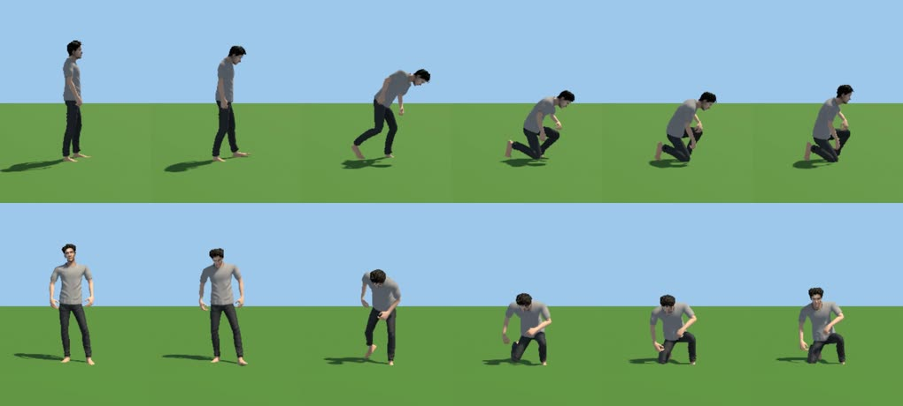

Stands, looks down at the spot, folds down onto one knee. Ends holding the kneel.

`stand` to `kneel`, 3.6s, at least 3.3s.

Standard: Weight: real mocap, looks down first, folds onto one knee. Ends in the kneel.

Tools: pops 0, left 0.192 m, right 0.083 m, reverse 0.

### lasso_swing_hammer: PASS

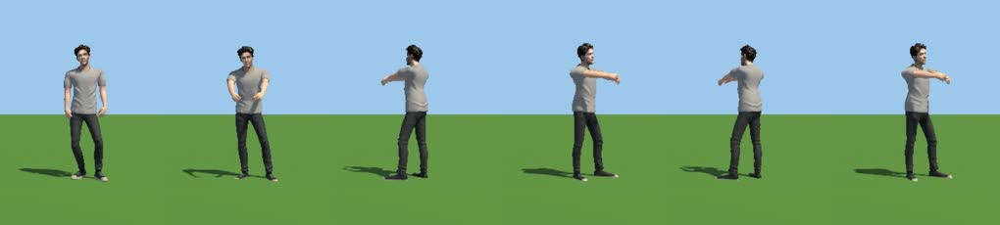

Swinging a roped planet round like a hammer thrower: both hands on the rope out in front, leaning back against the pull, the whole body turning `revs` times at `per` seconds a turn (a quarter turn a key, so it reads as one steady spin), teeth gritted. The planet and the rope are the card's: hang them off his hands. No ground. Ends mid-spin, hands on the rope.

`any` to `any`, 3.6s, at least 2s. Params: `revs` 2, `per` 1.3.

Standard: Made for Hawkes Punch (2026-11-07), lab-tested on the greener scene at every 2nd frame (renders play at 2x), judged on the sheets and 30 fps strips. Both hands on the rope ahead, leaning back, two steady turns a quarter turn a key. Measured only (feet 3.5 m in the lab: the spin with no ground), not watched frame by frame (C).

Tools: pops 1, left 3.467 m, right 1.303 m, reverse 0.

### lasso_throw: PASS

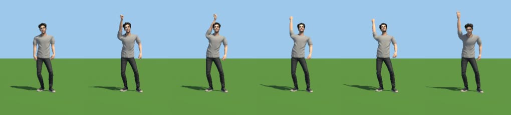

The lasso: the right hand circles over the head `spins` times (a reach round a ring, 8 points a turn, `per` seconds a point: 1 s a turn), the loop gripped, the body leaning with it; at the end of the last turn the arm whips forward and down for the throw with the fingers opening; then both hands take the rope and he leans back and hauls. The rope is the card's (the right hand is where its end is). Standing or flying (no ground is set). Ends hauling.

`any` to `any`, 4.6s, at least 3.4s. Params: `spins` 3, `per` 0.125.

Standard: Made for Hawkes Punch (2026-11-07), lab-tested on the greener scene at every 2nd frame (renders play at 2x), judged on the sheets and 30 fps strips. The arm circles over the head (the ring is clipped behind the head by the shoulder limit, 53 degrees in the lab: still reads as a lasso), the throw forward and the two-handed haul with the lean back. Bake alone: snaps 38>0, ankle 589>67. `lasso` fx from the right hand.

Tools: pops 9, left 0.220 m, right 0.473 m, reverse 0.

### lie_back: PASS

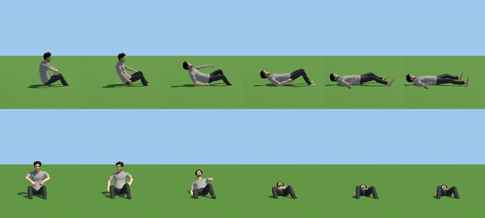

From sitting on the ground, leans back on his hands and lets himself down flat: legs out with one knee soft, arms easy on the grass, hands open, head level. `blend` 0.05 starts it on a cut, already sitting.

`sit_ground` to `lie`, 3.4s, at least 3.1s. Params: `blend` 0.6.

Standard: Rebuilt: ends flat on DeadBack, arms in, head level, feet rolled out, one soft knee. Side watched at 5 fps in the lab, not stepped at 30 fps. In a shot QA scored it 6.7.

Tools: pops 0, left 0.000 m, right 0.150 m, reverse 0.

### look_at_clouds: PASS

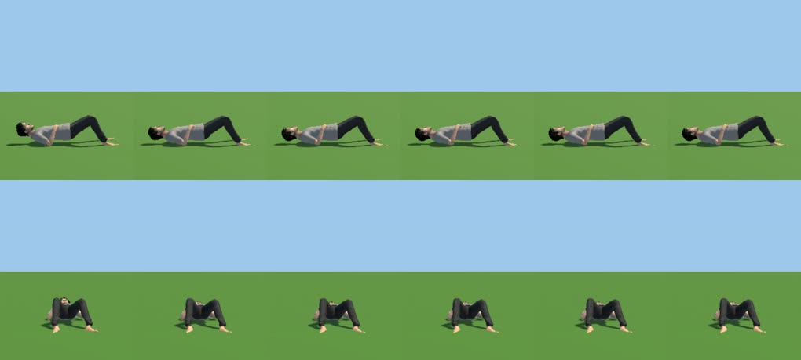

Lying on his back, watches the sky drift: slow eye darts, long soft blinks, breath in the chest. The smile comes in late and stays small. Needs lie_back before it (it holds that pose).

`any` to `any`, 5s, at least 3s. Params: `smile` 0.4.

Standard: Eyes drift with the head still, one long blink, the smile arrives. A head pop on going to eyes-only was found here and fixed in gaze. Body watched at 30 fps. The face was NOT watched close: the lab's close camera can't see him lying down. Check the face in the shot. Now holds the lie_back pose instead of restarting a clip. Face watched in clouds_face at the new camera, QA 8.5.

Tools: pops 0, left 0.064 m, right 0.063 m, reverse 0.

### look_over_shoulder: PASS

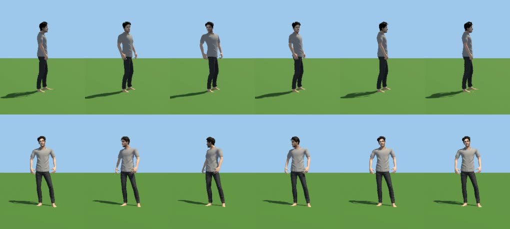

Eyes flick first, then he turns from the feet up to look behind him, nervous, and snaps back. side 1 is his right, -1 his left.

`stand` to `stand`, 2.8s, at least 2.4s. Params: `side` 1.

Standard: Weight: eyes flick first, then spine, chest, neck and head in order, with a root turn on planted feet. Holds, then comes back. Nervous. Right side tested; side -1 mirrors it, not watched.

Tools: pops 0, left 0.032 m, right 0.025 m, reverse 0.

### mouth_open_about_to_speak: PASS

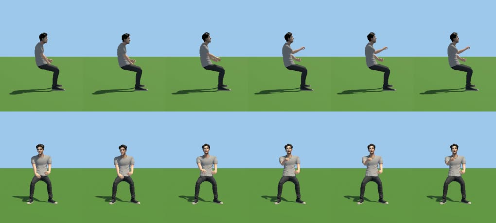

A breath in, the chest lifts, the brows go up, the jaw drops a little and the right hand starts to rise with a point half-formed: the word that never comes. It freezes there; whatever cuts in next takes over. Seated or standing.

`any` to `any`, 1.6s, at least 0.9s. Params: `to` [0,1.35,1.1].

Standard: Made for Hawkes Punch (2026-11-07), lab-tested on the greener scene at every 2nd frame (renders play at 2x), judged on the sheets and 30 fps strips. Face: brows up, jaw parts, breath in; the right hand lifts to the belly with the index half out and freezes. Small by design.

Tools: pops 0, left 0.010 m, right 0.014 m, reverse 0.

### nose_flick: PASS

He flicks the other one's nose: the right hand goes to the face (`target`, an actor: the fingertip stops just in front of the nose), the index flicks off the thumb at `flick`, and the hand snaps back. A wide grin the whole way, a lean in with the arm. For the one being flicked: nose_flicked. No ground. Ends flying.

`fly` to `fly`, 1.4s, at least 1s. Params: `target` "person", `flick` 0.5.

Standard: Made for Hawkes Punch (2026-11-07), lab-tested on the greener scene at every 2nd frame (renders play at 2x), judged on the sheets and 30 fps strips. Reach to the target's head with the index flicking off the thumb; tested in perf_lab with no target actor, so the reach aimed at his own head (C): test with two actors before a close-up.

Tools: no test yet.

### nose_flicked: PASS

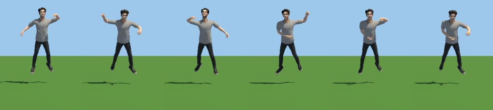

The nose takes a flick at `hit`: the head snaps back with overshoot, both eyes shut, then the right hand covers the nose and the face comes back offended: brows up, jaw open. No ground. Ends flying, hand on nose.

`fly` to `fly`, 1.6s, at least 1.1s. Params: `hit` 0.1.

Standard: Made for Hawkes Punch (2026-11-07), lab-tested on the greener scene at every 2nd frame (renders play at 2x), judged on the sheets and 30 fps strips. Head snaps back with overshoot, eyes shut, hand to the nose, offended face. Front sheet watched.

Tools: pops 4, left 0.307 m, right 0.192 m, reverse 0.

### point_at_lens: PASS

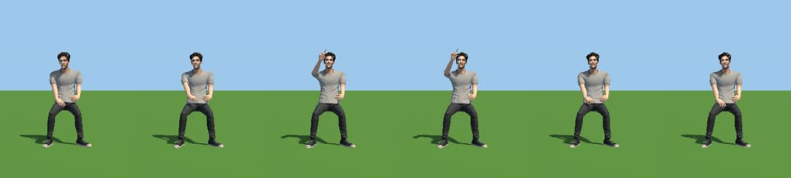

You: the right arm comes up straight at the lens with overshoot, index out, a lean in, the head tilted, the big smile and a wink, holds `hold`, then comes down. Right-handed, seated or standing (point_at_you is the left-handed standing one). `cam` is the lens in his own frame.

`any` to `any`, 2.2s, at least 1.4s. Params: `hold` 0.9, `cam` [0,1.25,3.2].

Standard: Made for Hawkes Punch (2026-11-07), lab-tested on the greener scene at every 2nd frame (renders play at 2x), judged on the sheets and 30 fps strips. Right arm straight at the lens with overshoot, index out, lean in, wink. Front sheet watched.

Tools: pops 3, left 0.088 m, right 0.091 m, reverse 0.

### punched_away: PASS

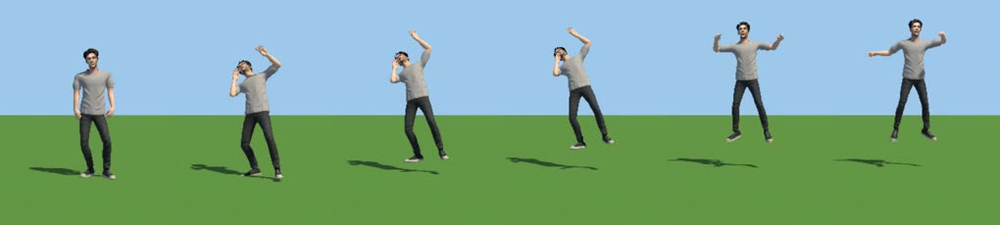

The hit and the flight. The hit reaction (GetHitFrontHeavyCombat, the head snapping back) for a quarter second, then a ragdoll with no gravity for `fly` seconds, spun by `spin` degrees a second and shoved by `impulse` (metres a second, in the world: keep it small; the travel across the sky is the flight path, not this), then the body gathers into a loose flying pose (Falling at a quarter speed, limbs alive on overlap). The ground is off from the first frame. Eyes wide, jaw open, no blink. Ends flying.

`stand` to `fly`, 3.2s, at least 2s. Params: `fly` 1.5, `impulse` [0,0.3,-0.8], `spin` 320, `seed` 3.

Standard: Made for Hawkes Punch (2026-11-07), lab-tested on the greener scene at every 2nd frame (renders play at 2x), judged on the sheets and 30 fps strips. The hit snap, then a no-gravity ragdoll (arms thrown up and flailing, spin 320 deg/s), then the loose Falling pose. In-place: the root is the card's `fly`. Bake alone: snaps 25>20, jerk 21>19: the ragdoll, contorted by design (B). Try `seed` for a different tumble.

Tools: pops 2, left 0.232 m, right 0.374 m, reverse 0.

### ride_satellite: PASS

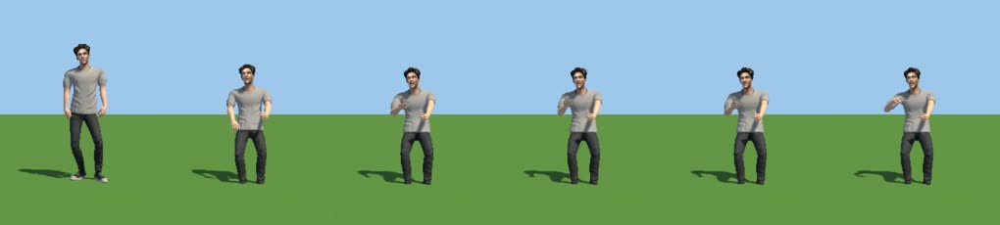

Astride a satellite like a bronco: the sit clip with the knees wide, the left hand gripping ahead (`grip`, a point in his own frame), the right arm up and whooping (Cheer2 over the right arm), the body bouncing on the ride every third of a second, mouth open, big smile. The satellite and its travel are the card's: attach him to it. Ends riding.

`any` to `ride`, 4s, at least 1.5s. Params: `grip` [-0.12,0.78,0.38].

Standard: Made for Hawkes Punch (2026-11-07), lab-tested on the greener scene at every 2nd frame (renders play at 2x), judged on the sheets and 30 fps strips. Sits astride with knees wide, left hand gripping ahead, the right arm whooping (Cheer2), the bounce. Attach him to the satellite in the card.

Tools: pops 0, left 0.259 m, right 0.381 m, reverse 0.

### rise_from_grass: PASS

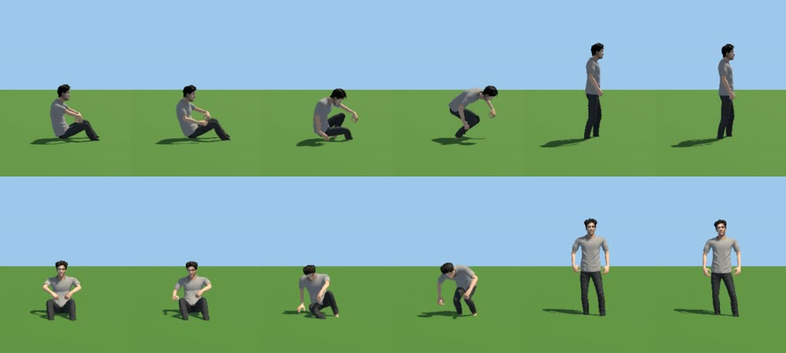

From sitting on the ground, gets up to a stand.

`sit_ground` to `stand`, 3.8s, at least 3.6s.

Standard: Weight: mocap, rocks forward and gets up. Same floor fix as sit_on_grass, and a right foot 3 cm under mid-rise is possible (C, hidden by grass).

Tools: pops 0, left 0.042 m, right 0.330 m, reverse 0.

### rise_from_kneel: PASS

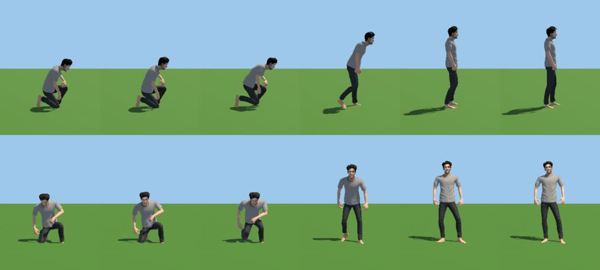

From the kneel, pushes up and stands.

`kneel` to `stand`, 3s, at least 2.8s.

Standard: Weight: mocap, pushes up off the front leg, straightens through. Ends in the default stand.

Tools: pops 0, left 0.151 m, right 0.035 m, reverse 0.

### shoulder_tap_react: PASS

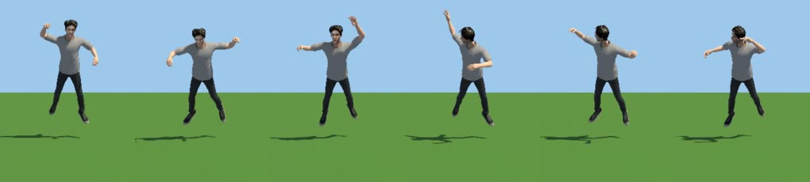

A tap on the shoulder in space: the shoulders jump, the eyes flick to `side` (1 his right, -1 his left), the head turns over that shoulder and the body follows, hands half up. Eyes wide, then the jaw drops on seeing him. No ground. Ends flying, turned.

`fly` to `fly`, 1.9s, at least 1.4s. Params: `side` 1.

Standard: Made for Hawkes Punch (2026-11-07), lab-tested on the greener scene at every 2nd frame (renders play at 2x), judged on the sheets and 30 fps strips. Shoulders jump, eyes flick, the head and chest turn over the shoulder with a settle, jaw drops. Front sheet watched, `side` 1 only.

Tools: pops 1, left 0.166 m, right 0.224 m, reverse 0.

### sigh: PASS

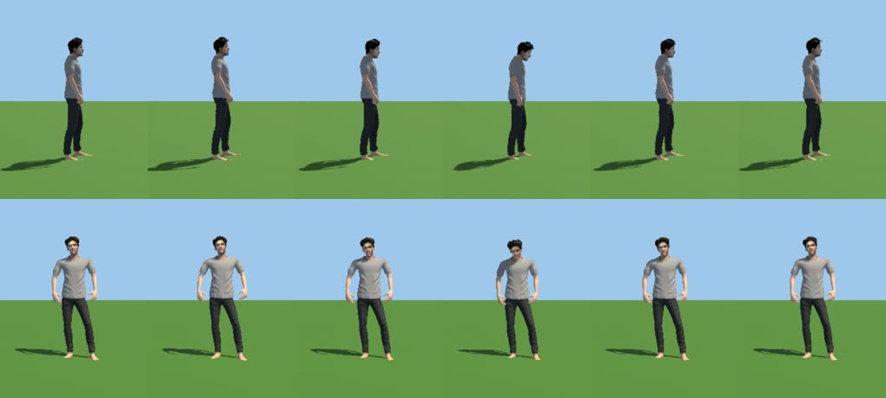

A small breath in, then everything drops: shoulders, chest, head, eyes.

`stand` to `stand`, 3s, at least 2.4s.

Standard: Weight: small breath in, then chest, shoulders and head drop with a settle. Face: lids drop, lips part. Reads best in a medium shot or closer.

Tools: pops 0, left 0.044 m, right 0.043 m, reverse 0.

### sit_bed_sick: PASS

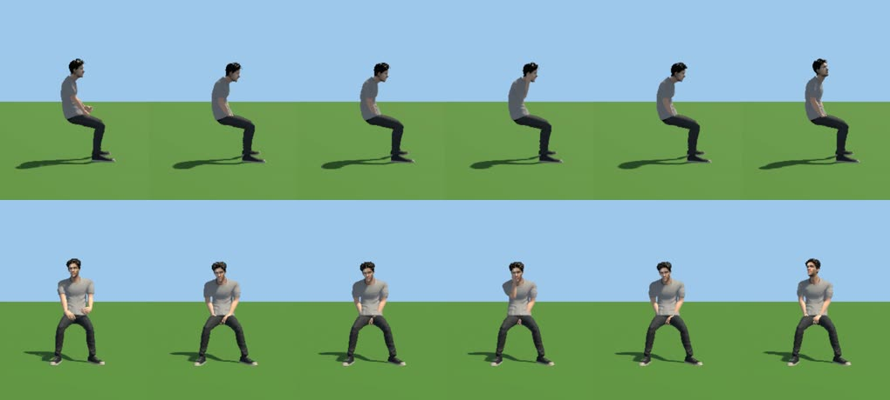

Slumped on the paper bed, small: shoulders down, chest folded, eyes heavy under a raised brow. A cough at `cough` (two jolts, a loose fist to the mouth), then at `look` his head comes up to the poster (`poster`, a point in his own frame: up and to his right by default). Pale is the grade, not the body. Seat about 0.45 m; starts on a cut.

`sit_chair` to `sit_chair`, 6s, at least 3s. Params: `clip` "IdleSit13", `cough` 2.2, `look` 3.8, `poster` [1.3,1.5,2.2].

Standard: Made for Hawkes Punch (2026-11-07), lab-tested on the greener scene at every 2nd frame (renders play at 2x), judged on the sheets and 30 fps strips. Weight: slumped, the slump reads from the side. The cough: fist to the mouth, two chest jolts with the jaw. The look up to the poster lands. Bake standing alone: snaps 0, everything 0.

Tools: pops 0, left 0.110 m, right 0.116 m, reverse 0.

### sit_grass_look_up: PASS

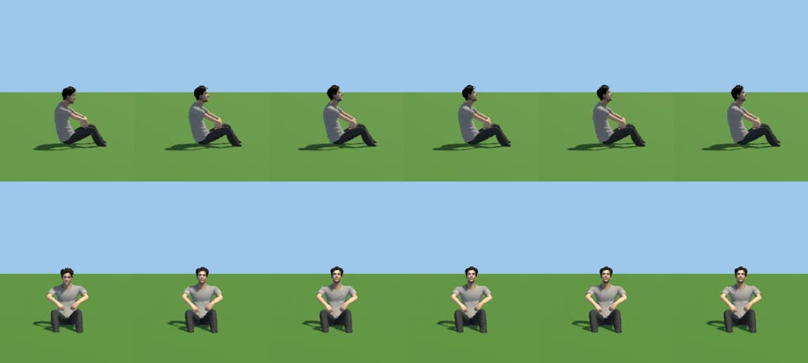

Sitting on the ground, tips his head back to the sky and takes it in.

`sit_ground` to `sit_ground`, 4s, at least 2.5s.

Standard: Mocap, tips his head to the sky. Blinks added. Face not watched close.

Tools: pops 0, left 0.017 m, right 0.015 m, reverse 0.

### sit_idle: PASS

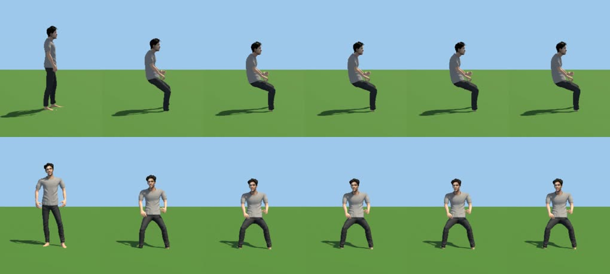

Sitting on a chair or sofa, alive: small shifts and breathing. The seat is about 0.45 m high.

`sit_chair` to `sit_chair`, 4s, at least 1s. Params: `clip` "IdleSit14".

Standard: Contact: feet on the floor, seat about 0.45 m; test had no chair, so check the sit against the real one. Face: blinks timed. Quiet by design. Start it on a cut: there is no sit-down from standing in this library.

Tools: pops 0, left 0.021 m, right 0.378 m, reverse 0.

### sit_on_grass: PASS

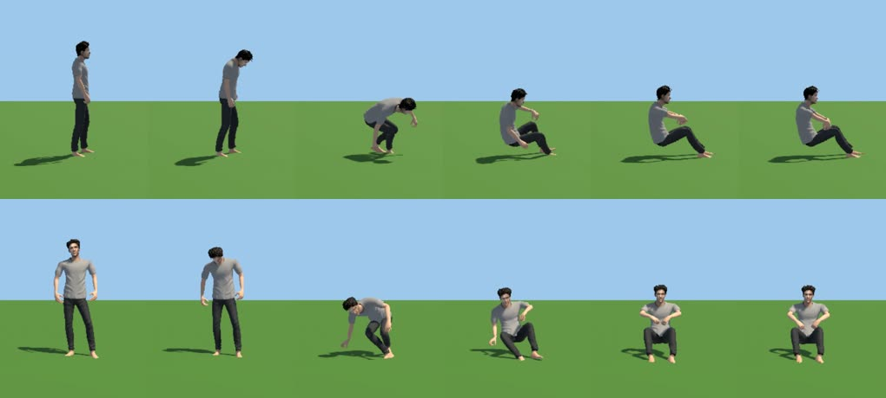

Lowers himself down from standing and sits on the ground, knees up.

`stand` to `sit_ground`, 3.9s, at least 3.5s.

Standard: Weight: mocap, lowers and drops the last bit. The clip sank his feet 15 cm into the floor (clips.json rejects it for that): root lift added, feet now on the floor in the hold, toes about 8 cm under for a moment mid-drop (C, hidden by grass).

Tools: pops 0, left 0.000 m, right 0.309 m, reverse 0.

### sit_stool_pitch: PASS

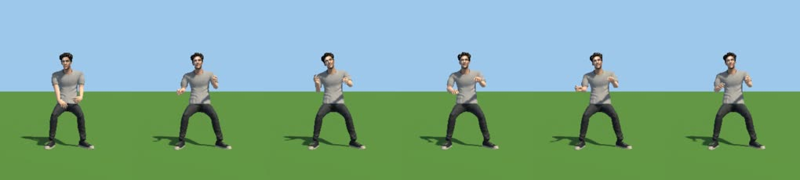

The pitch, seated on a stool to the lens: IdleSit13Explain gestures with the right hand while the left holds the can up at the chest (the can `can` is attached to the left hand on the first frame, the cup grip; `me` is the actor), a big cheesy smile, brows up, eyes on the lens (`cam`, a point in his own frame), a head tilt and a nod on the way. Seat about 0.45 m. Starts on a cut. Ends seated with the can.

`sit_chair` to `sit_chair_can`, 6s, at least 2s. Params: `can` "can", `me` "person", `cam` [0,1.25,3.2].

Standard: Made for Hawkes Punch (2026-11-07), lab-tested on the greener scene at every 2nd frame (renders play at 2x), judged on the sheets and 30 fps strips. IdleSit13Explain gestures with the right hand, the can held up in the left (attached on frame one; `me` is the actor), big smile to the lens, a tilt and a nod. Bake alone: 0 across.

Tools: pops 0, left 0.136 m, right 0.147 m, reverse 0.

### sit_up: PASS

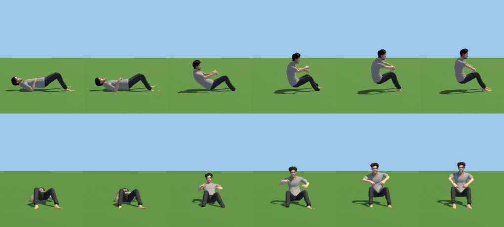

From lying down, sits back up.

`lie` to `sit_ground`, 2.9s, at least 2.7s.

Standard: Weight: mocap, curls up. Ends in the ground sit.

Tools: pops 0, left 0.189 m, right 0.182 m, reverse 0.

### slingshot: PASS

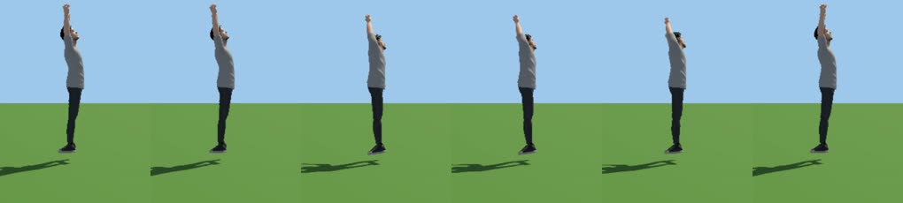

Whipped round a planet: from the superman he leans hard into the curve (`side` 1 banks to his right), the arms swept back and trailing, the head turned to the planet, lids pressed by the g, holds through the arc, then snaps straight with overshoot as he is flung out. The path is the card's. No ground. Ends flying.

`fly` to `fly`, 2.4s, at least 1.6s. Params: `side` 1.

Standard: Made for Hawkes Punch (2026-11-07), lab-tested on the greener scene at every 2nd frame (renders play at 2x), judged on the sheets and 30 fps strips. Side sheet only: the superman holds and the snap at the end reads; the bank is sideways, so judge it from the front in a shot.

Tools: pops 0, left 0.030 m, right 0.014 m, reverse 0.

### smile_small: PASS

The eyes go first, then the mouth: a small, private smile. It stays until hold ends.

`any` to `any`, 2.6s, at least 1.6s. Params: `amount` 0.7, `hold` 0.

Standard: Face: the new smile. Close-up watched: mouth stays shut and curves, cheeks fold, lower lids rise. Warm at 0.7. Eyes blink first.

Tools: pops 0, left 0.039 m, right 0.038 m, reverse 0.

### squint_at_sun: PASS

Looks up into the light, eyes narrow, head tips back a little, the face half-winces and half-smiles.

`any` to `any`, 3.4s, at least 2.4s.

Standard: Face: lids narrow, half wince, half smile. First version threw his head back too far, limited to 13 degrees a joint. Eyes lead and a blink lands on the turn. Close-up watched.

Tools: pops 0, left 0.047 m, right 0.046 m, reverse 0.

### stand: PASS

The default stand, rebuilt: arms hang close with a soft bend, hands open and relaxed, weight on his left leg, a small breathing sway. It sets a `stance` that holds through every later performance until one turns it off, so everything standing inherits it. `settle` is how long it takes to come in; 0.01 on a cut.

`any` to `stand`, 3s, at least 0.5s. Params: `blend` 0.5, `settle` 0.5, `side` -1.

Standard: Rebuilt for Touch Grass: arms close with a soft bend, relaxed hands, weight on the left leg, small sway, as a stance that holds under later performances. Front, side and close hand watched in the lab; pops 0, reverse 0, feet 3 cm.

Tools: pops 0, left 0.030 m, right 0.031 m, reverse 0.

### stand_up: PASS

From a chair: leans forward over his feet, pushes up, straightens. Weight first.

`sit_chair` to `stand`, 2.3s, at least 2.1s.

Standard: Weight: leans over the feet first, hips lead, settles with a small overshoot. Feet planted through the rise. No clip exists for this: built from a held lean, a long crossfade and root travel. Watched at 30 fps, no pop.

Tools: pops 0, left 0.056 m, right 0.235 m, reverse 0.

### step_stop: PASS

After a walk has slowed to nothing, left foot ahead (walk_tired and walk_out_door end that way): weight settles over the feet, a small breath. Ends in the default stand.

`walking_stopped` to `stand`, 1.4s, at least 1.1s.

Standard: Weight: settles and breathes. Contact: both feet drift about 5 cm forward over 0.6 s as the walk stance turns into the default stand (C, visible only full-body and watching the feet). Needs a walk_* straight before it.

Tools: pops 0, left 0.152 m, right 0.143 m, reverse 0.

### stretch_arms: PASS

Stands, stretches both arms overhead, leans back into it, half a yawn, lets it all fall.

`stand` to `stand`, 3.9s, at least 3.4s. Params: `weight` 0.92.

Standard: Clear pose: big open silhouette, arms from a mocap stretch, chest and head lean back. First version hung his head, fixed by masking to the arms. Face: half a yawn. Reads funny.

Tools: pops 0, left 0.055 m, right 0.053 m, reverse 0.

### take_can: PASS

Seated, he reaches to the can (`can`, an actor on the desk), the fingers open on the way, close round it, and he brings it to his chest and looks at her (`to`). The can is attached to his right hand from the grasp on (the cup grip of grips.json: a can is 6.6 cm). Ends holding it: the next performance decides the hand. `grab` is the second the fingers close, `me` the actor performing (the attach needs his name).

`sit_chair` to `sit_chair_can`, 2.8s, at least 2.2s. Params: `can` "can", `to` [0,1.35,1.1], `grab` 1.05, `me` "person".

Standard: Made for Hawkes Punch (2026-11-07), lab-tested on the greener scene at every 2nd frame (renders play at 2x), judged on the sheets and 30 fps strips. Contact: the hand opens on the way and the fingers close one after another (close-up render take_can_close: a hook grip, nothing through the hand; the can itself was a stand-in actor, so check it on the real can). Attaches the can at `grab`; `me` must be the actor's name. Bake alone: 0 across.

Tools: no test yet.

### thumbs_up: PASS

The thumbs up to the lens, seated or standing: the right forearm swings up beside the chest with overshoot, a fist with the thumb out, a lean toward the lens, the biggest smile, brows up, a wink (both lids: the model has one blink), holds `hold`, then comes down. `cam` is the lens in his own frame.

`any` to `any`, 2.4s, at least 1.5s. Params: `hold` 1, `cam` [0,1.25,3.2].

Standard: Made for Hawkes Punch (2026-11-07), lab-tested on the greener scene at every 2nd frame (renders play at 2x), judged on the sheets and 30 fps strips. The forearm swings up beside the chest with overshoot, fist with the thumb out, lean to the lens, the wink (both lids). Front sheet watched.

Tools: pops 2, left 0.089 m, right 0.092 m, reverse 0.

### tongue_out: PASS

Say ahh: the head tips back a little, the jaw drops wide and holds for the doctor, eyes on her (`to`, a point in his own frame), then closes with a swallow. No tongue shape key on the model: the open jaw is the placeholder until there is one. Works seated or standing.

`any` to `any`, 2.4s, at least 1.6s. Params: `to` [0,1.35,1.1], `open` 0.8.

Standard: Made for Hawkes Punch (2026-11-07), lab-tested on the greener scene at every 2nd frame (renders play at 2x), judged on the sheets and 30 fps strips. Face: jaw drops wide, head tips back a touch, closes with a blink. No tongue shape key on the model: a placeholder until one exists (C). Seated and standing.

Tools: pops 0, left 0.014 m, right 0.017 m, reverse 0.

### touch_grass: PASS

On one knee, leans out and lays his right hand on the grass, holds it there, comes back to the kneel. Held poses from a kneeling mocap clip. `hold` adds seconds with the hand down, so the hand can stay through a cut; `smile` 0 leaves the face alone, for a smile that belongs to the next shot `down` is the hand height above the mark, `reachFor` how long the hand takes to arrive, `open` how far the fingers curl while down (0 flat, 1 fist), `rise` when he is back up.

`kneel` to `kneel`, 4.2s, at least 3.9s. Params: `hold` 0, `smile` 0.45, `down` 0.07, `reachFor` 0.55, `rise` 3.5, `open` 0.1.

Standard: Contact: fingertips 3 to 6 cm above the ground at the bone, so inside real grass; flat lawn would show the gap. Uses a short reach for real contact, as AGENTS allows, over held poses from a kneeling clip. Weight: leans out, holds, comes back. The first version from the clip itself snapped and was thrown away. Hand is not palm-flat: it touches with the fingers. New params hold and smile: defaults give the same cues as before; hold 1.9 watched in Touch Grass.

Tools: pops 0, left 0.210 m, right 0.000 m, reverse 0.

### walk_out_door: PASS

First steps out: unsure pace, chin up, eyes going left, then right, taking it in. Follow with step_stop. The distance is rounded so the walk ends with the left foot just landed ahead, the default stand's stance, so step_stop slides nothing.

`stand` to `walking_stopped`, 4s, at least 2.6s. Params: `dist` 0, `pace` 0.55, `stride` 0.66, `clip` "Walk4".

Standard: Weight: unsure, eases in and out. Face: eyes lead left then right with a blink on each turn. Clear pose: arms carry wide from the front (C, the rig's stance). Stride 0.66 taken from the same measurement as walk_tired but not probed step by step.

Tools: pops 0, left 0.589 m, right 0.852 m, reverse 0.

### walk_tired: PASS

A worn-out walk: head low, shoulders down, short slow steps. Straight ahead of where he faces. `dist` metres, or `pace` m/s for `for`. Eases in and out; follow with step_stop. The distance is rounded so the walk ends with the left foot just landed ahead, the default stand's stance, so step_stop slides nothing.

`stand` to `walking_stopped`, 4s, at least 2.2s. Params: `dist` 0, `pace` 0.32, `stride` 0.335, `clip` "Walk6".

Standard: Weight: slumped, short steps. Contact: stance foot stays within 1 cm for a whole step, proven by probing the foot at 15 fps. Pace is low on purpose (0.32 m/s): 2 bars covers about 1.3 m. Clip Walk6 is marked rejected in clips.json for foot slide, measured against the wrong treadmill speed: with stride 0.335 it holds. Slow speeds up and slows down inside the cue.

Tools: pops 0, left 0.589 m, right 0.699 m, reverse 0.

### wave_small: PASS

A small shy wave from the elbow, right hand. Eyes on whoever it is. The legs and hips stay as they are.

`stand` to `stand`, 2.9s, at least 2.6s. Params: `weight` 0.85, `clip` "Idle1Greet".

Standard: Clear pose: right arm from the elbow, upper body only over the stand, one clear gesture. Fades cleanly.

Tools: pops 0, left 0.042 m, right 0.041 m, reverse 0.

## Not usable

### box_hop: FAIL

A gift box hops: squash, up, a little in the air, land, squash, settle. For props and crowds; `stagger` per member.

`any` to `any`, 0.857s, at least 0.3s. Params: `height` 0.35, `stagger` 0.

Standard: not watched yet

Tools: no test yet.

### butler_bow: FAIL

A turkey butler's bow: a small lift, down from the hips, a hold, up with a touch of overshoot. On a row it is one clip for all, so they stay in perfect unison; `stagger` is seconds between members.

`any` to `any`, 1.71s, at least 0.6s. Params: `stagger` 0.

Standard: not watched yet

Tools: no test yet.

### butler_chorus: FAIL

The butlers' take on chorus 1, in sync with dance_chorus and started at the same moment (47.63 s): hop, hop, bow on each hook, hops on the beat through the groove, one bow as he points. Their rig can't take human mocap, so this is their own keyed clips, one clip for a whole crowd. `stagger` is seconds between members.

`any` to `any`, 21.429s, at least 21.429s. Params: `stagger` 0.

Standard: not watched yet

Tools: no test yet.

### butler_chorus_2: FAIL

The butlers' side of chorus 2: butler_chorus picked up 16 beats in.

`any` to `any`, 14.57s, at least 14s. Params: `stagger` 0.

Standard: not watched yet

Tools: no test yet.

### butler_chorus_2_a: FAIL

The butlers on chorus 2, in sync with dance_chorus_2: bows bottom out on his drops, hops land on his stops, still while he walks and spins. Written by captures/dance/build_butlers.mjs.

`any` to `any`, 14.575s, at least 13.717s. Params: `stagger` 0.

Standard: not watched yet

Tools: no test yet.

### butler_chorus_2_b: FAIL

The butlers on chorus 2, in sync with dance_chorus_2: bows bottom out on his drops, hops land on his stops, still while he walks and spins. Written by captures/dance/build_butlers.mjs.

`any` to `any`, 14.575s, at least 13.717s. Params: `stagger` 0.

Standard: not watched yet

Tools: no test yet.

### butler_chorus_a: FAIL

The butlers on chorus 1, from bar 29:1 (beat 2 of dance_chorus), every rank in unison: bows bottom out on his drops, hops land on his stops, still while he walks and spins. Written by captures/dance/build_butlers.mjs.

`any` to `any`, 20.576s, at least 19.719s. Params: `stagger` 0.

Standard: not watched yet

Tools: no test yet.

### butler_chorus_b: FAIL

The butlers on chorus 1, from bar 29:1 (beat 2 of dance_chorus), every rank in unison: bows bottom out on his drops, hops land on his stops, still while he walks and spins. Written by captures/dance/build_butlers.mjs.

`any` to `any`, 20.576s, at least 19.719s. Params: `stagger` 0.

Standard: not watched yet

Tools: no test yet.

### butler_dance: FAIL

The butlers' dance behind him: two bars, hop on beat 1, hop on beat 3, bow across the second bar. Their rig can't take human mocap, so this is the butler's own keyed clips in a beat pattern, one clip for a whole crowd so a row stays in unison. Repeat every 2 bars; start it on a bar line. `stagger` is seconds between members, for a wave.

`any` to `any`, 3.429s, at least 3.429s. Params: `stagger` 0.

Standard: not watched yet

Tools: no test yet.

### butler_hop: FAIL

A turkey butler's hop on the beat: crouch, spring, wings out at the top, land, settle.

`any` to `any`, 0.857s, at least 0.5s. Params: `stagger` 0.

Standard: not watched yet

Tools: no test yet.

### butler_verse: FAIL

Verse 2, both dining rows in unison: a slow bow on the bar, then a bar of two hops.

`any` to `any`, 27.4s, at least 26s. Params: `stagger` 0.

Standard: not watched yet

Tools: no test yet.

### chorus_butlers: FAIL

The butlers' side of the chorus take: butler_dance, end to end, 12 bars. Every rank in unison.

`any` to `any`, 18.857s, at least 18s. Params: .

Standard: not watched yet

Tools: no test yet.

### chorus_take: FAIL

The whole of a chorus as one take, on one mark: hook, groove, hook, groove, 12 bars at 140 BPM. Every camera sees this same performance, so the cut is only choosing cameras. Written in this song's beats; the clips warp to its beat. Mocap only.

`any` to `stand`, 18.857s, at least 18s. Params: .

Standard: not watched yet

Tools: no test yet.

### dance_chorus: FAIL

Chorus 1 on the stage mark (he faces -z, so `back` +z returns him to the mark during the spin), 48 beats from "I'm your": hook, groove, travel, attitude and the point on "you", hook, spin into a held pose on "know".

`stand` to `stand`, 20.576s, at least 20.576s. Params: `back` 1.7.

Standard: not watched yet

Tools: no test yet.

### dance_chorus_2: FAIL

Chorus 2 from 121.36 s on the stage and clone marks, 34 beats: walk into the lens hand on hip, kick, house with the hand on the hip, an arm up, point on "you", the hook, the spin back to the mark, hands to the face on "know". They face -z, so back +z.

`any` to `stand`, 14.575s, at least 14.575s. Params: `back` 1.7.

Standard: not watched yet

Tools: no test yet.

### dance_groove: FAIL

The verse groove: 2000s pop side-to-side, mocap (Mixamo Hip Hop Side To Side), stepping on the beat with soft hands and arms held in. Warped to the song's beats. Loops; keep `for` under 11 s or cut, the clip wraps there. `out` 1 settles back to the stand at the end.

`stand` to `stand`, 6.857s, at least 1.71s. Params: `blend` 0.3, `start` 7.2, `out` 1, `warp` "beat".

Standard: not watched yet

Tools: no test yet.

### dance_hook: FAIL

Signature move on every "I'm your gateway drug, baby": a slide step with the hip, ribs popping in the arms, ending on the left-hand point at the lens on "baby" (beat 5 of 8).

`stand` to `stand`, 3.429s, at least 3.429s. Params: .

Standard: not watched yet

Tools: no test yet.

### dance_hook_stairs: FAIL

dance_hook from just after "gateway": the rise and the point on "baby", for a four-beat card that starts on the bar. Same frames as the hook.

`any` to `stand`, 1.715s, at least 1.715s. Params: .

Standard: not watched yet

Tools: no test yet.

### dance_strut: FAIL

Walks straight into camera like he owns the street: mocap strut (Mixamo Strut Walking) with real root travel, two steps a bar at this tempo, soft hands. Ends mid-step; chain step_stop, a dance, or cut.

`stand` to `walk`, 3.43s, at least 0.86s. Params: `blend` 0.3.

Standard: not watched yet

Tools: no test yet.

### dress_curtsy: FAIL

A full stage curtsy with the skirt spread: a small rise, sinks straight down, head dips last, holds, comes up with the chin leading.

`stand` to `stand`, 1.8s, at least 1.2s. Params: `depth` 0.32.

Standard: not watched yet

Tools: pops 0, left 0.041 m, right 0.063 m, reverse 0.

### dress_groove: FAIL

He sings on a stand with a small groove: the hip-hop step mocap on the beat, elbows at the waist, one hip dropped, soft hands. For sung standing shots that must not freeze. Any length.

`any` to `stand`, 3.43s, at least 0.86s. Params: `blend` 0.25.

Standard: not watched yet

Tools: no test yet.

### dress_lift_stairs: FAIL

Going down the grand stair with the skirt lifted, chin up, not looking at the steps: one tread a beat, four treads in eight beats, a step every two beats, each foot pinned to its tread by `plant`. Only for the card descend: the plants are world positions on the hall stair, from stair_go to stair_mid.

`stand` to `stand`, 3.429s, at least 1.7s. Params: `to` [0,0,0], `dist` 0, `clip` "Walk4", `stride` 1.03.

Standard: not watched yet

Tools: pops 0, left 0.986 m, right 1.358 m, reverse 0.

### dress_sit: FAIL

A chair with total confidence: knees together, back straight, chin level, and holds. Starts on a cut, seat about 0.45 m.

`sit_chair` to `sit_chair`, 4s, at least 1s. Params: `clip` "IdleSit14", `blend` 0.2.

Standard: not watched yet

Tools: pops 0, left 0.000 m, right 0.148 m, reverse 0.

### dress_stand: FAIL

Stands as if in a big party dress: skirt held out in both hands at the thigh, knees close, chin level, weight on one hip. Sets a stance that holds, so what follows inherits it.

`any` to `stand`, 3s, at least 0.5s. Params: `blend` 0.4, `settle` 0.4, `side` -1.

Standard: not watched yet

Tools: pops 0, left 0.065 m, right 0.065 m, reverse 0.

### dress_twirl: FAIL

A turn on the spot, mocap (mx_spin_in_place): one leg crosses, the body turns and the hands come up on the finish. Then back to the stand.

`stand` to `stand`, 1.71s, at least 1.2s. Params: `dir` 1.

Standard: not watched yet

Tools: pops 0, left 1.225 m, right 0.888 m, reverse 0.

### dress_walk: FAIL

The pop-star walk: mocap strut (real hip roll and stride, a step every two beats) at his own speed, soft hands. `skirt` 1 holds the invisible skirt up in both hands. Ends mid-step: chain dress_stand, a dance, or a cut.

`stand` to `stand`, 3.43s, at least 0.86s. Params: `dist` 0, `pace` 0.8, `stride` 1.37, `clip` "mx_strut", `skirt` 0.

Standard: not watched yet

Tools: pops 1, left 1.059 m, right 1.200 m, reverse 0.

### grab_earth_careful: FAIL

Both hands close on the Earth (`earth`, an actor about half a metre across) slowly, fingers soft and spread, the eyes on it, lips pressed; a held beat of care; then the hands let go (`let`) and come up open at the chest, okay okay, a step back in the hips, a relieved breath and a small smile. The Earth going back to its place is the card's, after `let`. Works for both of them. No ground. Ends hands up.

`any` to `any`, 4.4s, at least 3s. Params: `earth` "earth", `let` 2.6.

Standard: Made for Hawkes Punch (2026-11-07), lab-tested on the greener scene at every 2nd frame (renders play at 2x), judged on the sheets and 30 fps strips. Tested in perf_lab with no `earth` actor, so the reaches had nothing to go to: only the hands-up ending was seen. Bake alone: 0 across. Test with the Earth actor before use.

Tools: pops 0, left 0.252 m, right 0.249 m, reverse 0.

### hand_flourish: FAIL

A slow, playful flourish of one hand. Waves the world away. Mocap on the arm.

`any` to `any`, 1.7s, at least 1.2s. Params: `clip` "Idle1Greet", `mask` "rightArm", `start` 0.3.

Standard: not watched yet

Tools: no test yet.

### hem_smooth: FAIL

Both hands run down the top of his thighs, smoothing a skirt that is not there, then settle back. For dress_sit.

`sit_chair` to `sit_chair`, 1.7s, at least 1s. Params: .

Standard: not watched yet

Tools: no test yet.

### micro_life: FAIL

What a still face does: small eye darts off where he is looking and back, slow blinks landing on some of them, the lids and brow softening. Eyes only, on top of any gaze, so it goes over any close-up as an event and never moves the head. `amt` is the dart in degrees, `soft` 0 keeps the brow. The `fear` in `soft` opens the lips a little under a smile: use `soft` 0 there.

`any` to `any`, 6s, at least 1s. Params: `amt` 7, `soft` 1.

Standard: not watched yet

Tools: pops 0, left 0.067 m, right 0.067 m, reverse 0.

### point_at_you: FAIL

One finger at the lens, quick, then it holds. Idle1PointOut points with the LEFT arm, so the mask is leftArm; the upper arm turns in so it aims down the lens.

`any` to `any`, 1.7s, at least 1s. Params: `clip` "Idle1PointOut", `mask` "leftArm", `aim` 14.

Standard: not watched yet

Tools: no test yet.

### sit_lawn_chair_sing: FAIL

dress_sit with a knowing look held on the camera. Lip sync comes from tools/lipsync.py on its own.

`sit_chair` to `sit_chair`, 4s, at least 1s. Params: `clip` "IdleSit14".

Standard: not watched yet

Tools: no test yet.

### smile_relief: FAIL

The hero smile. Mouth shut, it starts small and grows slowly in three steps, head level, eyes soft, two slow blinks, a breath let go. `amount` 0.3 to 0.4 stays shut and warm; with soft lids on top, 0.42 already parts the lips in a close-up. `pitch` and `roll` level the head on whatever pose is under it.

`any` to `any`, 5s, at least 3.5s. Params: `amount` 0.36, `pitch` 0, `roll` 0.

Standard: not watched yet

Tools: pops 0, left 0.062 m, right 0.061 m, reverse 0.

### spin_top: FAIL

Kicked and spinning like a top: the hit at `hit` snaps him sideways, then `turns` whole turns about his length, fast at first and slowing (a quarter turn a key), arms out flat, eyes crossed and darting, jaw slack, then Stunned (the sway, the head rolling) as it stops. No ground. Ends stunned.

`any` to `any`, 3.4s, at least 2.4s. Params: `hit` 0.1, `turns` 4.

Standard: Made for Hawkes Punch (2026-11-07), lab-tested on the greener scene at every 2nd frame (renders play at 2x), judged on the sheets and 30 fps strips. The hit and four slowing turns read, but the arms stay bent near the body instead of out flat (the upper arm z keys were limited 23 degrees): fix the arm axis before use. Bake alone: snaps 79>5, jerk 213>17.

Tools: pops 18, left 6.361 m, right 2.534 m, reverse 0.

### verse_take: FAIL

Verse 2 on the table, 46 beats on one mark, small and cool: hands on hips, the hip-hop step, house, a small groove, hand on hip. Gestures on manners, sleep and keep. Every camera sees this one performance.

`any` to `stand`, 19.719s, at least 19.719s. Params: .

Standard: not watched yet

Tools: no test yet.

### verse_take_2: FAIL

Verse 2 back on the table after the long-table shot, 8 beats: hand on hip, hip bounce, then both hands on the hips.

`any` to `stand`, 3.429s, at least 3.429s. Params: .

Standard: not watched yet

Tools: no test yet.

### walk_plain: FAIL

A plain man's walk with no hips and no skirt, Walk1, narrow feet and hanging arms, that stops cleanly on its mark and settles into the plain stand. For the dip. `to` comes from the card's a>b.

`stand` to `stand`, 2.57s, at least 1.7s. Params: `to` [0,0,0], `dist` 0, `clip` "Walk1", `stride` 1.4.

Standard: not watched yet

Tools: no test yet.
