# Cold view 3: animatic.mp4

Automatic (mv make, 2026-11-08T23:49): 11 chunks of 20 s at 2 fps contact strips, each retold blind by claude-sonnet-5-5 with the captions and lines heard, then each board "change" beat judged against the retelling by claude-haiku-5-5. Vision $0.24.

## Verdict

**38 of 61 board beats did not get across.**

- c01 (0:00.0, chunk 1): "The place and the product. Plants: the poster, the turkey.". Place and turkey are covered: 'A waiting room opens with a turkey in a nurse's cap behind the reception desk.' The product is not named anywhere in the retelling, so half of this change is missing.
- c02 (0:03.0, chunk 1): "Plant: he hears music no one else can.". At 0:03 the retelling only has 'a man sits stiffly in a waiting-room chair, looking glum and slightly green.' Music is first mentioned at 0:16.5 ('can't stop listening to music'), and nothing says he hears music no one else can at this point.
- c03 (0:06.5, chunk 1): "Plant: the product's name and the tagline.". The sign is described only as 'a red sign' that 'fills the screen and shows a red raised fist.' The product's name and tagline are not mentioned.
- c04 (0:08.5, chunk 1): "Turn (+): he is called in.". The retelling says only 'Cut to the turkey receptionist at a curved desk, with the man seen from behind.' It never says he is called in; the turn is not stated.
- c10 (0:28.5, chunk 2): "Symptom 3. The first crack in her calm.". Missing. The retelling says nothing about the therapist's calm first cracking at 0:28.5. It only describes her as taking notes and later as flat. The 'in love with a ghost' content is there, but the crack in her composure is not.
- c11 (0:30.0, chunk 2): "The pause.". Missing. No pause is mentioned. The 0:29 grid-panel reaction is absent from the retelling.
- c13 (0:37.0, chunk 2): "She takes it in stride: she has seen this before.". "The therapist flatly repeats 'A space ghost'" gives a flat, unfazed tone, but nothing says she has seen this before, and the darkening shot is not mentioned. The 'takes it in stride, has seen this before' idea is only partially implied.
- c14 (0:39.5, chunk 3): "The reaction is the punchline.". The retelling reports the line ('...Space ghost,' repeating a diagnosis) and calls the man 'worried,' but never says the reaction works as the punchline. Missing: that the stunned reaction itself is the joke.
- c15 (0:41.5, chunk 3): "Suspense: the audience now knows what the cure is.". No suspense is described. The retelling lists the gloves and then the cure ('take "Hawkes Punch" every day') in order, but does not say the audience's knowledge of the cure creates tension. Missing: the suspense framing.
- c19 (0:51.0, chunk 3): "Turn begins (-): the cure is her fist.". 'The doctor, standing by the gloves, says "No."' The retelling records the reversal but never says the cure is a punch or her fist. Missing: that the cure is a punch, which turns the story.
- c21 (0:57.5, chunk 3): "Turn (-): hope to doom. The long build begins.". 'Don't worry. It's only just a healthy amount of people in the world.' is called 'odd and isn't explained.' The retelling reads this as nonsensical reassurance, not as a shift from hope to doom or the start of a long build. Missing: the doom turn.
- c21 (0:57.5, chunk 4): "Turn (-): hope to doom. The long build begins.". Missing. The retelling covers only 1:00-1:20 and says nothing about the 0:57.5 hope-to-doom turn or the build-up that precedes it. The doctor's stern opening is described, but no shift in mood is identified.
- s01 (1:15.3, chunk 4): "World rule: planets are real size, a man is a speck. Sound to silence.". Missing. "A line ends on the planet's rings, and a scream is heard around 1:12." The viewer never mentions the scale contrast (Saturn's real size versus the man as a speck), and the sound dropping to silence is not described. Only the scream is noted.
- s02 (1:20.3, chunk 5): "Payoff: silence = more music. He gets a goal: find her.". Partly covered. The retelling captures the payoff: "It's silent, then he says there's no music and wants more." It does not convey the goal of finding her. "She's up here" reads as a discovery of her location, not a stated aim to look for her, so the 'He gets a goal: find her' half is missing.
- s03 (1:28.3, chunk 5): "Suspense: we see her, he doesn't. Then he is found, by the wrong one.". Not covered. The retelling notes the cut to "a white ghost-shaped figure standing on a rock" with the man crouched with his paper, and he says "Space ghost?", which suggests he has noticed her. It never conveys that the audience sees her while he doesn't, and it never mentions him being found by the wrong figure.
- s04 (1:35.3, chunk 6): "Rule of three broken: not the ghost, a double. He has company he didn't ask for.". The retelling starts at 1:40, after the s04 change (1:35.3). It notes 'Two figures stand on a moon' and a ghost drawing, but never conveys that the second figure is a double, that the rule of three is broken, or that he has unwanted company. Missing.
- s05 (1:43.3, chunk 6): "His goal: catch him for an answer. He is as strong as the double.". 'Are you her?!' and 'No!' hint at questioning, but the retelling never says he is trying to catch the double for an answer, and it says nothing about the two being evenly matched in strength. The flying/explosion scene is described without any parity. Missing.
- s06 (1:46.3, chunk 6): "Power by accident: his flinch cracks a moon.". The viewer reads the grey one's 'Aah!' as 'a prank scare' and notes 'A crater with steam is shown,' but never links the flinch to accidentally cracking or cratering the moon. The power-by-accident idea is missing.
- s09 (1:56.8, chunk 6): "Escalation 3: a planet is coming.". At 1:55.5: 'a realistic view of Saturn and Jupiter with a tiny red figure on a ring between them.' Jupiter and Saturn are named, but nothing says a planet is coming or that the stakes escalate. The escalation is missing.
- s09 (1:56.8, chunk 7): "Escalation 3: a planet is coming.". Storyboard time 1:56.8 falls before the viewer's watched window (2:00.0-2:20.0), so the retelling cannot show this escalation. Nothing about a planet coming appears in the retelling.
- s10 (2:02.8, chunk 7): "The finisher: the biggest hit in the film, a planet caught.". The retelling records the 2:03 shot as 'a boy with his arms raised in front of a huge Jupiter, a red lightning-like mark above him.' It does not describe a planet being caught or a hit landing, so the finisher's substance (biggest hit, planet caught) is missing.
- s11 (2:07.3, chunk 7): "Payoff hold: he is unimpressed. The double has to go bigger.". The retelling notes 'raised open palms and a red spot by his head, and he says "Okay."' The flat 'Okay' is present, but the viewer never describes him as unimpressed, and nothing says the double has to go bigger. Only the line is captured, not the payoff.
- s12 (2:11.8, chunk 7): "The rule of three breaks: this one he stops.". At 2:12 the retelling shows 'a figure in red holding the Earth overhead' with 'Hey' and 'What.' Nothing indicates that the pattern of three breaks or that he stops this time. The change is missing.
- s13 (2:15.3, chunk 7): "Absurd literal-mindedness stops the game.". The retelling quotes 'People live there' from a 'sad, teary boy with a red dot beside him,' which is the literal-minded line. However, it never says the line stops the game, and the 'Hey'/'What' reaction is not tied to any halt. Only the dialogue is present; the stopping of the game is not conveyed.
- s14 (2:18.3, chunk 7): "Turn: rivals to truce. The careful set-down is the joke.". The retelling says a red-shirt boy 'hands or holds the Earth toward a dark-haired boy, with the moon nearby, as if showing or giving it to him.' The giving gesture is there but hedged, and the viewer does not identify rivals, a truce, or a careful set-down as the joke.
- s14 (2:18.3, chunk 8): "Turn: rivals to truce. The careful set-down is the joke.". Missing. The retelling describes the red boy holding the glowing Earth while the gray boy watches, but never shows a rivalry turning into a truce and never mentions a careful set-down as a joke. The relationship is described only as 'two versions of the same person' and a 'double'.
- s15 (2:24.3, chunk 8): "Turn (+): lonely to not alone. Payoff of 'she doesn't have a face'. The drawing released.". Partly touched, not covered. The gray boy holds out a paper, and the 'You do have a face' exchange at 2:30 sits near the 'she doesn't have a face' payoff. But the retelling never identifies that setup, never describes a shift from lonely to not alone, and never says the drawing is released. It treats the paper as a plain prop.
- s16 (2:33.3, chunk 8): "The ghost pays off for us, not him. The story becomes the ad.". Missing. The retelling says a 'cartoon white ghost holding the paper' appears above Earth at 2:32, but it never says the ghost is addressing the audience, never says the story turns into an advertisement, and never names a product or brand. The ghost is recorded only as a character.
- a03 (2:48.3, chunk 9): "Payoff: 'healthy amount of people'; she never looks up.". Retelling quotes the line: "A woman in glasses and a white coat says she has prescribed it to a healthy amount of people." Missing: the payoff that she never looks up. The retelling does not mention her gaze or why the line lands as a payoff. The WHO section says she "sits at a desk" but does not note she never looks up.
- a05 (2:55.8, chunk 9): "The list is everything we just saw.". Retelling: "The clip ends on a newspaper-like page with small print and a red fist logo, with a voice rattling off side effects." Missing: the viewer never says the side-effects list recaps everything shown (the ghost, the doubles, the fist). The list is described only as side effects.
- a05 (2:55.8, chunk 10): "The list is everything we just saw.". Missing: the retelling never describes a recap or list of the earlier footage. Its only reference to the newspaper page and red fist logo is the opening, and it does not frame anything as a list of prior material. The a05 change falls at 2:55.8, before the 3:00-3:20 window the viewer watched, so the viewer could not have seen it.
- a06 (3:05.8, chunk 10): "Payoff of the poster.". The retelling records the opening 'still newspaper-style page with a small red fist logo' and later 'a red card with a white fist and blank text boxes', but never says either one pays off. Nothing connects the poster to a later moment, so the payoff did not register.
- b01 (3:07.8, chunk 10): "Payoff: 'every day'.". Missing: 'every day' is never mentioned. The retelling has no text, phrase, or idea of daily or recurring action at the 3:07.8 moment.
- b02 (3:10.8, chunk 10): "The edge of the frame hides the punch. Payoff: he has a new symptom.". Partly present: the retelling has 'She asks "Any symptoms?" and he starts to say he met someone', which gives the symptom question and answer. Missing: the edge of the frame hiding the punch is never mentioned, and the retelling never states that he has a new symptom as a payoff. Only one half of the beat registers.
- b03 (3:13.8, chunk 10): "Same time, same place.". Missing at 3:13.8: the retelling says nothing about the setting staying the same or a repeated 'same time, same place' idea during the close-up. 'Same time tomorrow?' appears only at the end, in the 3:18-3:20 segment, so it does not cover this beat.
- b04 (3:16.3, chunk 10): "Payoff: the daily dose is a friend. The ghost waves at the audience.". Missing: the retelling mentions 'a glowing ghost holding a paper' and 'red cups or gloves together' but never says the daily dose is a friend and never mentions the ghost waving at the audience. The ghost is noticed, but the change is not.
- b04 (3:16.3, chunk 11): "Payoff: the daily dose is a friend. The ghost waves at the audience.". Not covered. The storyboard's b04 is at 3:16.3, which is before the viewed stretch (3:20.0-3:24.3), so the retelling cannot cover it. The retelling also does not mention the ghost waving at the audience or the idea of the daily dose being a friend. The ghost only 'floats between them holding a piece of paper.'
- b05 (3:21.3, chunk 11): "The last image is the product.". Partially close but not covered. At 3:21.5 the retelling says 'the film cuts to a dark, empty gray surface with a single red can lying on its side,' and it identifies the can as a 'red soda can' in the WHO/WHERE section. However, the viewer frames this shot as a mood shift to 'lonely and bleak' and never says the can is the product or that a product name or brand reads. The storyboard change is that the last image is the product, and the retelling does not make that point. Missing: the product's name or brand, and any sense that the final image is a product shot.

## Chunk by chunk

### 0:00.0-0:20.0

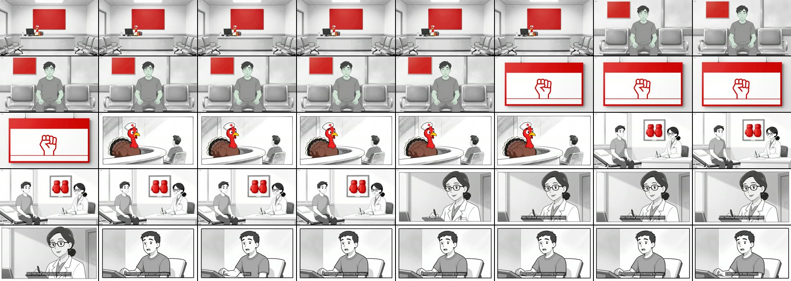

**What happened:** A waiting room opens with a turkey in a nurse's cap behind the reception desk, held static for about three seconds. Then a man sits stiffly in a waiting-room chair, looking glum and slightly green, under a red sign. The sign fills the screen and shows a red raised fist. Cut to the turkey receptionist at a curved desk, with the man seen from behind. Then we are in an exam room where the man sits on the table and a woman doctor in glasses and a white coat writes on a clipboard, with red boxing gloves framed on the wall. She asks about his symptoms, and he says he can't stop listening to music, "like, ever. In the shower."

**Who, where:** A young man in a gray t-shirt, a turkey in a nurse's cap working as receptionist, and a woman doctor with glasses and a ponytail in a white coat. Settings: a clinic waiting room, the reception desk, and an exam room.

**Beats:**
- 0:00: Static wide shot of the waiting room with the turkey nurse at the desk.
- 0:03: Cut to the man sitting still and glum in a waiting chair, under a red sign.
- 0:07.5: The sign fills the frame and shows a red fist icon.
- 0:09: Cut to the turkey receptionist at the desk, with the man seen from behind.
- 0:11: The scene moves to the exam room, where the man sits on the table and the doctor writes.
- 0:14.3: Close on the doctor, who asks about his symptoms.
- 0:16.5: Close on the man, who says okay and then that he can't stop listening to music, even in the shower.

**Confusions:**
- The red sign changes from a blank panel to a fist icon and it's unclear what it means.
- The framed boxing gloves in the exam room are unexplained.
- The man's green tint in the waiting room disappears later, so it's unclear if it meant he was sick.
- How he got from the desk to the exam room isn't shown.
- The opening is very still, with many near-identical frames.

**Jokes:**
- landed: A turkey in a nurse's cap as the receptionist, shown as a deadpan visual gag with no comment.
- landed: The patient's symptom is that he can't stop listening to music, even in the shower. It's a mild, odd complaint played seriously.
- did not land: Boxing gloves and a fist sign as clinic decor, which seems like a sight gag but has no clear point yet.

**Board beats:**
- MISSED c01: Place and turkey are covered: 'A waiting room opens with a turkey in a nurse's cap behind the reception desk.' The product is not named anywhere in the retelling, so half of this change is missing.
- MISSED c02: At 0:03 the retelling only has 'a man sits stiffly in a waiting-room chair, looking glum and slightly green.' Music is first mentioned at 0:16.5 ('can't stop listening to music'), and nothing says he hears music no one else can at this point.
- MISSED c03: The sign is described only as 'a red sign' that 'fills the screen and shows a red raised fist.' The product's name and tagline are not mentioned.
- MISSED c04: The retelling says only 'Cut to the turkey receptionist at a curved desk, with the man seen from behind.' It never says he is called in; the turn is not stated.
- ok c05: 'an exam room where the man sits on the table and a woman doctor in glasses and a white coat writes on a clipboard, with red boxing gloves framed on the wall.' The geography and the gloves plant are both covered.
- ok c06: 'She asks about his symptoms.' The doctor invites the problem.
- ok c07: 'he says he can't stop listening to music, "like, ever. In the shower."' This is the first symptom.

### 0:20.0-0:40.0

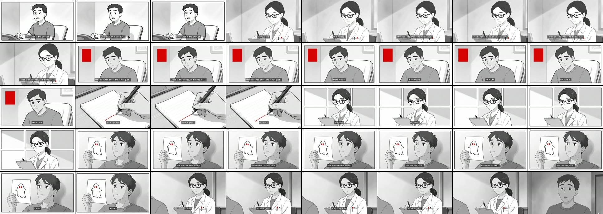

**What happened:** A man sits across from a woman in a white coat who seems to be a therapist taking notes. He describes music always playing in his head: in the shower, in his sleep, and even when he tried silence, it was just more music. He then hesitantly admits he's in love with a ghost in space. He holds up a drawing of a simple white ghost with red eyes and explains she has no face but has a vibe. The therapist flatly repeats "A space ghost," and the man looks unsettled.

**Who, where:** A young dark-haired man in a gray t-shirt in a chair in an office-like room. A woman with glasses and a ponytail, in a white lab coat and holding a clipboard, who appears to be a therapist or doctor.

**Beats:**
- 0:20: The man finishes a thought about hearing music in the shower and in his sleep.
- 0:22: The therapist listens, then he says silence was just more music.
- 0:24: A red rectangle appears behind the man as he looks down and hesitates.
- 0:27: He says 'I'm in love.' and the red rectangle is still there.
- 0:28: Close-up of a pen making a red line on paper, with 'With a ghost.'
- 0:29: The therapist in a grid of gray panels, reacting to 'In space.'
- 0:32: The man holds up a drawing of a white ghost with red eyes: 'She doesn't have a face.'
- 0:36: 'A vibe.' The man looks sincere.
- 0:37: The therapist repeats 'A space ghost,' and the shot is darker.
- 0:39: The man looks startled and the last line is 'Space ghost.'

**Confusions:**
- A red rectangle appears on the wall behind the man from about 0:24 to 0:27, then vanishes. It isn't clear what it is.
- The therapist's background changes to a grid of gray panels around 0:30 and the reason is unclear.
- A close-up of a hand drawing a red line doesn't match the ghost drawing shown later. It's unclear whether the man drew the ghost.
- The last frame is a darker, grainier shot of the man looking startled, with no obvious cause.

**Jokes:**
- landed: 'I tried silence once, and it was just... more music.'
- landed: Sudden reveal: 'I'm in love. With a ghost. In space.'
- landed: 'She doesn't have a face. But she has, like... a vibe.' with the faceless ghost drawing
- landed: Therapist deadpan repeating 'A space ghost,' then the echo 'Space ghost' over the man's wide-eyed look

**Board beats:**
- ok c07: "He describes music always playing in his head: in the shower, in his sleep". The substance of symptom 1 comes through, though the retelling never frames it as one of three numbered symptoms, and the viewer started at 0:20, after the 0:16.5 cut.
- ok c08: "even when he tried silence, it was just more music." The silence-equals-music plant is captured.
- ok c09: "He then hesitantly admits he's in love with a ghost in space." The turn to a personal confession is conveyed, though it is not framed as a second symptom.
- MISSED c10: Missing. The retelling says nothing about the therapist's calm first cracking at 0:28.5. It only describes her as taking notes and later as flat. The 'in love with a ghost' content is there, but the crack in her composure is not.
- MISSED c11: Missing. No pause is mentioned. The 0:29 grid-panel reaction is absent from the retelling.
- ok c12: "holds up a drawing of a simple white ghost with red eyes and explains she has no face but has a vibe." The faceless-ghost plant is captured. The drawing being carried to space is not mentioned, but the plant itself is.
- MISSED c13: "The therapist flatly repeats 'A space ghost'" gives a flat, unfazed tone, but nothing says she has seen this before, and the darkening shot is not mentioned. The 'takes it in stride, has seen this before' idea is only partially implied.
- ok c14: "the man looks unsettled" and, at the end, "The man looks startled and the last line is 'Space ghost.'" The reaction beat is noted, though the retelling doesn't call it a punchline.

### 0:40.0-1:00.0

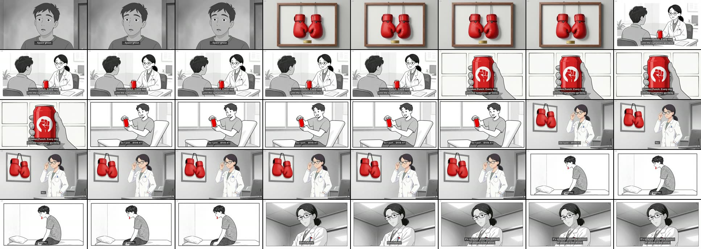

**What happened:** A worried man says "...Space ghost," apparently repeating a diagnosis the doctor just gave. A framed pair of red boxing gloves is shown. In a doctor's office, a woman in a white coat tells him to take "Hawkes Punch" every day until the symptoms go away. It is a red can with a fist logo. He holds the can and asks, "So I just... drink it?" The doctor, standing by the framed gloves, says "No." Next, the man sits on the exam table with something red hanging from his mouth and says "Oh no." The doctor, in a flat close-up, says "Don't worry. It's only just a healthy amount of people in the world." The line is odd and isn't explained.

**Who, where:** A young man with dark hair and a gray T-shirt, and a woman doctor with glasses, a ponytail and a white coat. They are in a doctor's office or exam room with a desk, an exam table, and framed red boxing gloves on the wall.

**Beats:**
- 0:40-0:41.5: The man looks stunned and says '...Space ghost.' This sets up a strange diagnosis.
- 0:42-0:43.5: Insert of framed red boxing gloves. It sets a punch motif.
- 0:43.7-0:46: The doctor smiles at her desk with a red can in front of her and says to take Hawkes Punch every day.
- 0:46-0:48: Close-up of the can in the man's hand, with a fist logo. The product is clearly shown.
- 0:48.5-0:50.5: The man holds the can, cheerful, and asks 'So I just... drink it?'
- 0:51-0:54: The doctor stands by the gloves, adjusts her glasses, and says 'No.' The expectation is reversed.
- 0:54-0:57: The man slumps on the exam table with something red at his mouth and says 'Oh no.'
- 0:57-1:00: Close-up of the doctor, who says 'Don't worry' and then a nonsensical reassurance.

**Confusions:**
- What 'Space ghost' means: a diagnosis, a symptom, or a reply to something said earlier.
- Why the boxing gloves get an insert shot at the start.
- If he doesn't drink the can, what does he do with it? The 'No' is never explained.
- What the red thing hanging from the man's mouth is. It could be a tongue, blood, or part of the can.
- The doctor's last line, 'a healthy amount of people in the world,' doesn't parse. It may be garbled or a joke about something else.
- The man's pose and location shift between shots: a chair at the desk, then an exam table.

**Jokes:**
- landed: The doctor prescribes an energy-drink-style can called Hawkes Punch, the man asks if he just drinks it, and she flatly says 'No.'
- did not land: The man says 'Oh no' with something red hanging from his mouth, which suggests the treatment went wrong.
- did not land: The doctor's deadpan reassurance, 'Don't worry. It's only just a healthy amount of people in the world.'

**Board beats:**
- MISSED c14: The retelling reports the line ('...Space ghost,' repeating a diagnosis) and calls the man 'worried,' but never says the reaction works as the punchline. Missing: that the stunned reaction itself is the joke.
- MISSED c15: No suspense is described. The retelling lists the gloves and then the cure ('take "Hawkes Punch" every day') in order, but does not say the audience's knowledge of the cure creates tension. Missing: the suspense framing.
- ok c16: 'In a doctor's office, a woman in a white coat tells him to take "Hawkes Punch" every day until the symptoms go away.' The cure and the 'every day' plant are both stated.
- ok c17: 'It is a red can with a fist logo.' The red can is named and described as a plant.
- ok c18: 'He holds the can and asks, "So I just... drink it?"' The hope that the cure is a drink is conveyed through his question, though the word 'hope' is not used.
- MISSED c19: 'The doctor, standing by the gloves, says "No."' The retelling records the reversal but never says the cure is a punch or her fist. Missing: that the cure is a punch, which turns the story.
- ok c20: 'the man sits on the exam table with something red hanging from his mouth and says "Oh no."' The distress and red object show he has realized the danger. The retelling does not name the object as the can, so this is only partly specific.
- MISSED c21: 'Don't worry. It's only just a healthy amount of people in the world.' is called 'odd and isn't explained.' The retelling reads this as nonsensical reassurance, not as a shift from hope to doom or the start of a long build. Missing: the doom turn.

### 1:00.0-1:20.0

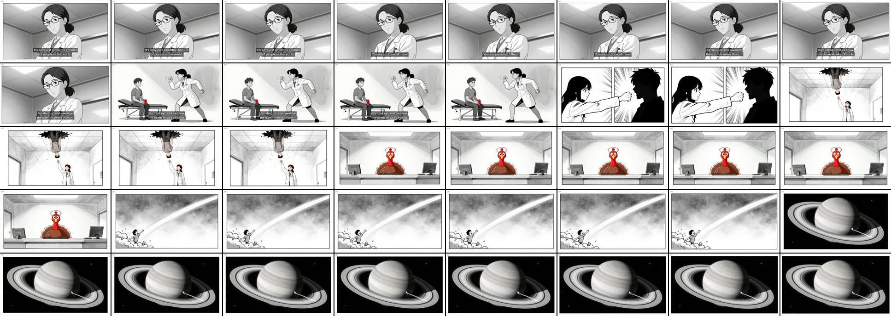

**What happened:** A woman doctor in a white coat looks unimpressed and tells someone there are only a healthy number of people in the world and he is just one of them. She then says to shut up and swallow the "Hawkes Punch". The picture cuts to her in a fighting stance beside a man sitting on an exam table holding a red object, and then to a manga-style panel of her punching a silhouetted figure. The man is launched upward and smashes into the ceiling, upside down in a burst of debris, while she stays with her fist raised. After a cut to a turkey in a nurse's cap behind a reception desk, the man flies through the sky leaving a streak and then toward Saturn. A line ends on the planet's rings, and a scream is heard around 1:12.

**Who, where:** A woman doctor with glasses and a ponytail in a white coat, in a clinic exam room. A young man in a gray shirt sits on an exam table. A turkey wearing a nurse's cap is at a reception desk. The man is later in the sky and then in space near Saturn.

**Beats:**
- 1:00: Doctor close-up, stern, saying there's a healthy amount of people in the world.
- 1:01.5: She says he's just one of them, with a small detail on her coat.
- 1:03: She says to shut up and swallow the Hawkes Punch.
- 1:04.5: Wide shot: she takes a fighting stance beside the seated man holding a red object.
- 1:06.5: Manga-style punch panel with speed lines hitting a silhouetted figure.
- 1:07.5: The man hits the ceiling upside down, shattering it, while she stands with her fist up.
- 1:10: Cut to a turkey in a nurse's cap at the reception desk, held for a few seconds.
- 1:12.5: The man is flying through clouds with a streak trailing behind, and a scream is heard.
- 1:16: Saturn, with a line ending at its rings, held to the end.

**Confusions:**
- The red object the man holds is unclear; it might be the Hawkes Punch, which is also the punch.
- The turkey receptionist appears with no setup or link to the rest.
- The jump from ceiling impact to turkey to sky to Saturn is abrupt. The man seems to keep flying through the roof and out into space, but this isn't shown.
- The scream line at 1:12 plays over the turkey or sky shots, and I couldn't tell who was screaming.
- The last 7 seconds hold on a static Saturn, so the ending is hard to read.

**Jokes:**
- landed: A deadpan doctor tells a patient he's just one of many people, then punches him with the 'Hawkes Punch' and sends him through the ceiling.
- landed: A turkey in a nurse's hat at the front desk appears as a non sequitur.
- landed: The patient is launched all the way to Saturn, an absurd escalation.
- did not land: The long static hold on Saturn as a final beat.

**Board beats:**
- MISSED c21: Missing. The retelling covers only 1:00-1:20 and says nothing about the 0:57.5 hope-to-doom turn or the build-up that precedes it. The doctor's stern opening is described, but no shift in mood is identified.
- ok p01: "The picture cuts to her in a fighting stance beside a man sitting on an exam table holding a red object." Both characters are in one frame and their positions are clear.
- ok p02: "a manga-style panel of her punching a silhouetted figure" followed by "The man is launched upward and smashes into the ceiling." The punch resolves the confrontation in a single beat, which the viewer captures.
- ok p03: "She then says to shut up and swallow the 'Hawkes Punch'" sets up the cure, and "while she stays with her fist raised" shows her owning the action. The viewer does not explicitly say the cure was administered, but the sequence is clearly conveyed.
- ok p04: "After a cut to a turkey in a nurse's cap behind a reception desk" records the mundane counterpoint to the epic event. The viewer does not describe it as a laugh or comic deflation, so the tonal payoff is only partly conveyed, but the element itself is present.
- ok p05: "the man flies through the sky leaving a streak and then toward Saturn." The viewer describes one continuous move from the clinic to space with no cut between them.
- MISSED s01: Missing. "A line ends on the planet's rings, and a scream is heard around 1:12." The viewer never mentions the scale contrast (Saturn's real size versus the man as a speck), and the sound dropping to silence is not described. Only the scream is noted.

### 1:20.0-1:40.0

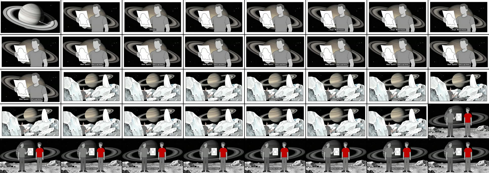

**What happened:** A man in a grey t-shirt holds up a drawing of a ghost against a big ringed planet backdrop. It's silent, then he says there's no music and wants more. He realizes he's in space and says "She's up here," meaning the ghost. The view cuts to a rocky icy surface with a white ghost-shaped figure standing on a rock in front of the planet, and the man crouching with his paper. He says "Space ghost?" Then the shot cuts wide to two men on a moon surface, one in grey holding the ghost drawing and one in a red shirt. They argue: "That's a sheet," "She has a vibe."

**Who, where:** A man in a grey t-shirt, and later a second man in a red t-shirt. They are in space, on a rocky moon or asteroid surface with a ringed planet (Saturn-like) behind them. The ghost is a white sheet-like figure.

**Beats:**
- 1:20.0: Wide shot of a ringed planet with an arrow pointing at the ring.
- 1:20.5: Man holds ghost drawing against the planet; 'Silence.' is heard.
- 1:22.5: He says 'Nope. More music.' Static pose.
- 1:24.5: Camera shifts slightly; he says 'Wait. Space... She's up here.'
- 1:27.0: Cut to rocky surface: man crouched with paper, a white ghost figure stands on a rock near the planet.
- 1:29.8: 'Space ghost?' said over the held shot.
- 1:34.0: Cut to wide shot of two men on a moon surface, one in red, the ghost drawing held between them.
- 1:36.3: 'That's a sheet.'
- 1:38.0: 'She has a vibe.' Same static framing.

**Confusions:**
- Unclear how the man got from a stylized planet backdrop to the rocky surface; it seems the first scenes are a conceptual or abstract space.
- Where the red-shirted man came from is not shown; he just appears in the wide shot.
- Who says each line is not certain, though the 'sheet' line likely belongs to the red-shirted man.
- The ghost figure on the rock vs. the paper drawing: unclear whether it is real or imagined.

**Jokes:**
- landed: 'Silence.' then 'Nope. More music.' as a meta gag about missing score
- landed: 'Space... She's up here.' realization that the ghost is in space
- landed: 'Space ghost?' with a white sheet figure on a rock
- landed: 'That's a sheet.' / 'She has a vibe.' deadpan argument over the ghost drawing

**Board beats:**
- MISSED s02: Partly covered. The retelling captures the payoff: "It's silent, then he says there's no music and wants more." It does not convey the goal of finding her. "She's up here" reads as a discovery of her location, not a stated aim to look for her, so the 'He gets a goal: find her' half is missing.
- MISSED s03: Not covered. The retelling notes the cut to "a white ghost-shaped figure standing on a rock" with the man crouched with his paper, and he says "Space ghost?", which suggests he has noticed her. It never conveys that the audience sees her while he doesn't, and it never mentions him being found by the wrong figure.
- ok s04: Covered. The retelling has "two men on a moon surface, one in grey holding the ghost drawing and one in a red shirt," followed by "That's a sheet," which implies the ghost is a double, and "She has a vibe." The second man's arrival is the company he didn't ask for. The retelling does not explicitly frame it as a broken rule of three.

### 1:40.0-2:00.0

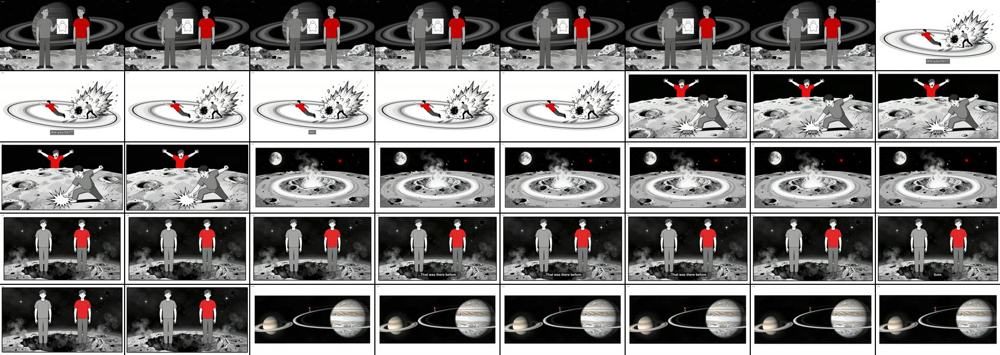

**What happened:** Two figures stand on a moon in front of a ringed planet. One holds up a paper with a ghost drawing on it. Then a comic-style scene shows the figure in the red shirt flying through the air by a ring while a grey figure is at a big explosion, with the line "Are you her?!" and "No!". Next, the grey-shirted one on a cratered surface lunges at a starburst while the red-shirted one pops up behind with arms spread, yelling "BOO!" The grey one yells "Aah!", so it looks like a prank scare. A crater with steam is shown, then the two stand in front of a smoking crater. One says "...That was there before." and the other says "Sure." The last shot is a wide view of Saturn and Jupiter with a tiny red figure walking on a ring between them.

**Who, where:** Two young people, one in a grey shirt and one in a red shirt, on a moon or asteroid surface with a big ringed planet behind them. At the end, the red figure is tiny on a ring between Saturn and Jupiter.

**Beats:**
- 1:40: The two figures stand on the moon and one holds up a ghost drawing. The shot barely changes for several seconds.
- 1:43.5: Cut to a white-background comic scene. One figure flies through the air near an explosion with a ring around it, and the captions say 'Are you her?!' and 'No!'
- 1:46.5: On the cratered surface, the grey one lunges at a starburst while the red one pops up behind with arms out, shouting BOO. The grey one yells 'Aah!'
- 1:49: Wide shot of a steaming ringed crater under a moon and a red dot, which looks like the aftermath.
- 1:51.5: The two stand calmly before a smoking crater. One says 'That was there before' and the other says 'Sure.'
- 1:55.5: Cut to a realistic view of Saturn and Jupiter with a tiny red figure on a ring between them, which changes the scale and the location.

**Confusions:**
- The 'Are you her?!' and 'No!' lines come over a white-background explosion scene. I couldn't tell who is speaking or who 'her' is.
- The ghost drawing is never explained. I assume it is a scare or prank prop.
- I couldn't tell whether the explosion and crater were caused by the scare or were an earlier event.
- 'That was there before' has no clear referent. It probably refers to the crater.
- The jump to the tiny figure on a ring between Saturn and Jupiter has no setup.

**Jokes:**
- landed: The red-shirted one jumps out and shouts BOO, and the grey one recoils with 'Aah!'
- landed: The two stand beside a smoking crater and one deadpans '...That was there before.' and the other says 'Sure.'
- did not land: The over-the-top comic explosion with 'Are you her?!' and 'No!'

**Board beats:**
- MISSED s04: The retelling starts at 1:40, after the s04 change (1:35.3). It notes 'Two figures stand on a moon' and a ghost drawing, but never conveys that the second figure is a double, that the rule of three is broken, or that he has unwanted company. Missing.
- MISSED s05: 'Are you her?!' and 'No!' hint at questioning, but the retelling never says he is trying to catch the double for an answer, and it says nothing about the two being evenly matched in strength. The flying/explosion scene is described without any parity. Missing.
- MISSED s06: The viewer reads the grey one's 'Aah!' as 'a prank scare' and notes 'A crater with steam is shown,' but never links the flinch to accidentally cracking or cratering the moon. The power-by-accident idea is missing.
- ok s07: At 1:49: 'Wide shot of a steaming ringed crater under a moon and a red dot, which looks like the aftermath.' This captures the shift from the figures' faces to a tiny red figure set against a large world.
- ok s08: At 1:51.5: 'The two stand calmly before a smoking crater. One says That was there before and the other says Sure.' The calm reaction to a large aftermath is recorded. The viewer doesn't state the contrast outright, but the substance is present.
- MISSED s09: At 1:55.5: 'a realistic view of Saturn and Jupiter with a tiny red figure on a ring between them.' Jupiter and Saturn are named, but nothing says a planet is coming or that the stakes escalate. The escalation is missing.

### 2:00.0-2:20.0

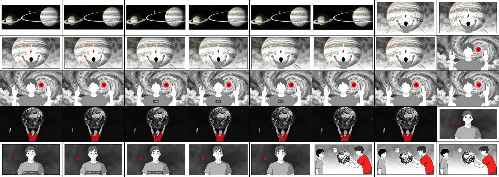

**What happened:** A tiny figure floats in space between Saturn and Jupiter, then we cut to a boy with his arms raised in front of a huge Jupiter, a red lightning-like mark above him. Next he is in close-up in a swirling storm of clouds with raised open palms and a red spot by his head, and he says "Okay." Then we see a figure in red holding the Earth overhead against black space, while a small pale figure drifts at left. The red figure says "Hey" and "What." A sad, teary boy with a red dot beside him says "People live there." Finally a boy in red hands or holds the Earth toward a dark-haired boy, with the moon nearby, as if showing or giving it to him.

**Who, where:** A boy in a gray T-shirt (dark hair, one eye with a tear or blue glint) and a boy in a red shirt, in outer space among Jupiter, Saturn, Earth and the Moon. The setting is a cosmic, stylized, mostly grayscale space with red accents.

**Beats:**
- 2:00: A tiny figure sits in the ring or orbit between Saturn and Jupiter. The scale is established, and the shot holds for 3 seconds.
- 2:03: Cut to a boy with raised arms before a giant Jupiter and a red bolt. The shot holds a long time.
- 2:07: Close-up in a cloud vortex: the boy with palms up and a red spot. He says 'Okay.' at 2:08.8.
- 2:12: Cut to a red-shirted figure holding the Earth overhead, with a small figure far off. 'Hey.' at 2:12.8 and 'What.' at 2:14.1.
- 2:15: Cut to a close-up of the gray-shirt boy with a tear and a red dot. 'People live there.' at 2:15.8.
- 2:17: Cut to a new, brighter shot of a red-shirt boy offering the Earth to a dark-haired boy, with the Moon above.

**Confusions:**
- Is the red-shirt figure the same character as the gray-shirt boy, or a different one?
- What the red lightning mark and the red dot mean (a power, a presence, or a character?).
- Why he is holding the Earth up, and whether he is giant or the Earth is small.
- Who the tiny floating figure beside the Earth is.
- Who says each line, since the captions have no speaker labels.
- Who 'People live there' is addressed to, and whether it is a warning.
- The last scene's relation to the earlier ones: it may be a different moment or a new character.

**Jokes:**
- landed: A casual 'Hey.' and 'What.' while someone holds up the whole Earth, which reads as deadpan understatement.
- landed: 'People live there.' said flatly with a teary face, as a deadpan reaction to the Earth being handled carelessly.

**Board beats:**
- MISSED s09: Storyboard time 1:56.8 falls before the viewer's watched window (2:00.0-2:20.0), so the retelling cannot show this escalation. Nothing about a planet coming appears in the retelling.
- MISSED s10: The retelling records the 2:03 shot as 'a boy with his arms raised in front of a huge Jupiter, a red lightning-like mark above him.' It does not describe a planet being caught or a hit landing, so the finisher's substance (biggest hit, planet caught) is missing.
- MISSED s11: The retelling notes 'raised open palms and a red spot by his head, and he says "Okay."' The flat 'Okay' is present, but the viewer never describes him as unimpressed, and nothing says the double has to go bigger. Only the line is captured, not the payoff.
- MISSED s12: At 2:12 the retelling shows 'a figure in red holding the Earth overhead' with 'Hey' and 'What.' Nothing indicates that the pattern of three breaks or that he stops this time. The change is missing.
- MISSED s13: The retelling quotes 'People live there' from a 'sad, teary boy with a red dot beside him,' which is the literal-minded line. However, it never says the line stops the game, and the 'Hey'/'What' reaction is not tied to any halt. Only the dialogue is present; the stopping of the game is not conveyed.
- MISSED s14: The retelling says a red-shirt boy 'hands or holds the Earth toward a dark-haired boy, with the moon nearby, as if showing or giving it to him.' The giving gesture is there but hedged, and the viewer does not identify rivals, a truce, or a careful set-down as the joke.

### 2:20.0-2:40.0

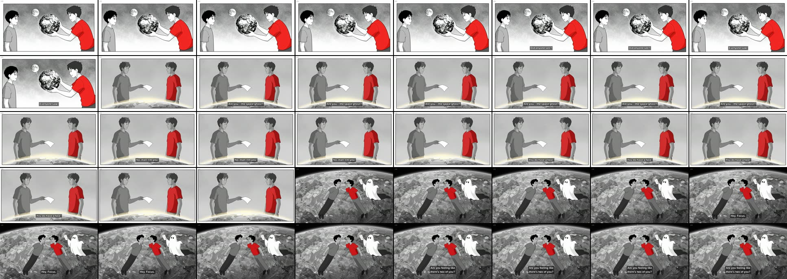

**What happened:** A boy in a red shirt holds a glowing, detailed Earth in his hands while a small moon floats beside it, and a boy in gray looks on. Captions suggest someone worries about being seen, then admits everyone saw. The scene cuts to the two boys facing each other in front of the curved Earth horizon. The gray boy holds out a piece of paper and asks if the red-shirted one is the "space ghost." The red boy says "No, man, I'm you," and the gray boy notes he does have a face. In the last shot they float in orbit above Earth with a cartoon white ghost holding the paper. The red boy tells the gray one to focus and asks if he feels like there are two of him.

**Who, where:** Two boys, one in a gray shirt with black hair and one in a red shirt with dark hair, who may be two versions of the same person since the red one says "I'm you." A cartoon white sheet-style ghost appears at the end. They start in a blank gray void with a globe and moon, then stand against Earth's horizon, then float above Earth from orbit.

**Beats:**
- 2:20: The red boy holds the glowing Earth with the moon nearby while the gray boy watches.
- 2:22: 'Did anyone see?' is asked, then 'Everyone saw.' at 2:23.
- 2:24: Cut to the boys facing each other against the Earth horizon, with the gray boy holding out a paper.
- 2:25: The gray boy asks if the red boy is the space ghost.
- 2:28: The red boy says he is the gray boy's double. The gray boy answers 'You do have a face.' at 2:30.
- 2:32: Cut to the boys and a white ghost floating above Earth, with the ghost holding the paper.
- 2:35: 'Hey. Focus.' tells the gray boy to snap out of it.
- 2:37: 'Are you feeling like there's two of you?' ends the stretch on a question.

**Confusions:**
- The red boy's character design changes between the first shot (sharper, anime style) and the later shots (more realistic, tanner), so it is unclear if he is the same character.
- It is unclear who says 'Did anyone see?' and 'Everyone saw.' or what they saw.
- The paper's origin is unexplained; it appears in the gray boy's hand and then in the ghost's.
- The ghost appears abruptly with no setup, and the red boy is not the ghost, so who the ghost is remains unclear.
- It is unclear how they went from standing to floating in orbit.
- The gray boy seems to change from solid to semi-transparent between shots.

**Jokes:**
- landed: 'Did anyone see?' answered flatly by 'Everyone saw.' as the boy holds the Earth like a stolen object.
- landed: 'Are you... the space ghost?' answered with 'No, man. I'm you.'
- did not land: 'You do have a face.' is a deadpan reply to the claim that the red boy is the gray boy.
- landed: The cartoon ghost silently appearing in the orbit shot while the boys talk about there being two of them.

**Board beats:**
- MISSED s14: Missing. The retelling describes the red boy holding the glowing Earth while the gray boy watches, but never shows a rivalry turning into a truce and never mentions a careful set-down as a joke. The relationship is described only as 'two versions of the same person' and a 'double'.
- MISSED s15: Partly touched, not covered. The gray boy holds out a paper, and the 'You do have a face' exchange at 2:30 sits near the 'she doesn't have a face' payoff. But the retelling never identifies that setup, never describes a shift from lonely to not alone, and never says the drawing is released. It treats the paper as a plain prop.
- MISSED s16: Missing. The retelling says a 'cartoon white ghost holding the paper' appears above Earth at 2:32, but it never says the ghost is addressing the audience, never says the story turns into an advertisement, and never names a product or brand. The ghost is recorded only as a character.

### 2:40.0-3:00.0

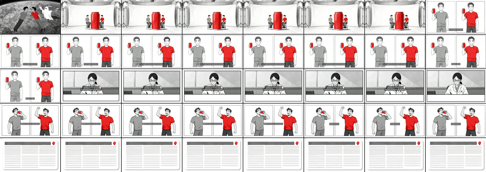

**What happened:** This looks like a parody ad for a red canned drink. It opens in a space-like shot with two men and a ghost floating over Earth, while a voice asks if you feel like there are two of you. The scene then cuts to a studio with two men sitting on stools beside a giant red can. The same two men, one in gray and one in red, each hold up a can and ask whether it's right for them. They are told it's right for everyone like them, and the red man says "That's me!" A woman in glasses and a white coat says she has prescribed it to a healthy amount of people. The men drink the can, and one says it tastes like a fist and then "a good fist" while the other raises a clenched fist. The clip ends on a newspaper-like page with small print and a red fist logo, with a voice rattling off side effects.

**Who, where:** Two men who look alike, one in a gray shirt and one in a red shirt. The gray one may be a desaturated double of the red one. A ghost appears briefly in the opening shot. A woman with glasses and a ponytail in a white coat sits at a desk, apparently a doctor. Settings are above Earth, a white studio with lights and a giant red can, blank white panels, a doctor's office, and a page of fine print.

**Beats:**
- 2:40: Opening shot of two men and a ghost floating above Earth, in grayscale with red accents.
- 2:40.5: Cut to a studio where the two men sit on stools beside a giant red can. This holds for about 3 seconds.
- 2:43.5: Split panel: both men hold up cans and ask 'Is it right for me?'
- 2:45: A voice answers that it's right for everyone like you, and the framing stays the same.
- 2:47: The red man says 'That's me!'
- 2:48.5: Cut to the woman doctor, who says she has prescribed it to a healthy amount of people. At the end she shifts pose.
- 2:52: The gray man drinks and says it tastes like a fist, while the red man raises a fist.
- 2:54.3: The line is corrected to 'A good fist.'
- 2:56: A fine-print page with a red fist logo appears while a voice reads out side effects.

**Confusions:**
- Why the two men are one gray and one red, and whether they are meant to be two versions of one person.
- Why the ghost appears and floats in space in the first frame.
- The opening line about feeling like there are two of you is heard before this stretch, so the setup is missing.
- The drink seems to be marketed as medicine, but what it is or does isn't clear.
- The fist logo and the fist taste are not explained.
- Frames stay almost identical for long periods, so it's hard to tell who speaks each line.

**Jokes:**
- landed: 'Tastes like a fist!' followed by the correction 'A good fist.' while the red man pumps his fist
- landed: The doctor says she has prescribed it to 'a healthy amount of people', a vague, unreassuring claim in the style of a drug ad
- did not land: 'It's right for everyone like you' and 'That's me!', mocking ad targeting
- did not land: Fine print page with a voice listing side effects, a drug-ad parody

**Board beats:**
- ok a01: Retelling opens: "This looks like a parody ad for a red canned drink." The viewer identifies the clip as a commercial from the start, though "looks like" hedges it.
- ok a02: Retelling: "The same two men, one in gray and one in red, each hold up a can and ask whether it's right for them," and "the red man says 'That's me!'" Both men are shown as the pitchmen, and the WHO section notes the gray man may be a double. The viewer does not explicitly link the opening "two of you" line to the double being the spokesman, so this is covered only in substance.
- MISSED a03: Retelling quotes the line: "A woman in glasses and a white coat says she has prescribed it to a healthy amount of people." Missing: the payoff that she never looks up. The retelling does not mention her gaze or why the line lands as a payoff. The WHO section says she "sits at a desk" but does not note she never looks up.
- ok a04: Retelling: "The men drink the can, and one says it tastes like a fist and then 'a good fist' while the other raises a clenched fist. The clip ends on... a red fist logo." The viewer links the can to the fist through taste and the fist logo on the fine print.
- MISSED a05: Retelling: "The clip ends on a newspaper-like page with small print and a red fist logo, with a voice rattling off side effects." Missing: the viewer never says the side-effects list recaps everything shown (the ghost, the doubles, the fist). The list is described only as side effects.

### 3:00.0-3:20.0

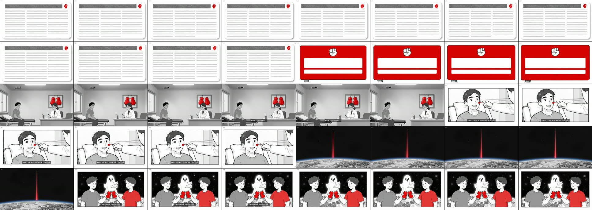

**What happened:** The first six seconds are a still newspaper-style page with a small red fist logo, then a red card with a white fist and blank text boxes. We cut to a doctor's office where a man sits on an exam table across from a woman in a white coat. Red boxing gloves hang on the wall behind her. She asks "Any symptoms?" and he starts to say he met someone. In a close-up he smiles while a hand reaches in and touches or swabs his nose, which has a red dot on it. Then we cut to a dark view of a planet's curved horizon with a red beam shooting up from it. The last shot shows a gray boy, a glowing ghost holding a paper, and a boy in a red shirt. They hold red cups or gloves together over the planet, and someone asks "Same time tomorrow?"

**Who, where:** A young man in a gray shirt and a woman doctor in a white coat, in a clinic with an exam table and boxing gloves on the wall. Later, a gray-shirted boy, a white ghost and a red-shirted boy in space above a planet. A red beam rises from the planet.

**Beats:**
- 3:00-3:06: Static newspaper page with a red fist logo. Nothing moves.
- 3:06-3:08: Cut to a red card with a white fist and blank text boxes.
- 3:08-3:11: Cut to the clinic. The man sits on the table and the doctor sits at her desk. She asks 'Any symptoms?'
- 3:11-3:14: Close-up of the man smiling, saying he met someone, as a hand touches his nose.
- 3:14-3:18: Cut to a black space shot of a planet horizon with a red beam rising.
- 3:18-3:20: Cut to the boy, ghost and red-shirted boy clinking red items over the planet. 'Same time tomorrow?'

**Confusions:**
- The newspaper and red fist cards are static and carry no readable text, so their meaning is unclear.
- It's unclear how the clinic scene connects to the space scene with the beam and the ghost.
- The red dot on the man's nose is unexplained. It could be a symptom, a swab, or a clown nose.
- I can't tell who says 'Same time tomorrow?' or whether the ghost is the 'someone' he met.
- The gray boy and the man in the clinic look similar, so I can't tell if they are the same person.
- The red cups or gloves in the final shot are ambiguous. They may echo the boxing gloves.

**Jokes:**
- did not land: Doctor asks 'Any symptoms?' and the patient answers by talking about meeting someone, with a red nose dot and a grin, which suggests an infection or romance gag.
- did not land: The boxing gloves hung like art in a doctor's office, and the red-fist motif recurring in the cards and the gloves.
- landed: Ghost and two boys toasting with red cups or gloves, then 'Same time tomorrow?' as a casual hangout line.

**Board beats:**
- MISSED a05: Missing: the retelling never describes a recap or list of the earlier footage. Its only reference to the newspaper page and red fist logo is the opening, and it does not frame anything as a list of prior material. The a05 change falls at 2:55.8, before the 3:00-3:20 window the viewer watched, so the viewer could not have seen it.
- MISSED a06: The retelling records the opening 'still newspaper-style page with a small red fist logo' and later 'a red card with a white fist and blank text boxes', but never says either one pays off. Nothing connects the poster to a later moment, so the payoff did not register.
- MISSED b01: Missing: 'every day' is never mentioned. The retelling has no text, phrase, or idea of daily or recurring action at the 3:07.8 moment.
- MISSED b02: Partly present: the retelling has 'She asks "Any symptoms?" and he starts to say he met someone', which gives the symptom question and answer. Missing: the edge of the frame hiding the punch is never mentioned, and the retelling never states that he has a new symptom as a payoff. Only one half of the beat registers.
- MISSED b03: Missing at 3:13.8: the retelling says nothing about the setting staying the same or a repeated 'same time, same place' idea during the close-up. 'Same time tomorrow?' appears only at the end, in the 3:18-3:20 segment, so it does not cover this beat.
- MISSED b04: Missing: the retelling mentions 'a glowing ghost holding a paper' and 'red cups or gloves together' but never says the daily dose is a friend and never mentions the ghost waving at the audience. The ghost is noticed, but the change is not.

### 3:20.0-3:24.3

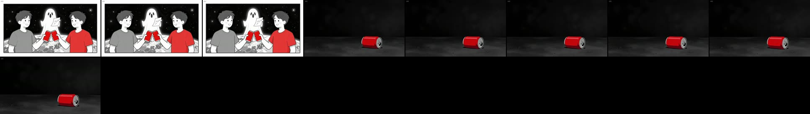

**What happened:** For the first 1.5 seconds we see a still, black-and-white drawing of two boys and a ghost on a moon-like surface under a starry sky. The boys, one in gray and one in red, clink red cans together. The ghost floats between them holding a piece of paper. After that the film cuts to a dark, empty gray surface with a single red can lying on its side. The can doesn't move for the rest of the stretch. There is no sound and no dialogue.

**Who, where:** Two boys, one in a gray shirt and one in a red shirt, and a white ghost holding a paper. They are on a cratered, moon-like surface with stars behind them. Then a lone red soda can on a dark gray ground.

**Beats:**
- 3:20.0-3:21.0: A still tableau shows the boys clinking red cans with the ghost between them holding paper. It reads as a celebratory or friendly moment.
- 3:21.5: Hard cut to a dark, empty ground with one red can lying on its side. The mood changes from warm and populated to lonely and bleak.
- 3:22.0-3:24.3: The can stays still in the same framing with nothing else happening. This holds as a lingering, silent beat.

**Confusions:**
- The ghost's paper is unclear: is it a note, a contract, or a photo?
- It's unclear whether the can is one of the cans from the toast, and why it's alone now.
- I couldn't tell whether the first image is a memory, a photo, or a live scene, since it looks frozen.
- I couldn't tell where the can is, or what the quiet shot is meant to say, such as loss or aftermath.
- There is no audio, so the mood is hard to read.

**Jokes:**
- did not land: A ghost joining two kids in a toast, with a lone can left behind afterward, may be a quiet gag or a sad beat.

**Board beats:**
- MISSED b04: Not covered. The storyboard's b04 is at 3:16.3, which is before the viewed stretch (3:20.0-3:24.3), so the retelling cannot cover it. The retelling also does not mention the ghost waving at the audience or the idea of the daily dose being a friend. The ghost only 'floats between them holding a piece of paper.'
- MISSED b05: Partially close but not covered. At 3:21.5 the retelling says 'the film cuts to a dark, empty gray surface with a single red can lying on its side,' and it identifies the can as a 'red soda can' in the WHO/WHERE section. However, the viewer frames this shot as a mood shift to 'lonely and bleak' and never says the can is the product or that a product name or brand reads. The storyboard change is that the last image is the product, and the retelling does not make that point. Missing: the product's name or brand, and any sense that the final image is a product shot.

