# Cold view 4: animatic.mp4

Automatic (mv make, 2026-11-09T00:02): 11 chunks of 20 s at 2 fps contact strips, each retold blind by claude-sonnet-5-5 with the captions and lines heard, then each board "change" beat judged against the retelling by claude-haiku-5-5. Vision $0.19.

## Verdict

**34 of 53 board beats did not get across.**

- c01 (0:00.0, chunk 1): "The place and the product. Plants: the poster, the turkey.". Place and turkey are covered: "A grey waiting room... A turkey in a nurse's cap sits behind it, under a blank red sign." The product is not covered. The red sign is called "blank," and no product name or brand is given anywhere in the retelling.
- c03 (0:06.5, chunk 1): "Plant: the product's name and the tagline.". The red sign is noted as "blank" and then "becomes a clenched-fist icon," but the product's name and tagline never appear. The fist is described only as an icon, not tied to any product.
- c09 (0:24.5, chunk 2): "Symptom 2. The scene turns personal.". Missing. The retelling skips the 0:24 shift: the red rectangle on the wall and the man looking down, subdued. It only notes that he 'then confesses' at the love line, so the turn to something personal is not shown at 0:24.5.
- c10 (0:28.5, chunk 2): "Symptom 3. The first crack in her calm.". Partly. The retelling includes the line "in love, with a ghost, in space," but nothing about the woman's first crack in composure. It says only that she 'listens and takes notes' and later 'repeats flatly,' so her reaction at 0:28.5 is not conveyed.
- c11 (0:30.0, chunk 2): "The pause.". Missing. Nothing in the retelling describes the pause or the stunned reaction in the gray panel grid at 0:30. Her stunned look is never mentioned.
- c15 (0:41.5, chunk 3): "Suspense: the audience now knows what the cure is.". The retelling says 'A framed pair of red boxing gloves is shown' at the gloves cut, but says nothing about the audience now knowing the cure. The cure is first named only later, at the desk scene ('take Hawkes Punch every day'), so the suspense shift at 0:41.5 is missing.
- c19 (0:51.0, chunk 3): "Turn begins (-): the cure is her fist.". 'The doctor, flatly says "No."' The flip is noticed, but the retelling never says the cure is her fist. The 'fist logo in a hand' is attributed to no one, so the link between the doctor and the fist cure is missing.
- c20 (0:55.0, chunk 3): "He finally sees the bomb.". 'The man sits on the table with a red thing hanging from his mouth and says "Oh no."' The reaction is there, but the 'red thing' is never identified as a bomb, so the realization of the bomb is only inferred, not stated.
- c21 (0:57.5, chunk 3): "Turn (-): hope to doom. The long build begins.". 'Don't worry. It's only just a healthy amount of people in the world.' The retelling notes the line is deadpan and nonsensical but does not state the shift from hope to doom or any sense of a long build toward it.
- p04 (1:09.3, chunk 4): "The free laugh: the mundane reaction to the epic event.". "Next comes a cut to a turkey in a nurse's cap behind a reception desk." The turkey is named, but nothing is said about its static, unbothered reaction or that it reads as a gag. The mundane-versus-epic contrast is missing.
- s01 (1:15.3, chunk 4): "World rule: planets are real size, a man is a speck. Sound to silence.". "the streak ends at Saturn, where a scream is heard." The retelling never says the planet is real-size or that the man is a speck against it. The scream also implies sound continuing, not a switch to silence. Missing: the scale relation and the sound-to-silence change.
- s03 (1:28.3, chunk 5): "Suspense: we see her, he doesn't. Then he is found, by the wrong one.". The retelling gives part of the suspense: "a white ghost-like shape standing on a rock" is visible while "he looks at the drawing," and he then asks "if it is a space ghost," so he apparently doesn't see her. It omits that he is found, and found by the wrong man. The retelling has no one finding him in that stretch. The cut to the two men at 1:34 is reported as a change of scene, not as him being discovered. The 'found by the wrong one' half of the change is missing.
- s04 (1:35.3, chunk 5): "Rule of three broken: not the ghost, a double. He has company he didn't ask for.". The retelling records "two men on a moon surface, one holding the ghost drawing" and "the one in the red shirt says it's just a sheet." It shows a second man present and dismissing the ghost. It does not say the red-shirt man is a double or stand-in for the ghost, and it does not note the broken rule of three or that he is unwanted company. Those substance points are missing; only the bare presence of a second man is conveyed.
- s05 (1:43.3, chunk 6): "His goal: catch him for an answer. He is as strong as the double.". Missing. The retelling notes 'Are you her?!' and 'No!' but never says the gray figure is trying to catch the red figure for an answer, and says nothing about the red figure being as strong as the double.
- s06 (1:46.3, chunk 6): "Power by accident: his flinch cracks a moon.". Not shown as a cause. The retelling links 'BOO!' and 'Aah!' to 'A crater with smoke and steam is shown,' but never says the flinch cracked the moon. The 'That was there before' line is reported without the accidental-power point.
- s07 (1:48.8, chunk 6): "The scale cut: face to a dot against a world.". Missing. The retelling skips the wide shot with the tiny red dot against the moon at 1:49. It only says 'the two stand beside' the crater, and the only wide shot it describes is the final one at 1:57.
- s08 (1:51.8, chunk 6): "The bigger the feat, the smaller the reaction.". Not conveyed as a contrast. The retelling reports the deadpan lines ('...That was there before' / 'Sure.') and says the two 'stand beside' the crater, but never connects the size of the feat to the muted reaction.
- s09 (1:56.8, chunk 6): "Escalation 3: a planet is coming.". Missing. The retelling ends with 'a tiny red figure walking along a ring between Saturn and Jupiter' but never says a planet is coming or that the stakes escalate.
- s10 (2:02.8, chunk 7): "The finisher: the biggest hit in the film, a planet caught.". Not covered. The retelling shows a tiny red figure between Saturn and Jupiter (2:00) and a boy with raised arms before Jupiter (2:03), but never describes a planet being caught or a big hit landing. The 'finisher' change is missing.
- s11 (2:07.3, chunk 7): "Payoff hold: he is unimpressed. The double has to go bigger.". Partly covered at most. The retelling has the boy in the storm with palms out and says 'Okay.' (2:07-2:08.8), which hints at a flat, unimpressed reaction. But it never says he is unimpressed, and nothing about a double or a bigger second move. The 'double has to go bigger' substance is missing.
- s12 (2:11.8, chunk 7): "The rule of three breaks: this one he stops.". Not covered. The retelling notes 'Hey' and 'What' and a floating figure at left (2:12-2:14), but does not show a rule of three or the boy stopping a pattern. The change that this time he stops is missing.
- s13 (2:15.3, chunk 7): "Absurd literal-mindedness stops the game.". Not covered. The retelling records 'People live there' with a tear (2:15.8), but does not show the game being halted by literal-mindedness. It reads as an emotional line, not a literal-minded stop. The change is missing.
- s14 (2:18.3, chunk 7): "Turn: rivals to truce. The careful set-down is the joke.". Partly covered. 'It looks like he is handing the planet over or showing it to him' (2:17.5) gestures at a handover, but the viewer is hedged and never names rivals or a truce, and does not register the careful, slow set-down as the joke. Substance largely missing.
- s15 (2:24.3, chunk 8): "Turn (+): lonely to not alone. Payoff of 'she doesn't have a face'. The drawing released.". The retelling has the gray boy holding out a slip of paper and the line 'You do have a face,' but never describes a turn from lonely to not alone, and never links the face line to a setup like 'she doesn't have a face.' The paper is held out, not described as a drawing being released. The retelling itself calls the 2:32 shift 'unexplained,' so the turn did not come across. Missing: the lonely-to-not-alone shift, the 'she doesn't have a face' payoff, and the drawing's release.
- s16 (2:33.3, chunk 8): "The ghost pays off for us, not him. The story becomes the ad.". The retelling mentions 'A cartoon white ghost holding a paper floats beside them,' so the ghost is noticed. But it is described as 'a new image and an unexplained shift,' with no sense that the ghost pays off for the audience rather than the gray boy, and no mention of an advertisement, product, or brand. Missing: the ghost as a payoff for viewers and the story turning into an ad.
- a02 (2:43.3, chunk 9): "Payoff: the double was the spokesman all along.". The retelling says "the two men are shown side by side, each holding up a can" and "an announcer says it's right for everyone like them," but never says the double is the spokesman. The two men are only described as looking alike, with no link made between the double and the pitch.
- a03 (2:48.3, chunk 9): "Payoff: 'healthy amount of people'; she never looks up.". The retelling says "A woman doctor in a white coat says she has prescribed it to 'a healthy amount of people.'" The phrase is captured, but the payoff depends on her never looking up, and the retelling does not mention her gaze or lack of it. Her pose shift is noted only in the beat list.
- a05 (2:55.8, chunk 9): "The list is everything we just saw.". The retelling says "a voice rushing through side effects" over a newspaper-style page with a fist logo. It never says the rushed list recaps everything shown earlier, so that payoff is missing.
- a06 (3:05.8, chunk 10): "Payoff of the poster.". The retelling mentions the poster-like items only as set details: the newspaper page with a red fist logo 'held for about 6 seconds' and 'a framed pair of red boxing gloves' on the doctor's office wall. It never says that anything pays off, so the payoff of the poster is missing.
- b01 (3:07.8, chunk 10): "Payoff: 'every day'.". No mention of 'every day' or any idea of daily repetition. The only repetition cue is the closing line 'Same time tomorrow?', which does not show the 'every day' payoff.
- b02 (3:10.8, chunk 10): "The edge of the frame hides the punch. Payoff: he has a new symptom.". The viewer describes 'the doctor's arm holds a red-tipped swab or stick to his nose or cheek while he smiles' but does not note that the frame edge hides a punch, and does not say he has a new symptom. The 'Any symptoms?' exchange is recounted, but its payoff is not stated.
- b03 (3:13.8, chunk 10): "Same time, same place.". The viewer quotes 'Same time tomorrow?' at the end, but places the black space scene and the ghost scene as different settings ('The setting appears to be space or a planet's surface'). Nothing notes that the time and place repeat, so the 'same time, same place' change is not conveyed.
- b04 (3:16.3, chunk 10): "Payoff: the daily dose is a friend. The ghost waves at the audience.". The ghost is described as 'holding paper' and standing 'between two boys' with 'red cups or gloves held together'. There is no ghost waving at the audience, and no mention of the daily dose being a friend.
- b05 (3:21.3, chunk 11): "The last image is the product.". The retelling shows the final image at 3:21.5-3:24.3 as 'a single red can lying on its side' in a 'dark, empty, gloomy space' and says the mood 'shifts to lonely and empty.' It never names a brand or product, and never says the can is a product or that the can is what the shot is presenting. The earlier red cans are described only as things the boys clink in a toast. What is missing is the identification of the last image as the product, such as a brand name, logo, or the viewer stating that the can is the advertised item.

## Chunk by chunk

### 0:00.0-0:20.0

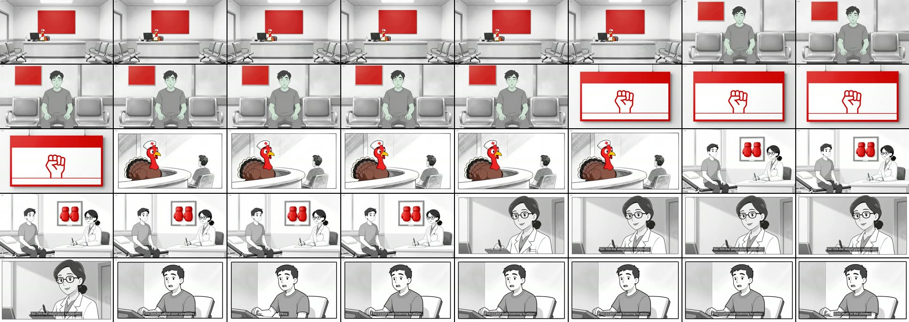

**What happened:** A grey waiting room opens with a long, static shot of a reception desk. A turkey in a nurse's cap sits behind it, under a blank red sign. The view cuts to a pale, greenish man sitting stiffly in a waiting-room chair. The red sign becomes a clenched-fist icon. Then we see the turkey receptionist up close, with the man's back to us at check-in. Next the man is in an exam room with a woman doctor in glasses and a white coat, and red boxing gloves hang on the wall. At 0:14 she asks about his symptoms. He looks worried and says he can't stop listening to music, "like, ever. In the shower."

**Who, where:** A young man in a grey t-shirt. A turkey in a nurse's cap working as a receptionist. A woman doctor with glasses, a ponytail and a white coat. They are in a clinic, first the waiting room and reception, then an exam room.

**Beats:**
- 0:00: Static wide shot of an empty waiting room. The turkey nurse sits at the desk under a red sign. It holds for about 3 seconds.
- 0:03: Cut to the greenish man sitting in a waiting chair, motionless. This holds for about 5 seconds.
- 0:07.5: The red sign fills the frame and shows a fist icon, which is unexplained.
- 0:08.5: Close shot of the turkey receptionist at the curved desk, with the man seen from behind.
- 0:11: Cut to the exam room. The man sits on the exam table, the doctor writes, and boxing gloves hang on the wall.
- 0:14.3: Close-up of the doctor, who asks about his symptoms.
- 0:16.5: Close-up of the man, who says 'Okay.' and then that he can't stop listening to music, even in the shower. This sets up the premise.

**Confusions:**
- The first 7 seconds are nearly static, with the same frame repeated, so the opening is dead time.
- The man is tinted green in the waiting room but normal in the exam room. I couldn't tell whether that meant he was sick or was a style choice.
- The fist sign is unexplained, and so are the boxing gloves on the wall.
- The turkey receptionist says nothing, and no one reacts to it being a turkey.
- There is no transition from check-in to the exam room.
- The 'symptom' of loving music sounds like a joke, but the man seems genuinely distressed.

**Jokes:**
- landed: A turkey in a nurse's cap works as the clinic receptionist, played deadpan.
- landed: The man's symptom is that he can't stop listening to music, even in the shower, treated as a medical problem.
- did not land: The red sign changes to a fist icon, and boxing gloves appear on the wall. They may be a running gag, but I couldn't tell what it was.

**Board beats:**
- MISSED c01: Place and turkey are covered: "A grey waiting room... A turkey in a nurse's cap sits behind it, under a blank red sign." The product is not covered. The red sign is called "blank," and no product name or brand is given anywhere in the retelling.
- ok c02: The thing is mentioned, though not at 0:03: "he says he can't stop listening to music, 'like, ever. In the shower.'" The retelling places the music only at 0:16.5, not in the 0:03 shot of the motionless greenish man, so the timing is off.
- MISSED c03: The red sign is noted as "blank" and then "becomes a clenched-fist icon," but the product's name and tagline never appear. The fist is described only as an icon, not tied to any product.
- ok c04: "Then we see the turkey receptionist up close, with the man's back to us at check-in. Next the man is in an exam room..." The move from waiting to check-in to the exam room conveys that he is taken in, although the retelling never explicitly says he is called.
- ok c05: "Next the man is in an exam room with a woman doctor in glasses and a white coat, and red boxing gloves hang on the wall." The exam-room geography and the gloves are both mentioned. The retelling does not say he cannot see the gloves.
- ok c06: "At 0:14 she asks about his symptoms."
- ok c07: "He looks worried and says he can't stop listening to music, 'like, ever. In the shower.'" This is the first symptom, and it is stated.

### 0:20.0-0:40.0

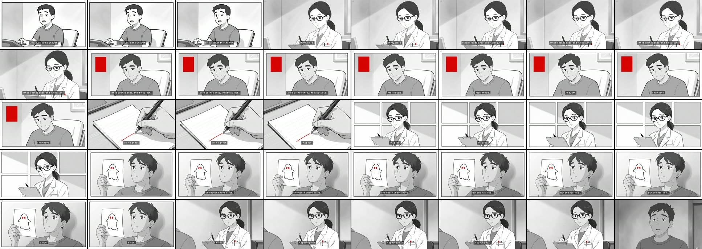

**What happened:** A man in a gray t-shirt sits in a chair in what looks like a therapist's office. He finishes a thought about music being everywhere, even in the shower and in his sleep. He says he tried silence once and it was just more music. A woman in a white coat and glasses listens and takes notes on a clipboard. The man then confesses he's in love, with a ghost, in space. A hand draws on a notepad, and he shows a drawing of a simple ghost with red eyes and no face. He says she has "a vibe." The woman repeats "a space ghost" flatly, and the last frame shows the man looking wide-eyed and a bit anxious.

**Who, where:** A man in a gray t-shirt (patient) and a woman with glasses and a ponytail in a white lab coat holding a clipboard (therapist or doctor). They are in a plain office or consulting room with a chair and a desk or monitor.

**Beats:**
- 0:20: The man finishes saying the music follows him everywhere, even in the shower, looking earnest and slightly worried.
- 0:21: Cut to the woman with the clipboard, listening. He says it happens in his sleep too.
- 0:22: He says he tried silence once and it was just more music. She stays on screen, impassive.
- 0:24: Back to the man, with a red rectangle on the wall behind him. He looks down, subdued.
- 0:27: He says 'I'm in love,' a turn from the music topic.
- 0:28: Close-up of a hand writing on paper with a red line as he says 'With a ghost.'
- 0:30: The woman reacts in a gray grid of panels as he adds 'In space.' She looks stunned.
- 0:32: The man holds up a drawing of a ghost with red eyes. He says she has no face.
- 0:34: He looks to the side and hesitates, 'But she has, like...', then says 'a vibe' at 0:36.
- 0:37: The woman, with a pen over her clipboard, says 'A space ghost' and repeats it at 0:39.8, putting the label on it.
- 0:39: A darker shot of the man looking wide-eyed and uneasy.

**Confusions:**
- A red rectangle appears on the wall behind the man from about 0:24 to 0:28 and then disappears. It could be a poster or a light, and I couldn't tell what it was or why it was there.
- In the middle of the stretch the woman is shown in a grid of empty gray panels. I couldn't tell if this was a stylistic device, a split screen, or a previs placeholder.
- The close-up of a hand drawing a red line is unclear. It's not obvious whose hand it is, and the line becomes the ghost's red eyes only later.
- The last frame changes to a darker, grainier look. I couldn't tell if that was a mood shift or an inconsistency.
- The man's lines about music in the first part lack context. I'm missing what came before.

**Jokes:**
- landed: 'I tried silence once, and it was just... more music.' It's a quirky gag about an overactive musical mind.
- landed: The deadpan reveal 'I'm in love. With a ghost. In space.' This builds as a three-step escalation.
- landed: The faceless ghost drawing with red eyes, described as 'she has, like... a vibe.'
- landed: The therapist flatly repeating 'A space ghost,' followed by his nervous look in the last frame.

**Board beats:**
- ok c08: "He says he tried silence once and it was just more music."
- MISSED c09: Missing. The retelling skips the 0:24 shift: the red rectangle on the wall and the man looking down, subdued. It only notes that he 'then confesses' at the love line, so the turn to something personal is not shown at 0:24.5.
- MISSED c10: Partly. The retelling includes the line "in love, with a ghost, in space," but nothing about the woman's first crack in composure. It says only that she 'listens and takes notes' and later 'repeats flatly,' so her reaction at 0:28.5 is not conveyed.
- MISSED c11: Missing. Nothing in the retelling describes the pause or the stunned reaction in the gray panel grid at 0:30. Her stunned look is never mentioned.
- ok c12: "He shows a drawing of a simple ghost with red eyes and no face."
- ok c13: "The woman repeats 'a space ghost' flatly." The flat delivery signals she is unfazed, though the retelling does not say she has seen this before. This is a weaker match than the other covered beats.
- ok c14: "the last frame shows the man looking wide-eyed and a bit anxious." The viewer captures the man's reaction as the closing beat.

### 0:40.0-1:00.0

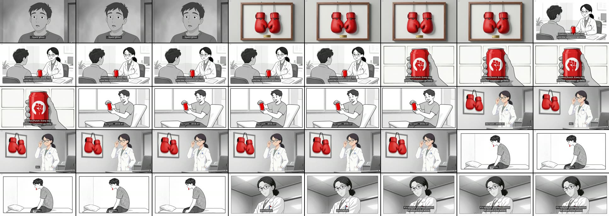

**What happened:** A stunned man mutters "...Space ghost," apparently reacting to a diagnosis. A framed pair of red boxing gloves is shown. Then a woman doctor sits across a desk from him with a red can on it and says to take Hawkes Punch every day until the symptoms go away. A close-up shows the can with a fist logo in a hand. The man, now smiling on an exam table, asks "So I just... drink it?" The doctor, beside the gloves, flatly says "No." The man sits on the table with a red thing hanging from his mouth and says "Oh no." The doctor, deadpan, says "Don't worry. It's only just a healthy amount of people in the world."

**Who, where:** A man with dark hair in a gray t-shirt, and a woman doctor with glasses and a ponytail in a white coat. They are in a clinic with a desk, an exam table, a window, and framed red boxing gloves on the wall.

**Beats:**
- 0:40: Man stares stunned, says 'Space ghost'; the diagnosis is the setup
- 0:41.5: Cut to framed red boxing gloves, a visual motif
- 0:43.5: Doctor and patient at the desk with a red can; she prescribes Hawkes Punch daily
- 0:46: Close-up of the can with a fist logo in a hand; the product is established
- 0:48.5: Man on the exam table, smiling, asks if he just drinks it
- 0:51: Doctor beside the gloves says 'No'; the expectation flips
- 0:54.5: Man slumps with a red thing at his mouth, says 'Oh no'
- 0:57: Doctor in close-up gives a deadpan reassurance with a nonsensical line

**Confusions:**
- The 'Space ghost' diagnosis has no context.
- The red thing hanging from the man's mouth is unclear (tongue, blood, ribbon?).
- 'No' implies drinking is wrong, but nothing explains the right way to take it.
- The final line is garbled or absurd, and I couldn't tell whether the caption is wrong or the line is meant to be nonsense.
- The man goes from stunned to cheerful between shots without explanation.
- The gloves move from a standalone frame to hanging on the doctor's wall.

**Jokes:**
- landed: Deadpan 'Space ghost' diagnosis to a stunned patient
- landed: Branded 'Hawkes Punch' prescription with a fist logo and boxing gloves as decor
- landed: 'So I just... drink it?' / 'No.' flat reversal
- did not land: 'Oh no' with the red thing in his mouth, then the doctor's 'Don't worry... healthy amount of people in the world'

**Board beats:**
- MISSED c15: The retelling says 'A framed pair of red boxing gloves is shown' at the gloves cut, but says nothing about the audience now knowing the cure. The cure is first named only later, at the desk scene ('take Hawkes Punch every day'), so the suspense shift at 0:41.5 is missing.
- ok c16: 'Then a woman doctor sits across a desk from him with a red can on it and says to take Hawkes Punch every day until the symptoms go away.' This gives the cure (a product to take) and the 'every day' plant.
- ok c17: 'a red can on it' at the desk, and 'A close-up shows the can with a fist logo in a hand.' The red can is noted and the product is established.
- ok c18: 'The man, now smiling on an exam table, asks "So I just... drink it?"' The hope that the cure is a drink is conveyed.
- MISSED c19: 'The doctor, flatly says "No."' The flip is noticed, but the retelling never says the cure is her fist. The 'fist logo in a hand' is attributed to no one, so the link between the doctor and the fist cure is missing.
- MISSED c20: 'The man sits on the table with a red thing hanging from his mouth and says "Oh no."' The reaction is there, but the 'red thing' is never identified as a bomb, so the realization of the bomb is only inferred, not stated.
- MISSED c21: 'Don't worry. It's only just a healthy amount of people in the world.' The retelling notes the line is deadpan and nonsensical but does not state the shift from hope to doom or any sense of a long build toward it.

### 1:00.0-1:20.0

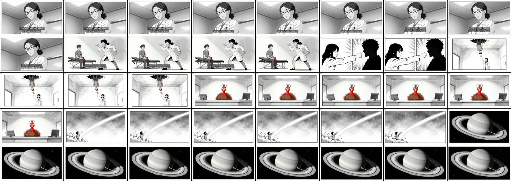

**What happened:** A woman doctor in glasses and a white coat stares at the camera in a stiff close-up while she lectures someone. She says there is only a healthy amount of people in the world and that the listener is just one of them. She tells them to shut up and swallow "the damn Hawkes Punch." The film then shows a man sitting on an exam table holding something red on his knee, while she winds up and attacks. A manga-style panel shows her fist driving into a dark silhouette. The man is blasted upside down through the ceiling, and she stands with her fist raised. Next comes a cut to a turkey in a nurse's cap behind a reception desk. After that, a small figure flies through clouds on a long streak, and finally the streak ends at Saturn, where a scream is heard.

**Who, where:** A woman doctor with a ponytail and glasses in a white coat, in a clinic or exam room. A seated man with short hair is her patient. A turkey in a nurse's cap works at a reception desk in the same clinic. Later the man is flying through clouds and then through space near Saturn.

**Beats:**
- 1:00-1:03.5: The doctor gives a stiff lecture in close-up: 'a healthy amount of people'. Then 'you are just one of them'.
- 1:03-1:04.5: She says to shut up and swallow the Hawkes Punch. The tone turns threatening.
- 1:04.5-1:06.5: A wide shot shows the man seated on the exam table while the doctor winds up a punch.
- 1:06.5-1:07.5: A manga-style panel shows the punch landing on a silhouette.
- 1:07.5-1:10: The man is blasted upside down into the ceiling while she holds her fist up.
- 1:10-1:12: A cut to a turkey nurse at the reception desk, static, as a reaction gag.
- 1:12-1:16: A small figure flies through clouds along a long streak, with a scream heard.
- 1:16-1:20: The streak reaches Saturn and the shot holds there.

**Confusions:**
- The first 8 frames are almost static, with only the caption changing, so it is hard to tell who she is talking to.
- The red object on the man's knee is unclear. It may be a reflex hammer or a drink, and it is not obvious how it relates to the 'Hawkes Punch'.
- The manga panel shows a long-haired girl punching a silhouette, which doesn't match the doctor's design.
- The turkey receptionist appears with no setup or explanation.
- The small flying figure may be the patient, but this is not certain.
- The punch seems to send him to Saturn, but the arrow on Saturn is only a guess at the path.
- The scream line at 1:12 plays over the turkey or flight shots, so it is unclear whose scream it is.

**Jokes:**
- landed: A deadpan doctor gives a bleak speech about people, then threatens to punch the patient with a 'Hawkes Punch'.
- landed: The punch launches the patient through the ceiling in manga style.
- landed: A turkey in a nurse's cap sits at the front desk as the receptionist, ignoring everything.
- landed: The patient is flung all the way to Saturn.

**Board beats:**
- ok p01: "The film then shows a man sitting on an exam table holding something red on his knee, while she winds up and attacks." Both figures appear in one description, so the seated patient and the windup read together.
- ok p02: "A manga-style panel shows her fist driving into a dark silhouette." The impact is conveyed as a resolved action in the panel.
- ok p03: "The man is blasted upside down through the ceiling, and she stands with her fist raised." Her reaction shows she owns the action. The retelling never explicitly calls the punch a 'cure', but it follows directly from her ordering him to swallow the Hawkes Punch, so the cure framing is implied rather than stated.
- MISSED p04: "Next comes a cut to a turkey in a nurse's cap behind a reception desk." The turkey is named, but nothing is said about its static, unbothered reaction or that it reads as a gag. The mundane-versus-epic contrast is missing.
- ok p05: "a small figure flies through clouds on a long streak, and finally the streak ends at Saturn." The move from the clinic to space is carried by one continuous streak.
- MISSED s01: "the streak ends at Saturn, where a scream is heard." The retelling never says the planet is real-size or that the man is a speck against it. The scream also implies sound continuing, not a switch to silence. Missing: the scale relation and the sound-to-silence change.

### 1:20.0-1:40.0

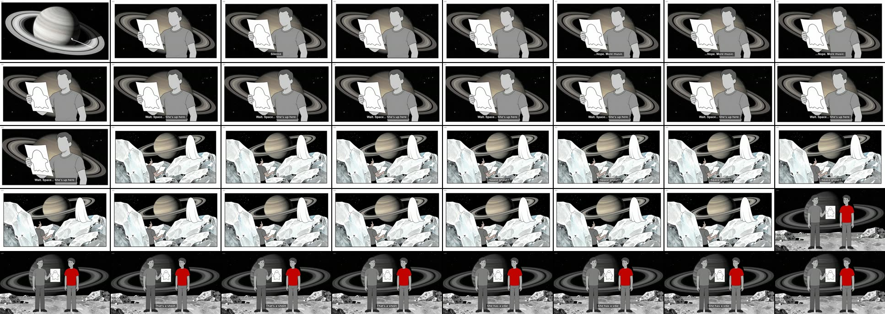

**What happened:** A man holds up a drawing of a cartoon ghost in front of a big ringed planet, and there is silence. He says there is no music, then says more music is needed. He realizes the setting is space and says "She's up here." The view cuts to a rocky, icy surface where he looks at the drawing, with the planet in the sky and a white ghost-like shape standing on a rock. He asks if it is a space ghost. Then the scene cuts to two men on a moon surface, one holding the ghost drawing. The one in the red shirt says it's just a sheet, and the other says she has a vibe.

**Who, where:** A man in a gray T-shirt with a faceless, flat look, holding a paper with a ghost drawing. Later a second man in a red shirt joins him. They are in space, first against a ringed planet (Saturn-like) and then on a rocky moon surface. A white ghost figure sits on the rocks in the middle shots.

**Beats:**
- 1:20.0: Opening on a ringed planet, then the man holds up a ghost drawing in front of it.
- 1:20.8: Caption 'Silence.' No sound plays.
- 1:22.5: 'Nope. More music.' The man corrects the soundtrack.
- 1:24.5: 'Wait. Space... She's up here.' He realizes where the ghost is.
- 1:27.0: Cut to a rocky surface with the planet in the sky. A white ghost shape stands on a rock and the man looks on with his paper.
- 1:29.8: 'Space ghost?' The question is held for a long beat on the same shot.
- 1:34.0: Cut to two men standing on the moon surface. One in gray holds the ghost drawing, and the other wears a red shirt.
- 1:36.3: 'That's a sheet.' The red-shirt man dismisses the ghost.
- 1:38.0: 'She has a vibe.' The gray-shirt man defends it.

**Confusions:**
- Who is speaking each line is not clear, and the second man in the red shirt appears with no explanation.
- It is unclear whether the first shots are a thought, a studio, or already in space.
- The man's drawing and the real ghost on the rock are linked, but how she got there is unexplained.
- Who the 'she' is, and why she has a vibe, is not explained.
- The long static holds repeat the same frame, so the stretch feels slow.

**Jokes:**
- landed: Caption 'Silence.' as a bare sound description, followed by 'Nope. More music.' as a self-aware correction
- did not land: 'Wait. Space... She's up here.' as a realization of where the ghost is
- landed: 'Space ghost?' as a pun on the cartoon character
- landed: 'That's a sheet.' undercutting the ghost, then 'She has a vibe.' as a deadpan defense

**Board beats:**
- ok s02: "He says there is no music, then says more music is needed." The silence-equals-more-music payoff is captured. The goal to find her is implied by "He realizes the setting is space and says 'She's up here,'" and by the later "asks if it is a space ghost," which shows him searching for her. The goal is only implicit, but the substance is there.
- MISSED s03: The retelling gives part of the suspense: "a white ghost-like shape standing on a rock" is visible while "he looks at the drawing," and he then asks "if it is a space ghost," so he apparently doesn't see her. It omits that he is found, and found by the wrong man. The retelling has no one finding him in that stretch. The cut to the two men at 1:34 is reported as a change of scene, not as him being discovered. The 'found by the wrong one' half of the change is missing.
- MISSED s04: The retelling records "two men on a moon surface, one holding the ghost drawing" and "the one in the red shirt says it's just a sheet." It shows a second man present and dismissing the ghost. It does not say the red-shirt man is a double or stand-in for the ghost, and it does not note the broken rule of three or that he is unwanted company. Those substance points are missing; only the bare presence of a second man is conveyed.

### 1:40.0-2:00.0

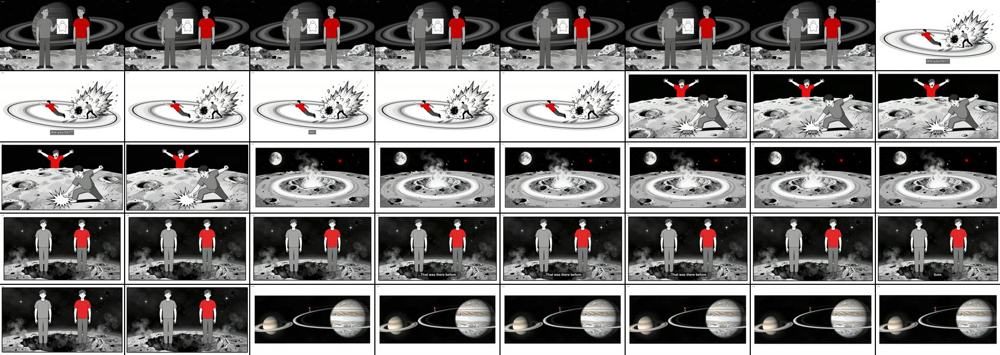

**What happened:** Two figures, one in gray and one in a red shirt, stand on a moon-like surface in front of a ringed planet. The gray one holds up a paper with a ghost drawing. Then a cartoon scene shows the red-shirted figure flying through the air toward a big explosion, with the gray figure beside it, as someone asks "Are you her?!" and someone answers "No!". Next, in a close shot, the red figure pops up with arms raised and shouts "BOO!" while the gray one recoils and yells "Aah!". A crater with smoke and steam is shown, and the two stand beside it. One says "...That was there before," and the other says "Sure." The last shot is a wide view of a tiny red figure walking along a ring between Saturn and Jupiter.

**Who, where:** A gray-shirted boy or man and a red-shirted boy or man, on a cratered moon or asteroid with ringed planets in the sky. At the end, a tiny red figure is on a ring between Saturn and Jupiter.

**Beats:**
- 1:40-1:43: Gray figure holds up a ghost drawing next to the red figure on the moon, with a ringed planet behind them. The shot barely changes.
- 1:44: Cut to a white background showing the red figure flying toward a big explosion, with the gray figure beside it. 'Are you her?!' is heard.
- 1:45: 'No!' is heard over the same explosion image, which holds for several seconds.
- 1:46: Close-up: the red figure leaps up shouting 'BOO!' while the gray one reaches toward a burst on the ground.
- 1:47: The gray figure shouts 'Aah!' and stays in the same pose.
- 1:49: Wide shot of a smoking crater ringed with rings, with a moon and a red dot in the sky.
- 1:52: The two stand calmly in front of a smoking crater.
- 1:53: One says '...That was there before.'
- 1:55: The other replies 'Sure.'
- 1:57: A realistic wide shot shows Saturn and Jupiter with a ring between them and a tiny red figure on the ring.

**Confusions:**
- The 'Are you her?!' and 'No!' exchange is unclear. The ghost drawing may be related, but I couldn't tell who was speaking.
- I couldn't tell why the red figure is flying through the air or what caused the explosion.
- I couldn't tell whether the crater is the result of the explosion or what 'That was there before' refers to.
- The final shot jumps to a realistic Saturn and Jupiter with a ring between them. Why the red figure is on it, and how it got there, is unexplained.
- The line 'him vibe' at 1:38 is unintelligible.

**Jokes:**
- landed: The red figure jumps up and shouts 'BOO!' and the gray one yells 'Aah!' in a classic jump scare.
- landed: After the explosion and crater, the deadpan 'That was there before.' / 'Sure.' reads as a joke about denying blame for the damage.
- did not land: The ghost drawing followed by 'Are you her?!' and 'No!' seems meant as a gag, but I couldn't follow it.

**Board beats:**
- MISSED s05: Missing. The retelling notes 'Are you her?!' and 'No!' but never says the gray figure is trying to catch the red figure for an answer, and says nothing about the red figure being as strong as the double.
- MISSED s06: Not shown as a cause. The retelling links 'BOO!' and 'Aah!' to 'A crater with smoke and steam is shown,' but never says the flinch cracked the moon. The 'That was there before' line is reported without the accidental-power point.
- MISSED s07: Missing. The retelling skips the wide shot with the tiny red dot against the moon at 1:49. It only says 'the two stand beside' the crater, and the only wide shot it describes is the final one at 1:57.
- MISSED s08: Not conveyed as a contrast. The retelling reports the deadpan lines ('...That was there before' / 'Sure.') and says the two 'stand beside' the crater, but never connects the size of the feat to the muted reaction.
- MISSED s09: Missing. The retelling ends with 'a tiny red figure walking along a ring between Saturn and Jupiter' but never says a planet is coming or that the stakes escalate.

### 2:00.0-2:20.0

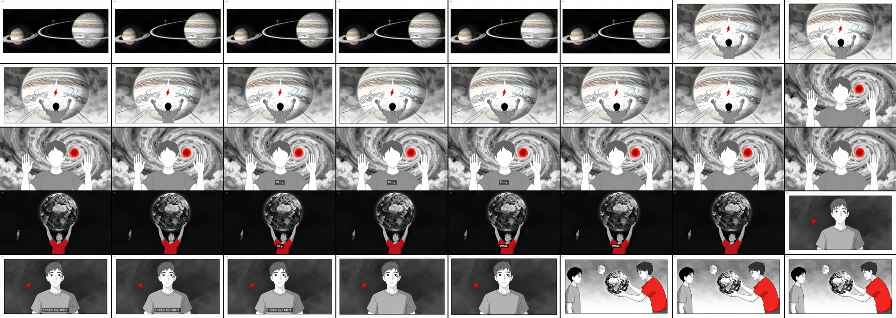

**What happened:** A tiny red figure travels through space between Saturn and Jupiter. The film then cuts close to a boy with his arms raised in front of a huge Jupiter, with a red lightning bolt mark above him. Next we see him up close in a swirling grey storm, palms out, with a red spot beside his face. He says "Okay." Then we see a figure in red holding up the Earth in black space, while a small pale figure floats off to the left. Someone says "Hey," then "What." A close-up shows the grey-shirted boy with a tear and a red dot, saying "People live there." Last, the red-shirted figure holds Earth out toward the boy, with a moon behind them. It looks like he is handing the planet over or showing it to him.

**Who, where:** A boy in a grey t-shirt with dark hair, and a figure in a red shirt who holds the Earth. They are in space among the planets, with Saturn and Jupiter, a swirling storm, and black space with Earth and the moon. A tiny floating figure appears near Earth.

**Beats:**
- 2:00: Wide shot of Saturn and Jupiter with a tiny red figure between them. It holds for about 3 seconds.
- 2:03: Cut to a boy with raised arms before a huge Jupiter, with a red bolt above him. The shot is held.
- 2:07: Close-up of the boy in a grey storm with palms out and a red spot beside him.
- 2:08.8: He says 'Okay.'
- 2:12: Cut to black space. A red-shirted figure holds up the Earth, and a small figure floats at left.
- 2:12.8: 'Hey.'
- 2:14.1: 'What.'
- 2:15: Close-up of the grey-shirted boy with a tear and a red dot.
- 2:15.8: He says 'People live there.'
- 2:17.5: The red-shirted figure holds the Earth out toward a dark-haired boy, with the moon behind them.

**Confusions:**
- Who the tiny red figure in the opening shot is, and whether it is the red-shirted character.
- The red lightning bolt and the red dot or spot: it is unclear what they are, and whether they are the same thing.
- The boy appears grey and in a storm. It is unclear whether this is a vision, a different place, or the same scene as the Jupiter shot.
- The small pale figure floating by Earth is not explained.
- It is unclear who says 'Hey' and 'What', and why the red-shirted figure is holding Earth.
- The red-shirted figure's face is barely visible, so I can't tell whether he is the same person as the boy.
- The last shot is unclear: he may be giving the Earth away, or the boy may be asking him to stop.

**Jokes:**
- did not land: A giant figure holds up the whole Earth and gets a deadpan 'Hey.' / 'What.' exchange, which seems meant to be absurdly casual.
- did not land: 'People live there.' said sadly, with a tear, in answer to someone treating a planet like a prop.

**Board beats:**
- MISSED s10: Not covered. The retelling shows a tiny red figure between Saturn and Jupiter (2:00) and a boy with raised arms before Jupiter (2:03), but never describes a planet being caught or a big hit landing. The 'finisher' change is missing.
- MISSED s11: Partly covered at most. The retelling has the boy in the storm with palms out and says 'Okay.' (2:07-2:08.8), which hints at a flat, unimpressed reaction. But it never says he is unimpressed, and nothing about a double or a bigger second move. The 'double has to go bigger' substance is missing.
- MISSED s12: Not covered. The retelling notes 'Hey' and 'What' and a floating figure at left (2:12-2:14), but does not show a rule of three or the boy stopping a pattern. The change that this time he stops is missing.
- MISSED s13: Not covered. The retelling records 'People live there' with a tear (2:15.8), but does not show the game being halted by literal-mindedness. It reads as an emotional line, not a literal-minded stop. The change is missing.
- MISSED s14: Partly covered. 'It looks like he is handing the planet over or showing it to him' (2:17.5) gestures at a handover, but the viewer is hedged and never names rivals or a truce, and does not register the careful, slow set-down as the joke. Substance largely missing.

### 2:20.0-2:40.0

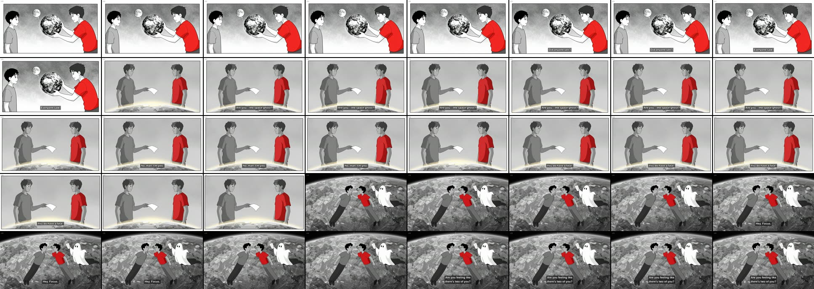

**What happened:** A boy in a red shirt holds a glowing, detailed Earth-like globe in his hands while a boy in gray looks on, with a small moon floating nearby. They say that someone saw something: "Did anyone see?" then "Everyone saw." The scene cuts to the two boys standing apart against a pale sky with a curved planet horizon below. The gray boy, who looks faded or semi-transparent, holds out a slip of paper. He asks the red-shirted boy if he is "the space ghost." The red boy answers "No, man. I'm you." Then the gray boy remarks "You do have a face." Next, the two float sideways over a greyscale view of the planet's surface. A cartoon white ghost holding a paper floats beside them. Someone tells the gray boy to "Focus," and then asks if he feels like there are two of him.

**Who, where:** Two boys: one with black hair in a gray shirt, who looks faded, and one in a bright red shirt. They are in a stylized space or sky setting, first holding a globe with a moon, then standing above a planet's curve, then floating high over Earth's surface. A white cartoon ghost holding a paper appears in the last part.

**Beats:**
- 2:20: The red boy holds a globe with a moon behind it while the gray boy watches. This sets up the scene.
- 2:22: 'Did anyone see?' The tone is worried.
- 2:23: 'Everyone saw.' A deadpan reply that raises the stakes.
- 2:24: Cut to the two boys facing each other above a planet horizon. The gray boy holds out a paper.
- 2:25: The gray boy asks whether the red boy is the space ghost.
- 2:28: The red boy says 'No, man. I'm you.' This reveals a doubling.
- 2:30: 'You do have a face.' This is a flat comic reaction.
- 2:32: Cut to a wide view of the two floating over the planet, with a white ghost holding paper beside them. This is a new image and an unexplained shift.
- 2:35: 'Hey. Focus.' Someone pulls attention back.
- 2:37: 'Are you feeling like there's two of you?' The doubling idea comes up again.

**Confusions:**
- Who is the 'space ghost'? The white ghost only appears at 2:30 or later, after the question was asked.
- The red boy says 'I'm you,' but he looks like a different person. It is unclear whether he is a double, a future self, or something else.
- 'Did anyone see?' and 'Everyone saw' are heard over the globe shot, and it is unclear what was seen or who said each line.
- The slip of paper is unexplained, and it is unclear why the ghost holds one too.
- The jump from standing to floating is unexplained, as is the ghost's sudden appearance.
- It is unclear who says 'Hey. Focus.' and who asks about 'two of you.'

**Jokes:**
- landed: 'Did anyone see?' / 'Everyone saw.' deadpan exchange over the globe shot
- landed: 'Are you... the space ghost?' answered with 'No, man. I'm you.'
- landed: 'You do have a face.' as a flat reaction
- did not land: A cartoon ghost suddenly floating in, followed by 'Are you feeling like there's two of you?'

**Board beats:**
- MISSED s15: The retelling has the gray boy holding out a slip of paper and the line 'You do have a face,' but never describes a turn from lonely to not alone, and never links the face line to a setup like 'she doesn't have a face.' The paper is held out, not described as a drawing being released. The retelling itself calls the 2:32 shift 'unexplained,' so the turn did not come across. Missing: the lonely-to-not-alone shift, the 'she doesn't have a face' payoff, and the drawing's release.
- MISSED s16: The retelling mentions 'A cartoon white ghost holding a paper floats beside them,' so the ghost is noticed. But it is described as 'a new image and an unexplained shift,' with no sense that the ghost pays off for the audience rather than the gray boy, and no mention of an advertisement, product, or brand. Missing: the ghost as a payoff for viewers and the story turning into an ad.

### 2:40.0-3:00.0

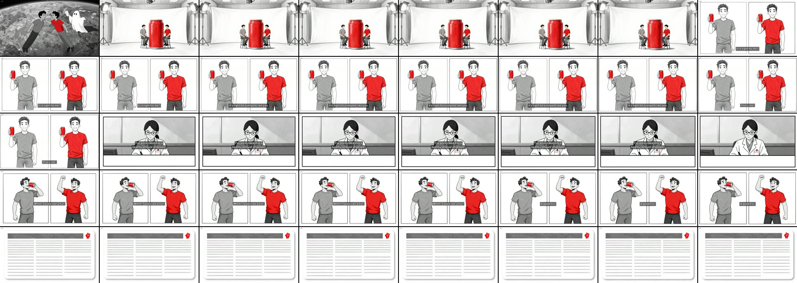

**What happened:** This looks like a parody commercial for a red canned drink, with a fist logo. It opens with two men and a ghost floating over Earth, which fits the "two of you?" line heard just before. It then cuts to a studio where the two men sit on stools beside a giant red can. Next, the two men are shown side by side, each holding up a can. They ask whether it's right for them, and an announcer says it's right for everyone like them. A woman doctor in a white coat says she has prescribed it to "a healthy amount of people." The men then drink the can, one gulping and one punching a fist in the air, and say it tastes like a fist. The strip ends on a newspaper-style page with a red fist logo, with a voice rushing through side effects.

**Who, where:** Two men who look alike, one in a gray shirt and one in a red shirt, with a possible ghost in the opening shot. They are over a planet or Earth, then on stools in a white photo studio with lights and a giant red can, then in split panels. A woman with glasses and a ponytail in a white coat sits at a desk in an office or lab. The last shot is a newspaper-like page with a fist logo.

**Beats:**
- 2:40.0: Over Earth, two men and a ghost float. The shot is quickly replaced.
- 2:40.5: In a studio, the two men sit on stools beside a giant red can. This holds for about 3 seconds.
- 2:43.5: Split panels show both men holding up cans. One asks 'Is it right for me?'
- 2:45.2: The reply is 'It's right for everyone like you.' The panels stay the same.
- 2:47.3: One man says 'That's me!'
- 2:48.6: A woman doctor in a white coat says she has prescribed it to a healthy amount of people. She shifts pose at the end.
- 2:52.0: The men are drawn more muscular. One gulps the can while the other raises a fist, and they say 'Tastes like a fist!'
- 2:54.3: The line is corrected to 'A good fist.'
- 2:56.0: A newspaper page with a fist logo is shown while the side-effects voice speaks. It holds to the end.

**Confusions:**
- The opening shot of the men and the ghost floating over Earth is only one frame, so I couldn't tell why it appears.
- I couldn't tell which of the two men says which line.
- Whether the gray man and the red man are meant to be one person split in two (the 'two of you' line) or two separate people.
- The ghost isn't explained.
- The newspaper page has no readable text, and the side-effects voice has no visible speaker.
- In the doctor shots, the last frame's pose changes slightly without a clear reason.

**Jokes:**
- landed: Doctor says she's prescribed it to 'a healthy amount of people', which is a vague, evasive medical claim.
- landed: 'Tastes like a fist!' followed by the correction 'A good fist.', with the red man punching the air.
- did not land: 'That's me!' in response to 'everyone like you', as the two lookalikes both claim the ad.
- landed: The side-effects voice rushing through the list over a dull newspaper page, a pharma-ad send-up.

**Board beats:**
- ok a01: "This looks like a parody commercial for a red canned drink, with a fist logo." The viewer identifies the clip as a commercial from the start, so the reveal lands.
- MISSED a02: The retelling says "the two men are shown side by side, each holding up a can" and "an announcer says it's right for everyone like them," but never says the double is the spokesman. The two men are only described as looking alike, with no link made between the double and the pitch.
- MISSED a03: The retelling says "A woman doctor in a white coat says she has prescribed it to 'a healthy amount of people.'" The phrase is captured, but the payoff depends on her never looking up, and the retelling does not mention her gaze or lack of it. Her pose shift is noted only in the beat list.
- ok a04: The viewer ties the fist to the drink from the start: "a parody commercial for a red canned drink, with a fist logo," and later "say it tastes like a fist" and "a red fist logo." The can and fist are treated as one product, though the retelling never states this link at the 2:51.8 moment itself.
- MISSED a05: The retelling says "a voice rushing through side effects" over a newspaper-style page with a fist logo. It never says the rushed list recaps everything shown earlier, so that payoff is missing.

### 3:00.0-3:20.0

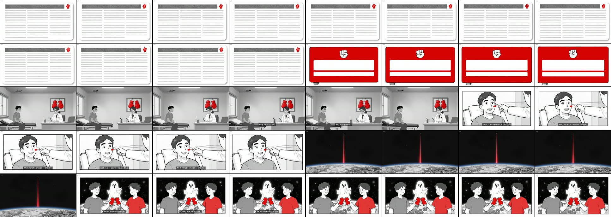

**What happened:** The stretch opens on a newspaper-style page with a small red fist logo, held for about 6 seconds. It cuts to a red card with a white fist and blank white text boxes, which looks like a title card or placeholder. Then we're in a doctor's office. A man sits on an exam table while a woman doctor in a white coat sits at a desk under a framed pair of red boxing gloves. She asks "Any symptoms?" and he starts to say "Well, I met someone, and he-". In a close-up, the doctor's arm holds a red-tipped swab or stick to his nose or cheek while he smiles. Next is a black space scene with a red beam shooting up from a planet's surface. Last, a ghost holding paper stands between two boys, one grey and one in red, with red cups or gloves held together in front of them. A line says "Same time tomorrow?"

**Who, where:** A young man with dark hair in a grey shirt, and a woman doctor with glasses in a white coat, in a clinic exam room with a boxing-glove picture on the wall. Later, a ghost and two boys, one grey and one in red, against a starry sky above a planet's curved surface. The setting appears to be space or a planet's surface.

**Beats:**
- 3:00: A newspaper page with a red fist logo holds on screen with no change.
- 3:06: Cut to a red fist card with blank white boxes, like a title or placeholder.
- 3:08: Wide shot of the clinic: the patient on the table, the doctor at her desk, boxing gloves on the wall.
- 3:09.3: The doctor asks 'Any symptoms?'
- 3:11: Close-up of the patient smiling as a hand holds a red-tipped thing to his face. He starts 'I met someone, and he-' and is cut off.
- 3:15: Cut to black space with a red beam rising from a planet's horizon.
- 3:16.6: A ghost with paper stands between a grey boy and a red-shirted boy, with red gloves or cups held together. 'Same time tomorrow?' is heard and the shot holds to the end.

**Confusions:**
- The newspaper and red fist cards carry no readable content, so I don't know what they mean.
- I can't tell whether the red card is meant to be a title or just a placeholder.
- In the close-up, the red thing at his nose is unclear. It could be a swab, a boxing-glove tap or a punch.
- The jump from the clinic to the red beam over the planet has no explanation.
- I don't know who the ghost is or how it relates to the man's story.
- I can't tell whether the red-shirted boy is the 'someone' he met or is the same man.
- Whether the final scene is the man's story or something real is unclear.
- The line 'Same time tomorrow?' has no visible speaker.

**Jokes:**
- did not land: The boxing gloves on the clinic wall, followed by a red mark at the patient's nose, may hint at a fight or punch story behind his symptoms.
- did not land: The ghost and boy fist-bumping or toasting with red cups or gloves, with 'Same time tomorrow?' sounding like a casual meetup, seems meant as a comic or sweet payoff.

**Board beats:**
- MISSED a06: The retelling mentions the poster-like items only as set details: the newspaper page with a red fist logo 'held for about 6 seconds' and 'a framed pair of red boxing gloves' on the doctor's office wall. It never says that anything pays off, so the payoff of the poster is missing.
- MISSED b01: No mention of 'every day' or any idea of daily repetition. The only repetition cue is the closing line 'Same time tomorrow?', which does not show the 'every day' payoff.
- MISSED b02: The viewer describes 'the doctor's arm holds a red-tipped swab or stick to his nose or cheek while he smiles' but does not note that the frame edge hides a punch, and does not say he has a new symptom. The 'Any symptoms?' exchange is recounted, but its payoff is not stated.
- MISSED b03: The viewer quotes 'Same time tomorrow?' at the end, but places the black space scene and the ghost scene as different settings ('The setting appears to be space or a planet's surface'). Nothing notes that the time and place repeat, so the 'same time, same place' change is not conveyed.
- MISSED b04: The ghost is described as 'holding paper' and standing 'between two boys' with 'red cups or gloves held together'. There is no ghost waving at the audience, and no mention of the daily dose being a friend.

### 3:20.0-3:24.3

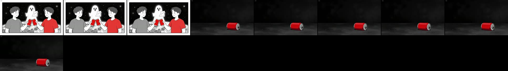

**What happened:** The stretch opens on a still, cheerful scene in black and white with red accents. Two boys, one in a gray shirt and one in a red shirt, clink red cans together. A white ghost floats between them holding a piece of paper. They stand on a cratered, moon-like surface under a starry sky. Then it cuts to a dark, empty, gloomy space where a single red can lies on its side on a gray floor. It stays there without moving for the rest of the stretch. No sound or dialogue is heard.

**Who, where:** A boy in a gray shirt, a boy in a red shirt, and a small white ghost holding a paper, all on a moonlike surface with stars behind them. The second location is a dark, empty void with a gray floor, and the only thing in it is a red can.

**Beats:**
- 3:20.0-3:21.0: A static, happy image of the two boys and the ghost toasting red cans on the moon.
- 3:21.5: Hard cut to a dark void with a single red can lying on its side.
- 3:22.0-3:24.3: The can stays completely still in the silent dark. The mood shifts to lonely and empty.

**Confusions:**
- Whether the first image is a drawing, a photo, or a memory. It looks like an illustration or a frozen picture, because it does not change across the three frames.
- What the paper the ghost holds is.
- How the can on the dark floor relates to the cheering scene. It may be one of the toasting cans, left behind, but that is a guess.
- Why there is no sound at all, and whether the quiet is intentional.

**Jokes:**
- did not land: The contrast between the happy toast with a ghost and the lonely can left alone in the dark may be a bittersweet or ironic punchline.

**Board beats:**
- MISSED b05: The retelling shows the final image at 3:21.5-3:24.3 as 'a single red can lying on its side' in a 'dark, empty, gloomy space' and says the mood 'shifts to lonely and empty.' It never names a brand or product, and never says the can is a product or that the can is what the shot is presenting. The earlier red cans are described only as things the boys clink in a toast. What is missing is the identification of the last image as the product, such as a brand name, logo, or the viewer stating that the can is the advertised item.

