# HAWKES PUNCH: storyboard (draft 1, for J's approval)

Written 2026-11-08 from `SCRIPT.md` (clinic, punch, ad, button), `SPACE-EPIC.md` (the approved space story) and `COLD-VIEW-2.md`,
to the rules in `research/story-and-script-craft.md` and `research/epic-anime-action.md` (1, 2, 5). Nothing is animated until
the panels are approved. **53 shots, 4902 frames = 204 s (3:24) at 24 fps**, down from about 100.
Space is 16 shots, down from 42.

**Read an act in one image:** [`storyboard/act1_clinic.jpg`](storyboard/act1_clinic.jpg), [`storyboard/act2_space.jpg`](storyboard/act2_space.jpg),
[`storyboard/act3_ad_button.jpg`](storyboard/act3_ad_button.jpg) (1600 px wide, 3 panels a row, captions under each; red badge = epic
register, grey = deadpan; red arrows = a camera move). One annotated card per shot is in `storyboard/cards/`, the raw panels in
`storyboard/panels/`. The panels are Hawkes Gen sketches (Z-Image Turbo, project tkshock, greyscale with red as the one accent): they
show staging, size and the register, not the final look; faces and shirts drift between panels, so read the labels for who is who
(grey tee = him, red tee = the double, white coat = the doctor).

## Synopsis (ten lines a stranger can follow)

1. A man who can't stop hearing music, and who is in love with a faceless ghost in space, waits in a clinic with a turkey nurse and a poster: HAWKES PUNCH. Ask your doctor.
2. He tells his doctor his three symptoms. She writes them down without blinking. On the wall behind her, we (not he) see her framed boxing gloves: GOLDEN GLOVES CHAMPION.
3. She prescribes Hawkes Punch, every day until the symptoms go away. He asks if he drinks it. She says no, stands, and takes off her glasses.
4. She punches him through the ceiling into space. The turkey looks up, then goes back to typing.
5. In space, at real planet scale, his scream cuts to silence ("Silence. ...Nope. More music."). He realises: she's up here. He takes out his crayon drawing of her.
6. He searches Saturn's rings for the ghost. We see her behind him; he never does. A tap on the shoulder: it's himself, in a red tee. "That's a sheet." "She has a vibe."
7. He chases his double for an answer. A startled punch craters a moon ("...That was there before." "Sure."). The double lassos Jupiter with Saturn's ring; he catches it and says "Okay."
8. The double winds up with the Earth. "People live there." The double very carefully puts it back. "Did anyone see?" "Everyone saw."
9. Out of breath above the sunrise: "Are you the space ghost?" "No, man. I'm you." "You do have a face." He lets the drawing go; the ghost catches it, pleased. They turn to camera: "Are you feeling like there's two of you?"
10. It was a commercial. Side effects are everything we just saw. The next day she punches him again, mid-sentence, and his double is waiting in space with two cans: "Same time tomorrow?" A red can rolls to a stop.

## Setup / payoff ledger

| Planted | Shot | Paid off | Shot |
|---|---|---|---|
| He hears music no one else can (drums his fingers, hums) | c02, c07 | "Silence." ... "Nope. More music." in true silence | s02 |
| Poster: HAWKES PUNCH. Ask your doctor. | c01, c03 | The commercial and the end card | a01-a06 |
| Her boxing gloves and plaque (we see, he doesn't) | c05, c15 | She glances at them; he follows her look; the punch | c19, c20, p01-p03 |
| "She doesn't have a face. But she has a vibe." and the crayon drawing of a sheet ghost | c12 | "That's a sheet." / "She has a vibe."; "You do have a face."; the ghost catches the drawing | s04, s15, s16 |
| "Every day until the symptoms go away." | c16 | THE NEXT DAY, punched again mid-sentence; "Same time tomorrow?" | b01, b02, b04 |
| The turkey nurse | c01, c04 | Looks up at the ceiling, back to the screen | p04 |
| The red can | c16, c17 | The ad's giant can, "Tastes like a fist!", two cans in space, the can rolls | a01, a04, b04, b05 |
| Silence cuts in at the ring plane | s01 | The silence gag is a choice, not a dropout | s02 |
| The double can't be told from him | s04 | "No, man. I'm you." | s15 |
| "A healthy amount of people" (her speech) | c21 | "I've prescribed it to a healthy amount of people." | a03 |
| The ghost behind him, unseen | s03 | She catches the drawing; she waves at us | s16, b04 |
| Rule of three: ring, moon, Jupiter (each bigger, each met with a shrug) | s05, s07, s11 | The fourth, the Earth, he stops: "People live there." | s12-s14 |

**Suspense, not surprise.** The gloves are shown twice before the punch (c05 wide, c15 insert held 2 s), and her glance at them (c19) gives
him and us the same clock. In space the ghost is behind him for a whole held shot (s03) before the tap.

**Two registers, never blended** (research 1.1). Every shot is marked **deadpan** (eye level, centred, 50-85 mm, locked off, near silence) or
**epic** (low or close wide lens, hard rim, shake, speed lines, impact frames). The joke is the cut between them: c21 to p01 to p04; s06/s07 to
s08; s10 to s11; s12 to s13. Deadpan holds are long and never cut away during the payoff.

**Cutting rules kept** (research 5): average shot 3.9 s; no shot under 18 frames except the impact frame p02; every epic
burst lands on a hold of 2 s or more; the 180 line holds (him screen left, the double screen right, until they turn to lens together).

## What was cut from SPACE-EPIC.md (42 shots to 16)

- Every beat is kept; what went is coverage. The silence and the drawing are one shot (s02). The ghost gag and the tap are one held shot (s03).
  The reveal, "That's a sheet", and the boop are one two-shot (s04). The ring blast and his follow-through are one side-on wide (s05) with
  "Are you her?!" / "No!" shouted across it; the side-by-side flying dialogue (c7_side) is gone. BOO, the flinch and the impact frame are one
  shot (s06). Ring pull, lasso, throw and yank are one extreme wide (s09); brace, catch and slide are one low shot (s10); "Okay" and the shove
  are one MCU (s11). Hey/What play over the Atlas wide (s12), the long look and the set-back over one wide (s14), and the stop's three lines
  over one close two-shot (s15). The ghost's catch, "Hey. Focus." and the turn to lens are one wide (s16).
- The clinic and ad keep every line of SCRIPT.md; the pen insert, the gloves insert, the can insert and the poster insert stay because the cold
  viewer could not read them at the old lengths, so each is held 1.5-2 s.
- The button keeps the script's shots (b01-b05); the second punch is shown this time (b02), which the cold viewer missed.

## Shots

Frames are at 24 fps. Size and lens are the shot's; moves are only where marked. "Changes" is what the shot turns: if nothing turned, it was cut.

## Act 1: the clinic and the punch

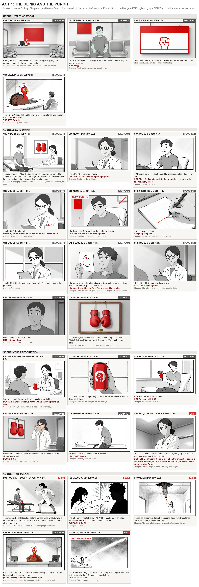

| panel | id | scene | size, lens | frames | action | line | register | what changes |
|---|---|---|---|---|---|---|---|---|
| 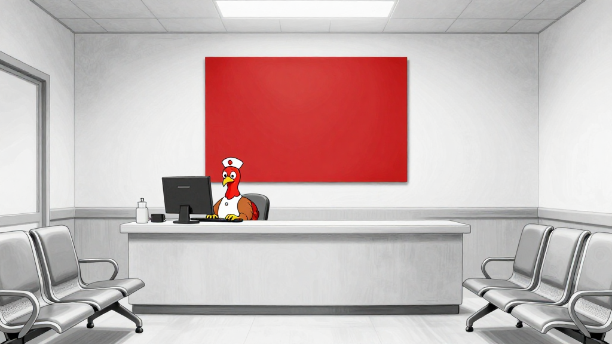 | **c01** | 1 Waiting room | WIDE, 24 mm | 72f (3.0s) | Pale green clinic. The TURKEY nurse at reception, typing, big enough to read. On the wall a red poster. | - | **deadpan** | The place and the product. Plants: the poster, the turkey. |
| 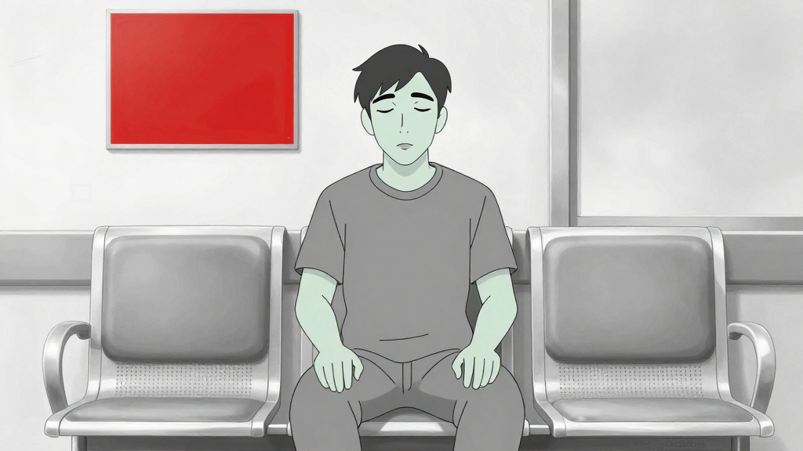 | **c02** | 1 Waiting room | MEDIUM, 50 mm | 84f (3.5s) | HIM in a waiting chair. His fingers drum his knees to a beat only he hears. He hums. | (humming) | **deadpan** | Plant: he hears music no one else can. |
| 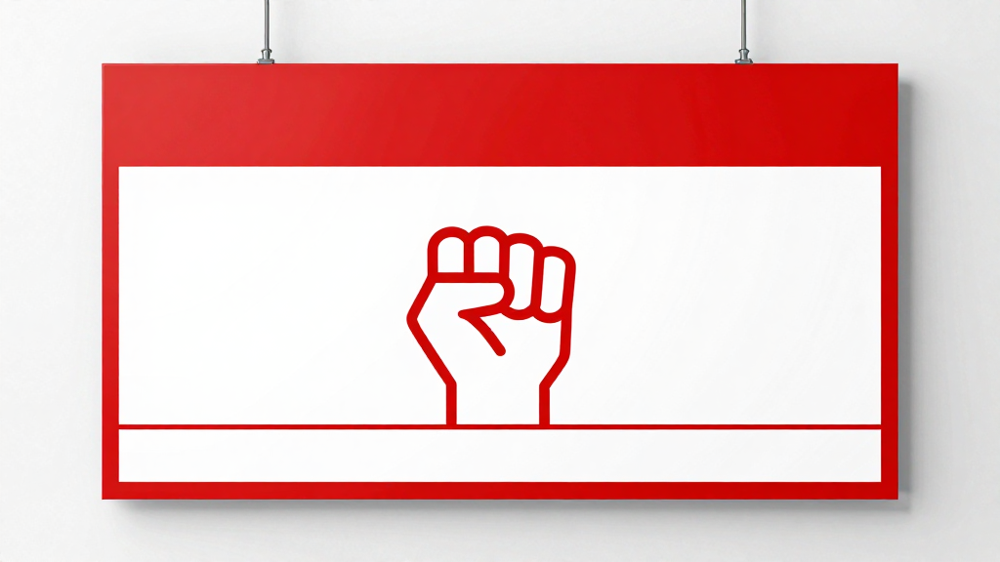 | **c03** | 1 Waiting room | INSERT, 85 mm | 48f (2.0s) | The poster, held 2 s so it reads: HAWKES PUNCH. Ask your doctor. | - | **deadpan** | Plant: the product's name and the tagline. |
| 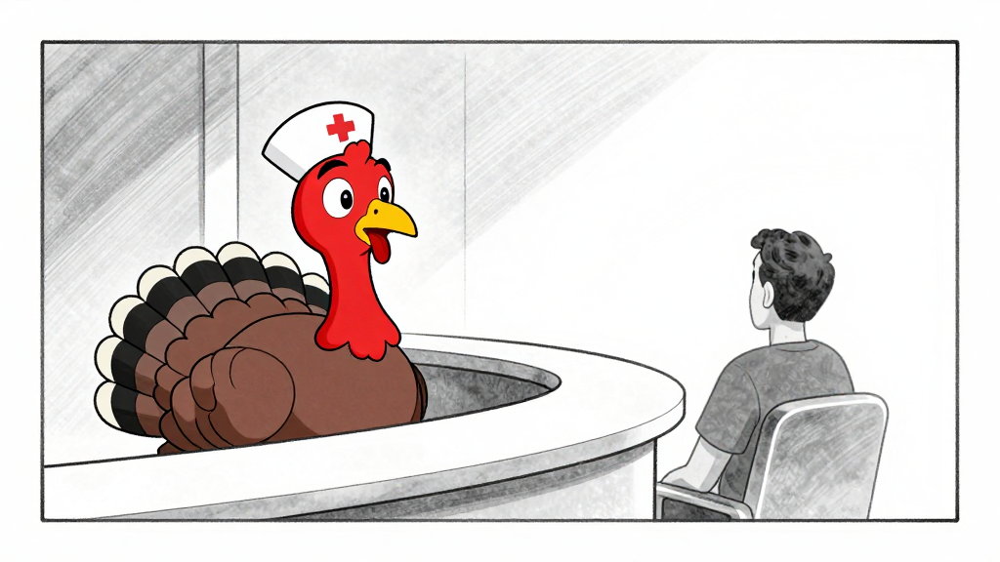 | **c04** | 1 Waiting room | MEDIUM, 50 mm | 60f (2.5s) | The TURKEY turns its head to him. He looks up, stands and goes in. Cut on his movement. | TURKEY: Gobble. | **deadpan** | Turn (+): he is called in. |
| 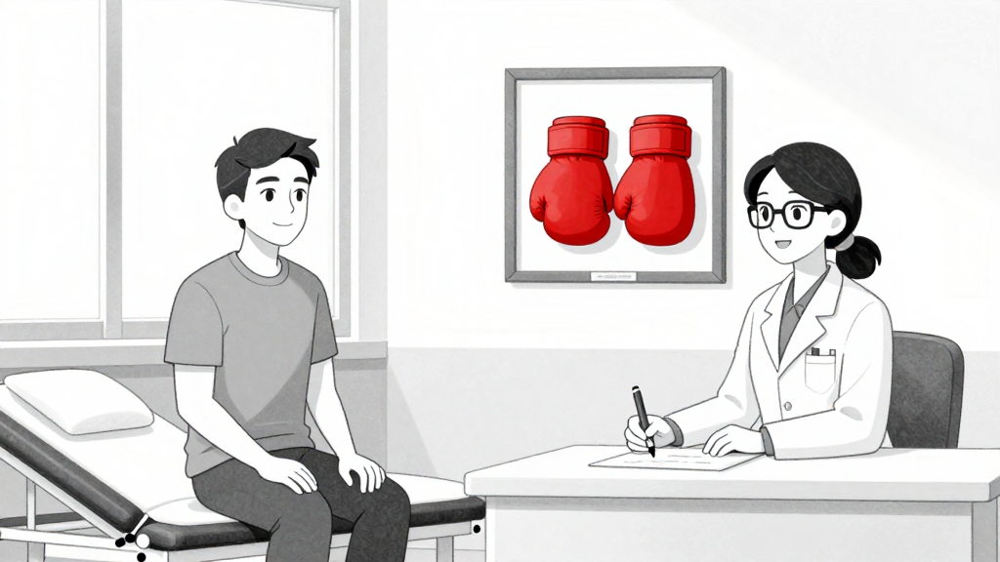 | **c05** | 2 Exam room | WIDE, 24 mm | 72f (3.0s) | The exam room. HIM on the bed screen left, the window behind him. The DOCTOR at her desk screen right, kind smile. On the wall behind her: a framed pair of red boxing gloves and a plaque. | - | **deadpan** | Geography for the whole scene. Plant: the gloves (we see them, he doesn't). |
| 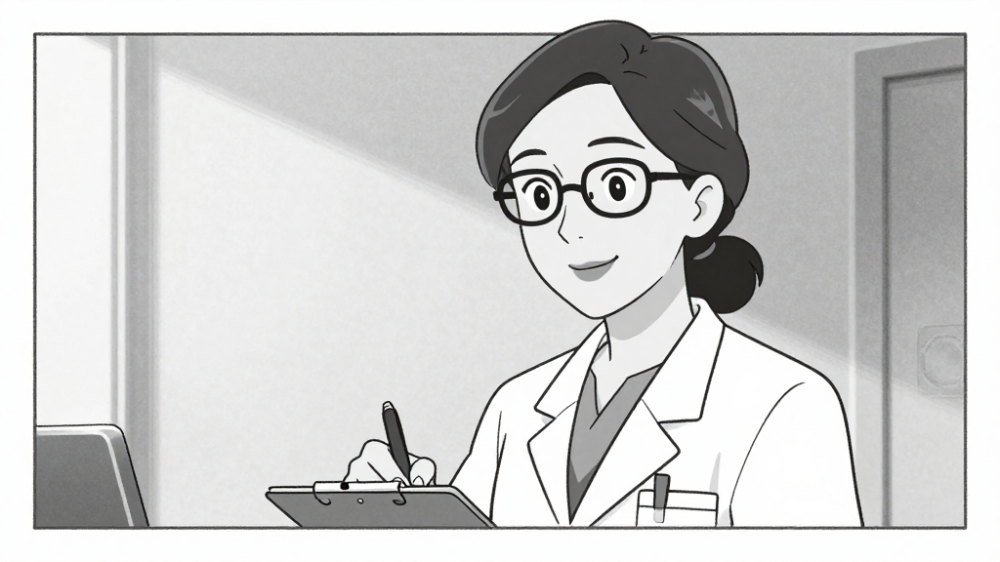 | **c06** | 2 Exam room | MCU, 85 mm | 60f (2.5s) | The DOCTOR, warm, pen ready. | DOCTOR: So. Tell me about your symptoms. | **deadpan** | She invites the problem. |
| 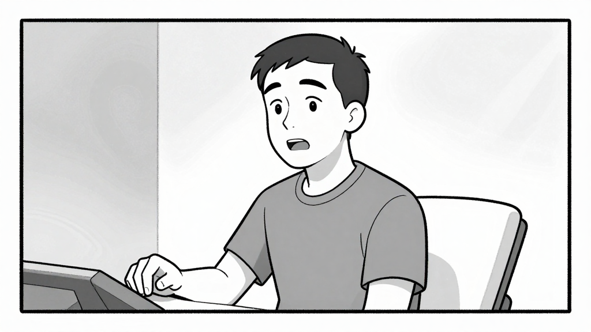 | **c07** | 2 Exam room | MCU, 85 mm | 120f (5.0s) | HIM, facing her, a little too honest. His fingers drum the edge of the bed. | HIM: Okay. So. I can't stop listening to music. Like, ever. In the shower. In my sleep. | **deadpan** | Symptom 1 of 3. |
| 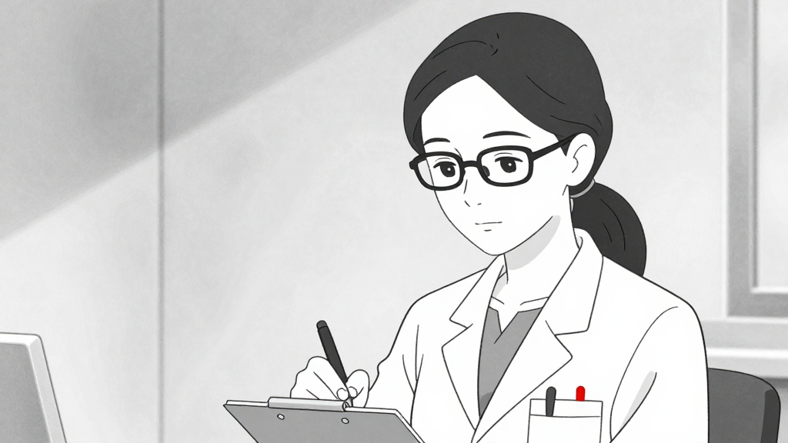 | **c08** | 2 Exam room | MCU, 85 mm | 72f (3.0s) | The DOCTOR nods, writes. | HIM (o.s.): I tried silence once, and it was just... more music. | **deadpan** | Plant: silence = more music. |
| 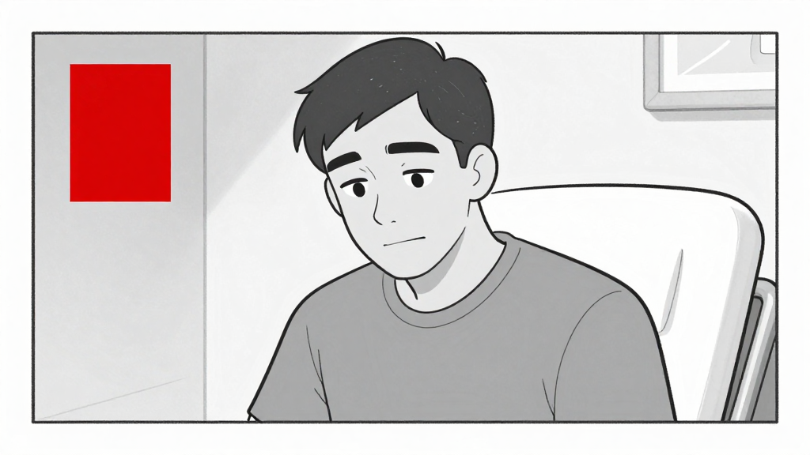 | **c09** | 2 Exam room | MCU, 85 mm (slow push in) | 96f (4.0s) | HIM, lower, shy. Slow push-in: the confession is his. | HIM: And, um. I'm in love. With a ghost. | **deadpan** | Symptom 2. The scene turns personal. |
| 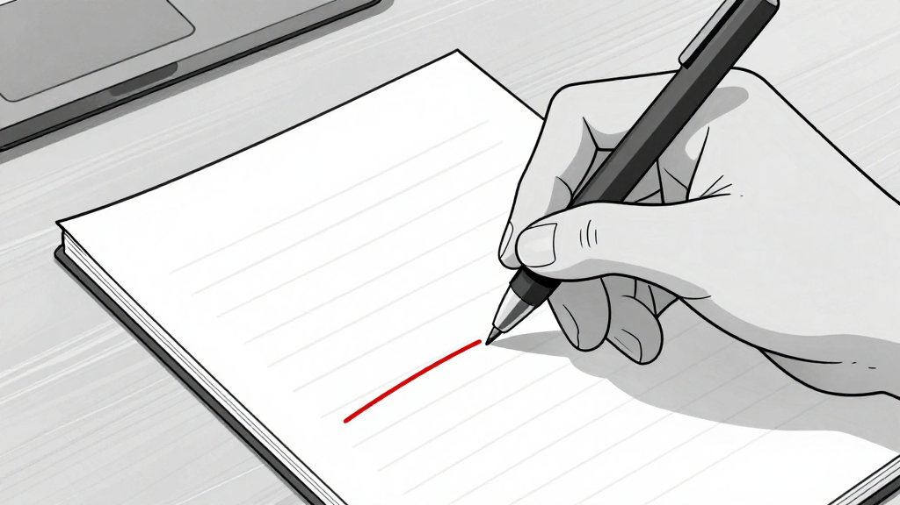 | **c10** | 2 Exam room | INSERT, 100 mm | 36f (1.5s) | Her pen stops mid-word. | HIM (o.s.): In space. | **deadpan** | Symptom 3. The first crack in her calm. |
| 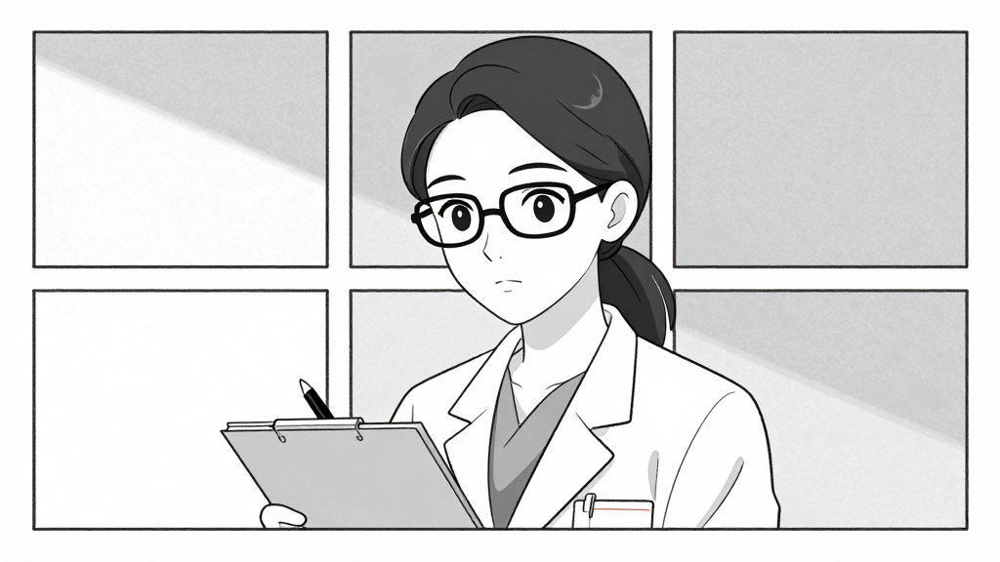 | **c11** | 2 Exam room | MCU, 85 mm | 60f (2.5s) | The DOCTOR looks up at him. Blank. Hold. (The pause before the punchline.) | - | **deadpan** | The pause. |
| 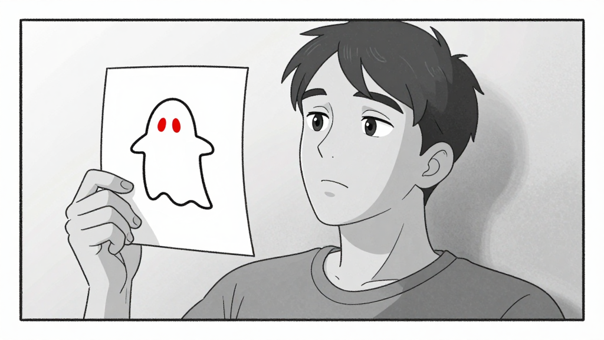 | **c12** | 2 Exam room | CLOSE, 85 mm | 108f (4.5s) | HIM, dreamy. He pulls a folded crayon drawing from his pocket and holds it up: a sheet ghost with no face. | HIM: She doesn't have a face. But she has, like... a vibe. | **deadpan** | Plant: the faceless ghost, and the drawing he will carry to space. |
| 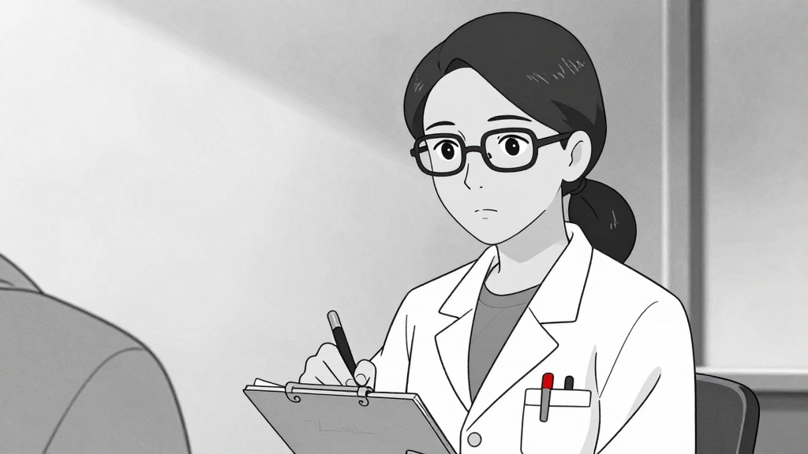 | **c13** | 2 Exam room | MCU, 85 mm | 60f (2.5s) | The DOCTOR, deadpan, writes it down. | DOCTOR: A space ghost. | **deadpan** | She takes it in stride: she has seen this before. |
| 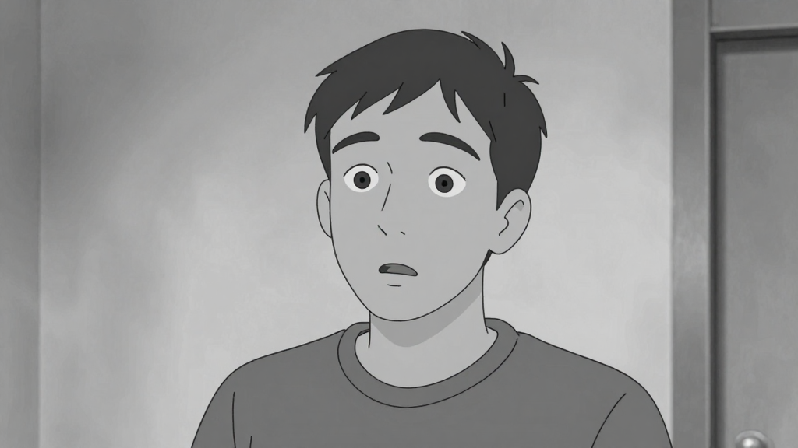 | **c14** | 2 Exam room | CLOSE, 85 mm | 48f (2.0s) | HIM, hearing it said back to him. | HIM: ...Space ghost. | **deadpan** | The reaction is the punchline. |
| 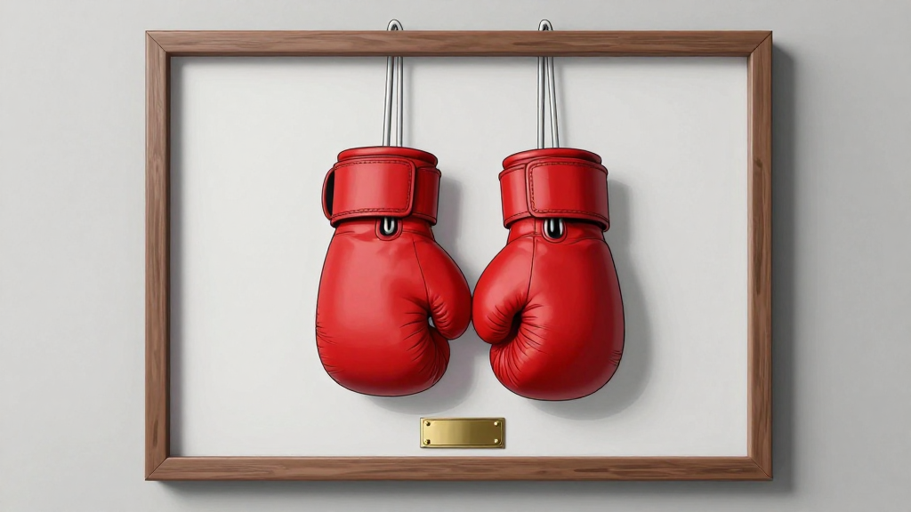 | **c15** | 2 Exam room | INSERT, 85 mm | 48f (2.0s) | The boxing gloves on the wall, held 2 s. The plaque: GOLDEN GLOVES CHAMPION. We see it; he doesn't. The bomb under the table. | - | **deadpan** | Suspense: the audience now knows what the cure is. |
| 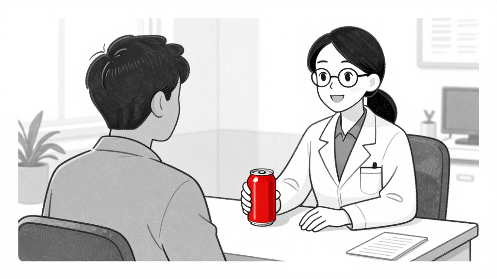 | **c16** | 3 The prescription | MEDIUM (over his shoulder), 50 mm | 72f (3.0s) | She smiles and slides a red can across the desk to him. | DOCTOR: Hawkes Punch. Every day until the symptoms go away. | **deadpan** | Turn (+, for now): there is a cure. Plant: 'every day'. |
| 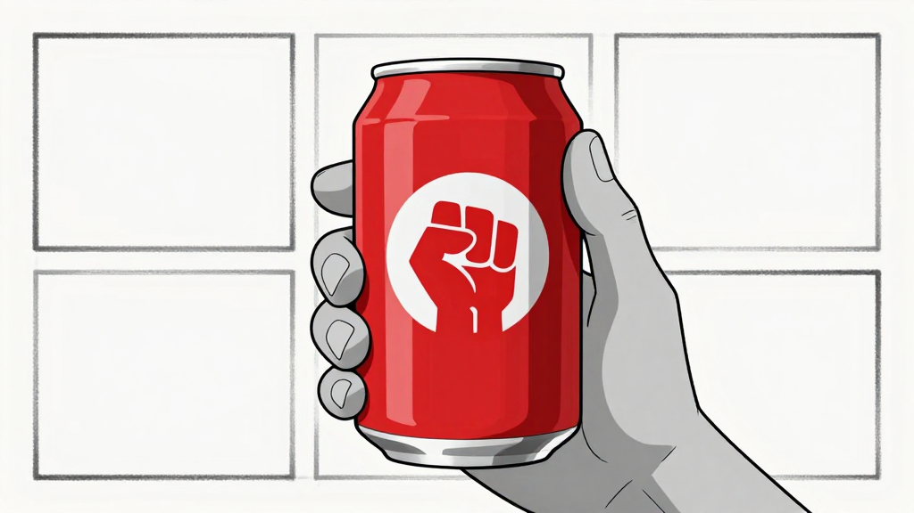 | **c17** | 3 The prescription | INSERT, 85 mm | 48f (2.0s) | The can in his hand, big enough to read: HAWKES PUNCH. One a day until it stops. | - | **deadpan** | Plant: the red can (the ad, the ending). |
| 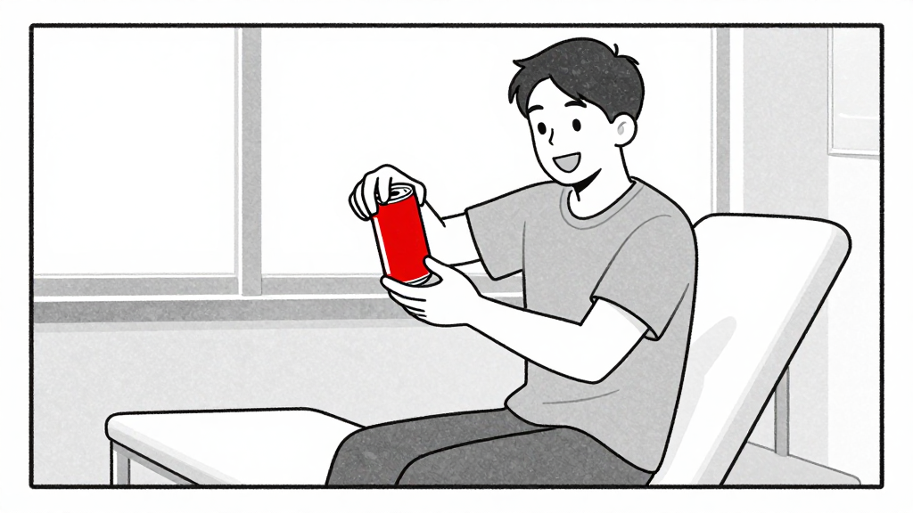 | **c18** | 3 The prescription | MEDIUM, 50 mm | 60f (2.5s) | HIM, relieved, turns the can over. | HIM: So I just... drink it? | **deadpan** | He hopes it is a drink. |
| 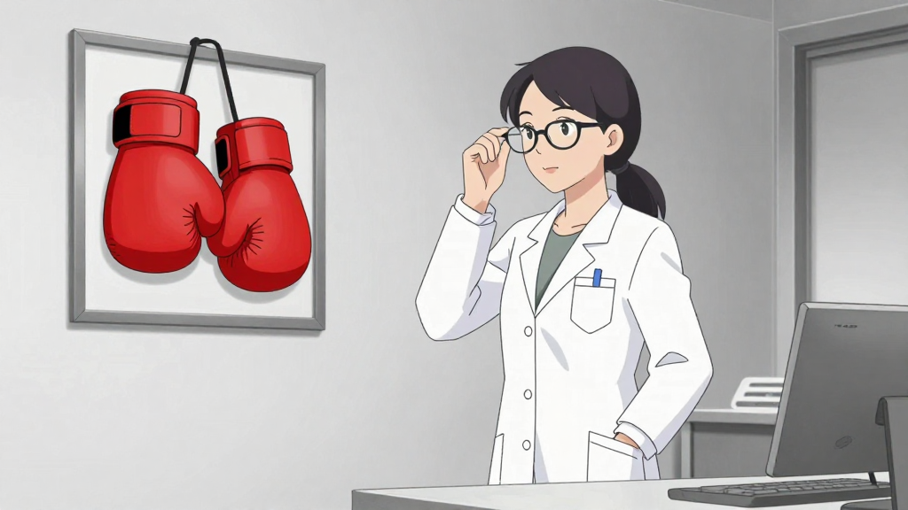 | **c19** | 3 The prescription | MEDIUM, 50 mm | 96f (4.0s) | Pause. She stands, takes off her glasses, and her eyes go to the gloves on the wall. | DOCTOR: No. | **deadpan** | Turn begins (-): the cure is her fist. |
| 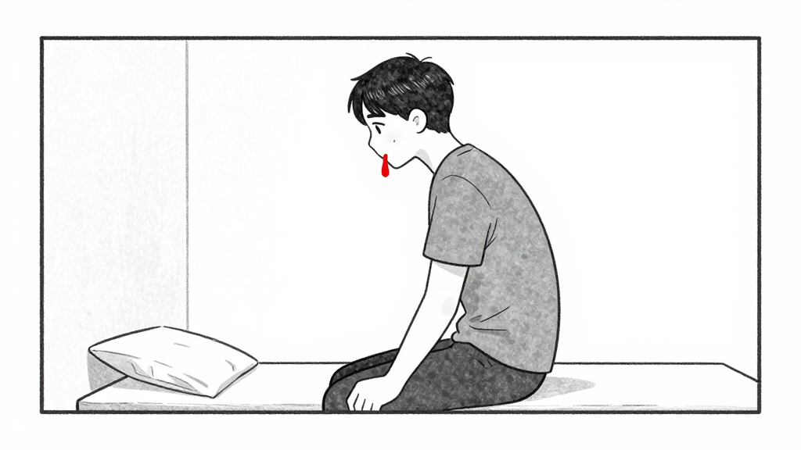 | **c20** | 3 The prescription | MEDIUM, 50 mm | 60f (2.5s) | He follows her look to the gloves. Back to her. | HIM (small): Oh no. | **deadpan** | He finally sees the bomb. |
| 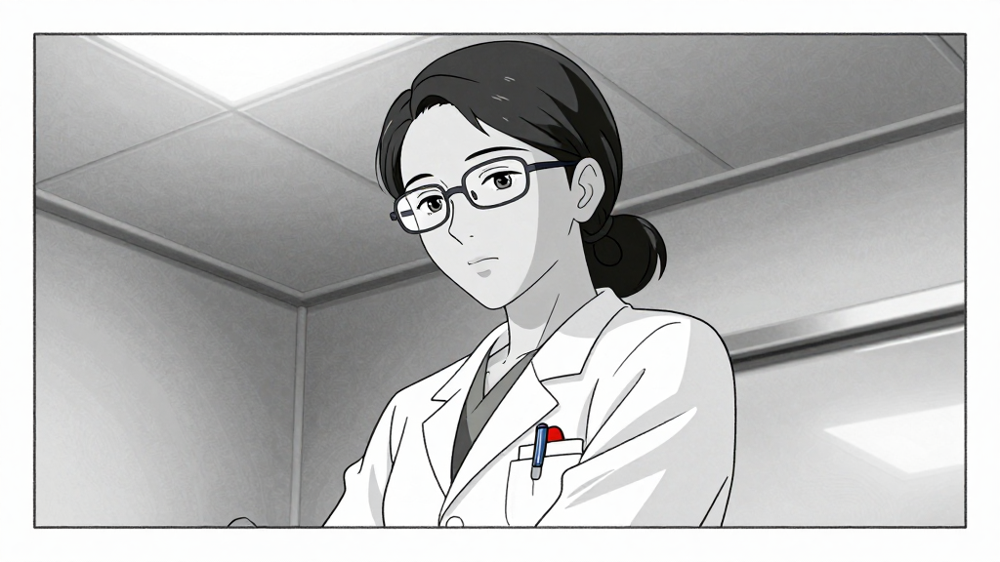 | **c21** | 3 The prescription | MCU, LOW ANGLE, 35 mm | 168f (7.0s) | The DOCTOR rolls her shoulders. Flat, calm, terrifying. The register switches: low angle, hard rim light. | DOCTOR: Don't worry. It's only just a healthy amount of people in the world. You are just one of them. So shut up, and swallow the damn Hawkes Punch. | **epic** | Turn (-): hope to doom. The long build begins. |
| 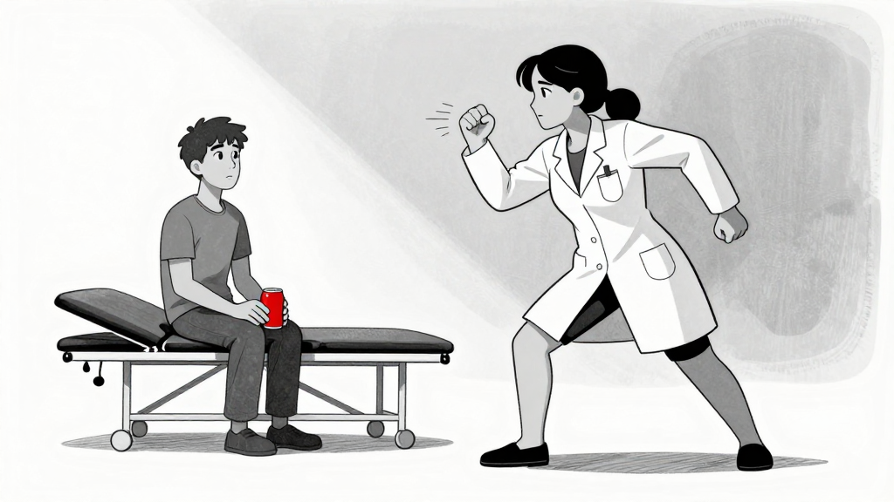 | **p01** | 4 The punch | TWO-SHOT, LOW 3/4, 24 mm | 48f (2.0s) | The wind-up, held: fist cocked behind her ear, torso twisted away, a tremble. He is in frame, within reach, frozen. Let the whole wind-up play in one shot. | - | **epic** | Anticipation. Both in one frame so the geography reads. |
| 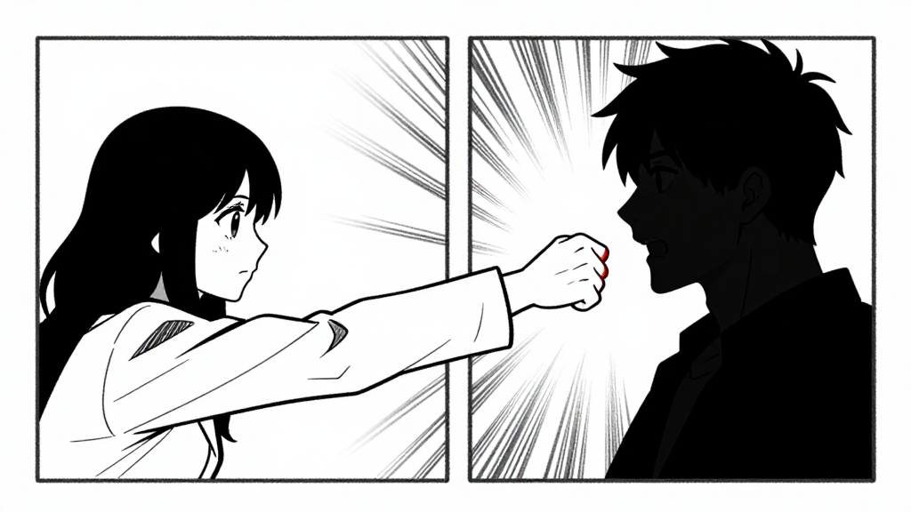 | **p02** | 4 The punch | CLOSE, 35 mm | 18f (0.8s) | The hit. Her fist meets his jaw: IMPACT FRAME, black on white, radial lines. Hitstop. The loudest sound in the film. | (WHOOSH-CRACK) | **epic** | Resolution in 2 frames. |
| 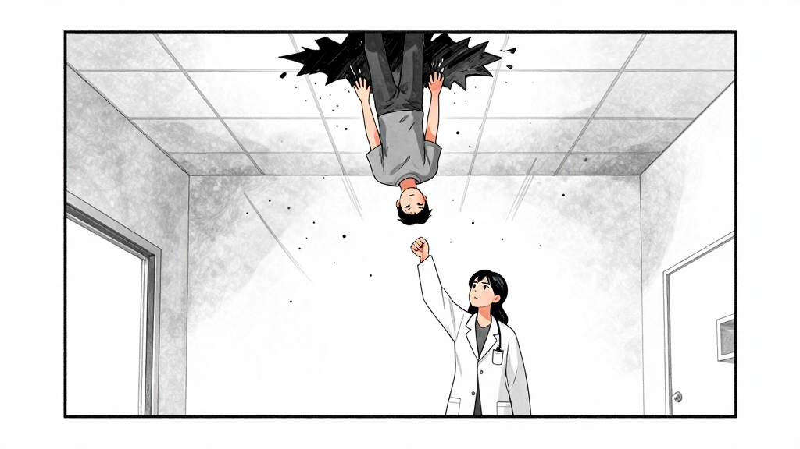 | **p03** | 4 The punch | WIDE, 24 mm | 48f (2.0s) | He rockets straight up through the ceiling. Tiles rain. She stands below, cold face, arm still extended. | - | **epic** | The cure administered. Her reaction (she owns the action). |
| 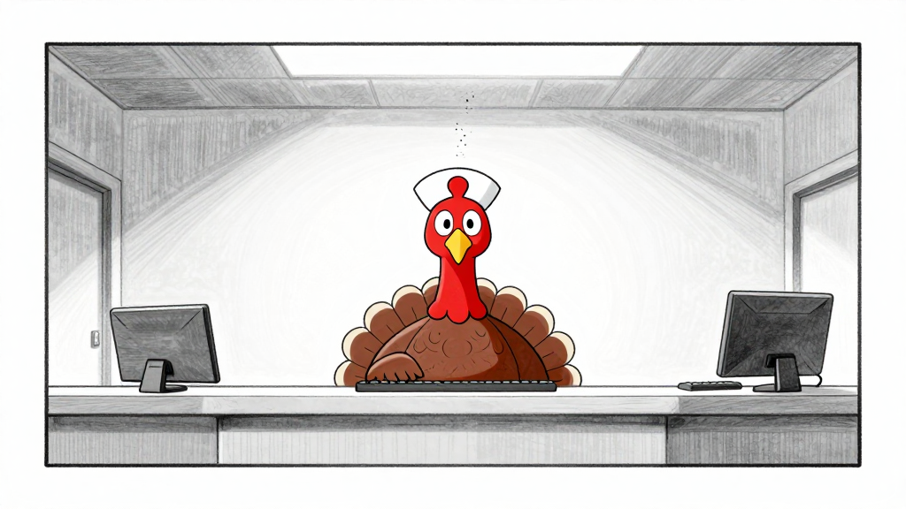 | **p04** | 4 The punch | MEDIUM, 50 mm | 72f (3.0s) | Reception. The TURKEY looks up at the rattling ceiling as dust falls. Looks back at its screen. Types. | (a small ceiling rattle; then keyboard taps) | **deadpan** | The free laugh: the mundane reaction to the epic event. |
| 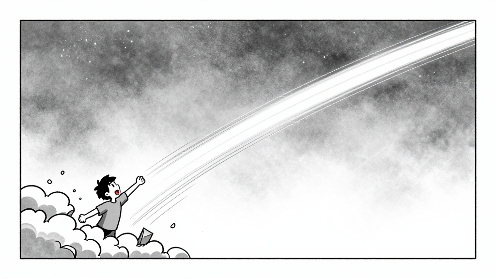 | **p05** | 4 The punch | WIDE, sky, 24 mm (tilt up) | 72f (3.0s) | He streaks up through the clouds, screaming. The sky goes from blue to deep blue to stars. Camera tilts up with him. | HIM: AAAAAAAAH— | **epic** | Clinic to space in one move. |

26 shots, 1806 frames = 75 s.
## Act 2: space

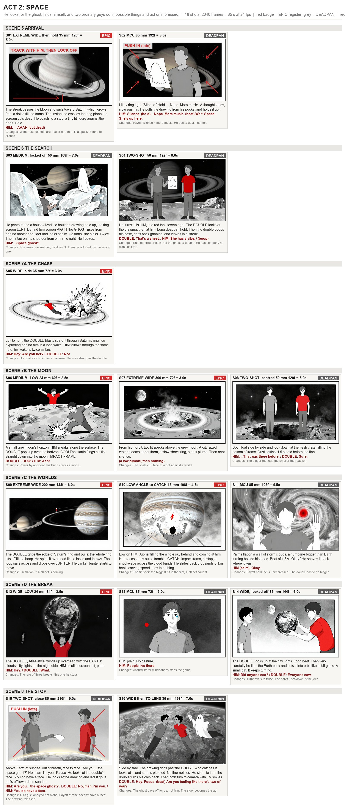

| panel | id | scene | size, lens | frames | action | line | register | what changes |
|---|---|---|---|---|---|---|---|---|
| 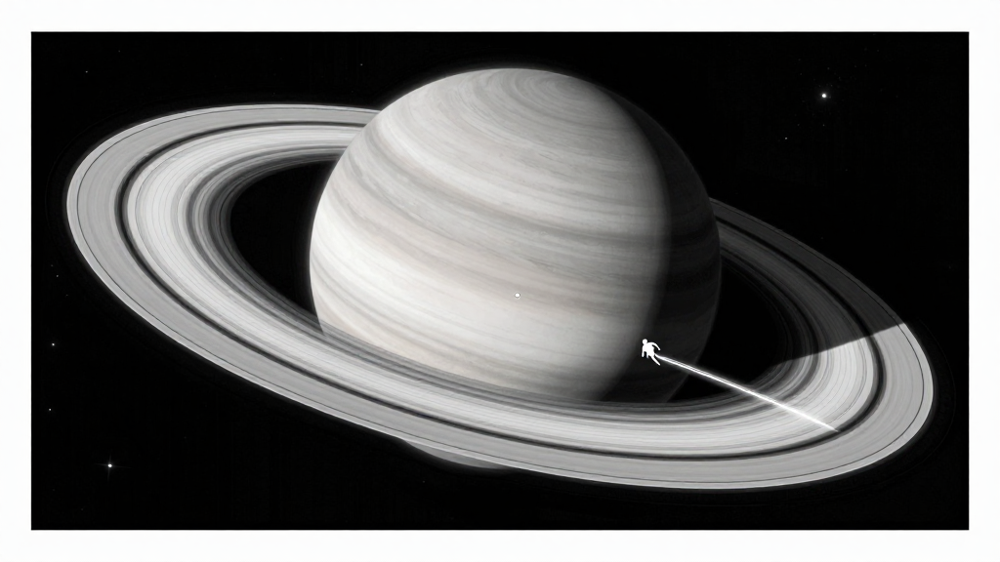 | **s01** | 5 Arrival | EXTREME WIDE then hold, 35 mm (track, then lock off) | 120f (5.0s) | The streak passes the Moon and sails toward Saturn, which grows from a dot to fill the frame. The instant he crosses the ring plane the scream cuts dead. He coasts to a stop, a tiny lit figure against the rings. Hold. | HIM: —AAAH (cut dead) | **epic** | World rule: planets are real size, a man is a speck. Sound to silence. |
| 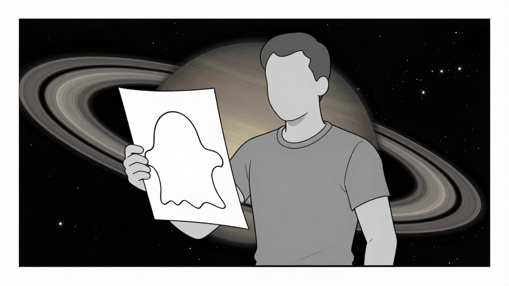 | **s02** | 5 Arrival | MCU, 85 mm (push in on the realisation) | 192f (8.0s) | Lit by ring light. 'Silence.' Hold. '...Nope. More music.' A thought lands; slow push in. He pulls the drawing from his pocket and holds it up. | HIM: Silence. (hold) ...Nope. More music. (beat) Wait. Space... She's up here. | **deadpan** | Payoff: silence = more music. He gets a goal: find her. |
| 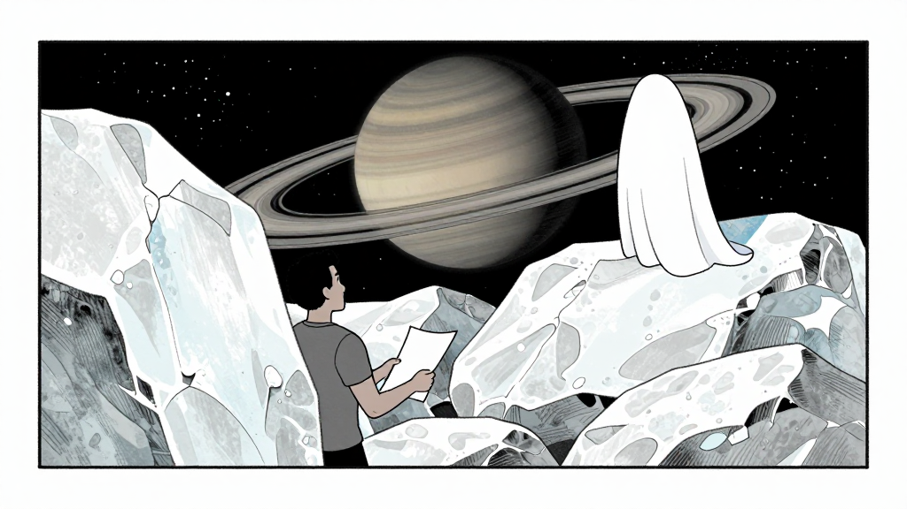 | **s03** | 6 The search | MEDIUM, locked off, 50 mm | 168f (7.0s) | He peers round a house-sized ice boulder, drawing held up, looking screen LEFT. Behind him screen RIGHT the GHOST rises from behind another boulder and looks at him. He turns; she sinks. Twice. Then a tap on his shoulder from off-frame right. He freezes. | HIM: ...Space ghost? | **deadpan** | Suspense: we see her, he doesn't. Then he is found, by the wrong one. |
| 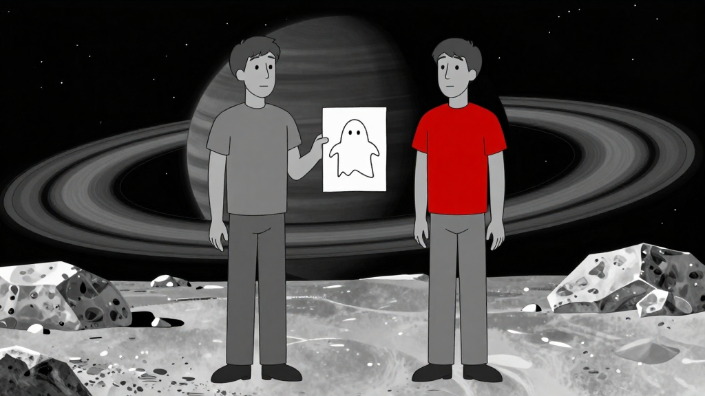 | **s04** | 6 The search | TWO-SHOT, 50 mm | 192f (8.0s) | He turns: it is HIM, in a red tee, screen right. The DOUBLE looks at the drawing, then at him. Long deadpan hold. Then the double boops his nose, drifts back grinning, and leaves in a streak. | DOUBLE: That's a sheet. / HIM: She has a vibe. / (boop) | **deadpan** | Rule of three broken: not the ghost, a double. He has company he didn't ask for. |
| 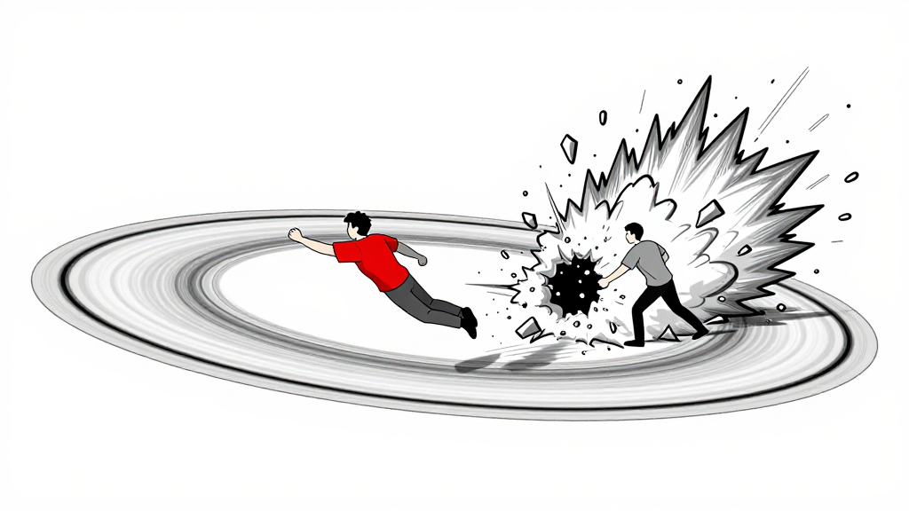 | **s05** | 7a The chase | WIDE, side, 35 mm | 72f (3.0s) | Left to right: the DOUBLE blasts straight through Saturn's ring, ice exploding behind him in a long wake. HIM follows through the same hole; his wake is twice as big. | HIM: Hey! Are you her?! / DOUBLE: No! | **epic** | His goal: catch him for an answer. He is as strong as the double. |
| 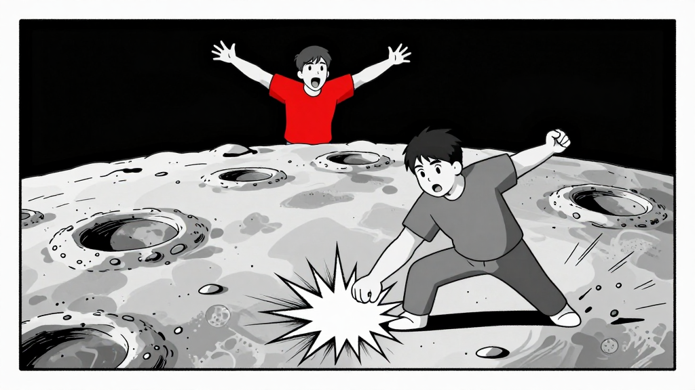 | **s06** | 7b The moon | MEDIUM, LOW, 24 mm | 60f (2.5s) | A small grey moon's horizon. HIM sneaks along the surface. The DOUBLE pops up over the horizon: BOO! The startle flings his fist straight down into the moon: IMPACT FRAME. | DOUBLE: BOO! / HIM: Aah! | **epic** | Power by accident: his flinch cracks a moon. |
| 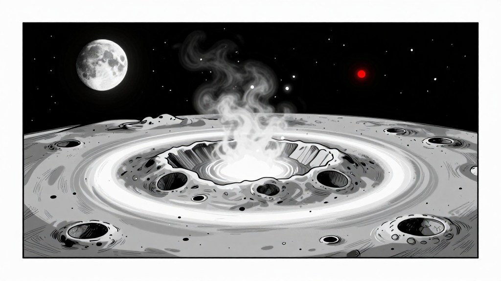 | **s07** | 7b The moon | EXTREME WIDE, 300 mm | 72f (3.0s) | From high orbit: two lit specks above the grey moon. A city-sized crater blooms under them, a slow shock ring, a dust plume. Then near silence. | (a low rumble, then nothing) | **epic** | The scale cut: face to a dot against a world. |
| 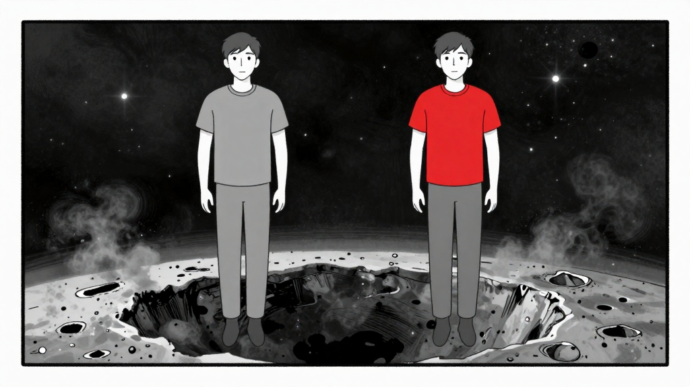 | **s08** | 7b The moon | TWO-SHOT, centred, 50 mm | 120f (5.0s) | Both float side by side and look down at the fresh crater filling the bottom of frame. Dust settles. 1.5 s hold before the line. | HIM: ...That was there before. / DOUBLE: Sure. | **deadpan** | The bigger the feat, the smaller the reaction. |
| 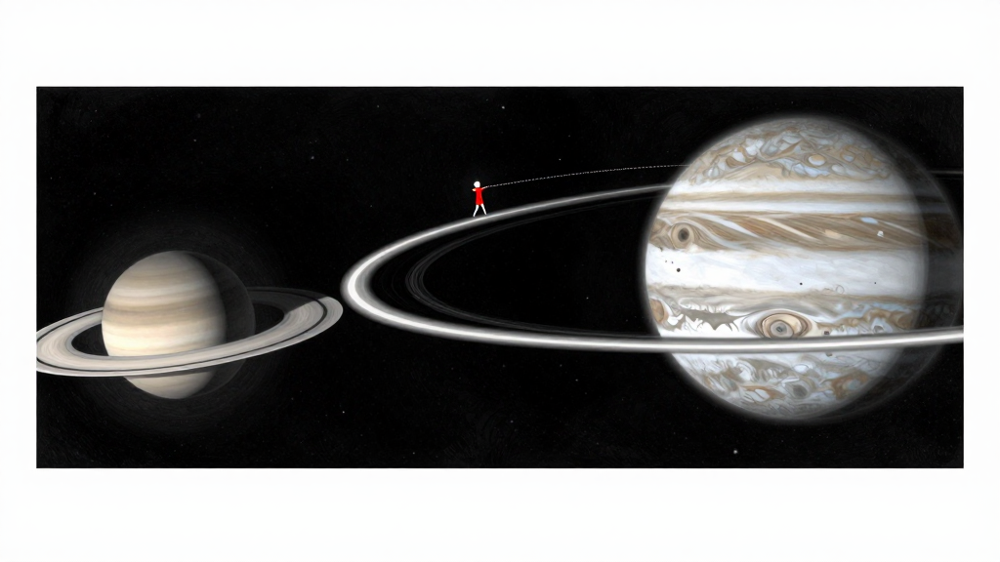 | **s09** | 7c The worlds | EXTREME WIDE, 200 mm | 144f (6.0s) | The DOUBLE grips the edge of Saturn's ring and pulls: the whole ring lifts off like a hoop. He spins it overhead like a lasso and throws. The loop sails across and drops over JUPITER. He yanks. Jupiter starts to move. | - | **epic** | Escalation 3: a planet is coming. |
| 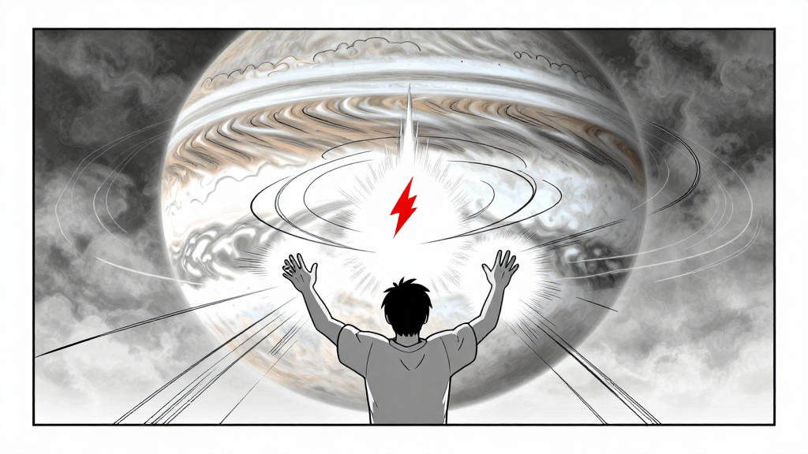 | **s10** | 7c The worlds | LOW ANGLE to CATCH, 18 mm | 108f (4.5s) | Low on HIM, Jupiter filling the whole sky behind and coming at him. He braces, arms out, a tremble. CATCH: impact frame, hitstop, a shockwave across the cloud bands. He slides back thousands of km, heels carving speed lines in nothing. | - | **epic** | The finisher: the biggest hit in the film, a planet caught. |
| 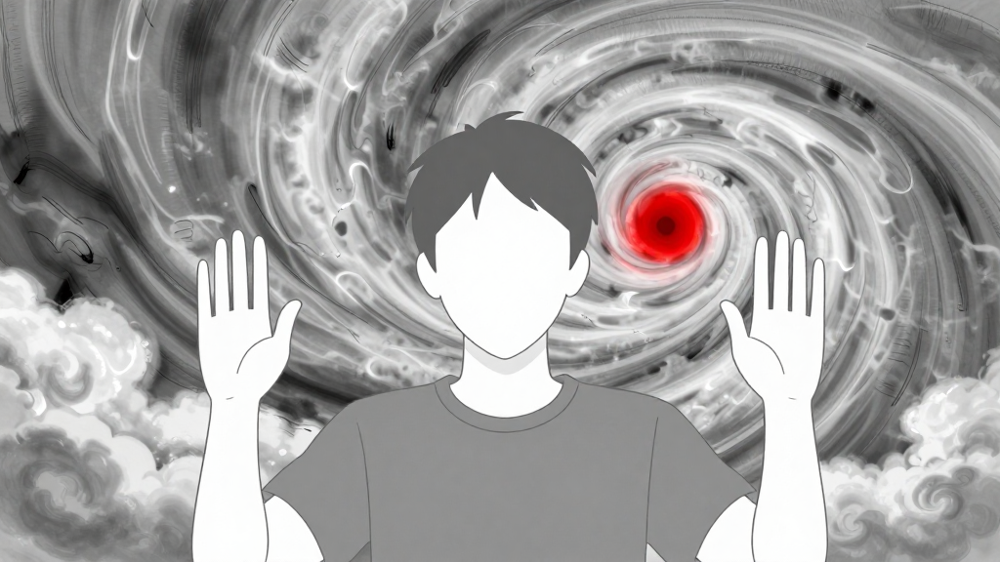 | **s11** | 7c The worlds | MCU, 85 mm | 108f (4.5s) | Palms flat on a wall of storm clouds, a hurricane bigger than Earth turning beside his head. Beat of 1.5 s. 'Okay.' He shoves it back where it was. | HIM (calm): Okay. | **deadpan** | Payoff hold: he is unimpressed. The double has to go bigger. |
| 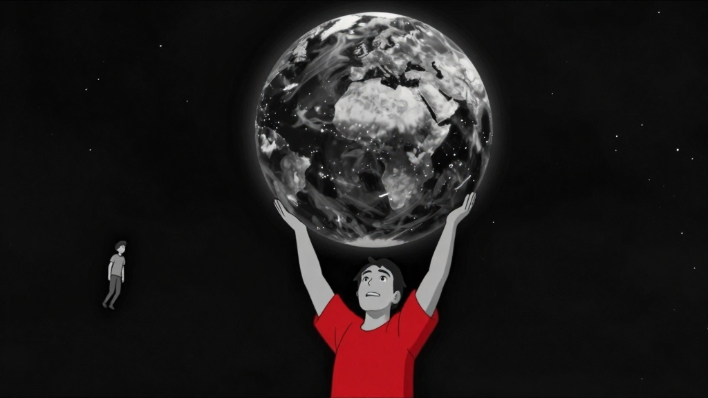 | **s12** | 7d The break | WIDE, LOW, 24 mm | 84f (3.5s) | The DOUBLE, Atlas-style, winds up overhead with the EARTH: clouds, city lights on the night side. HIM small at screen left, plain. | HIM: Hey. / DOUBLE: What. | **epic** | The rule of three breaks: this one he stops. |
| 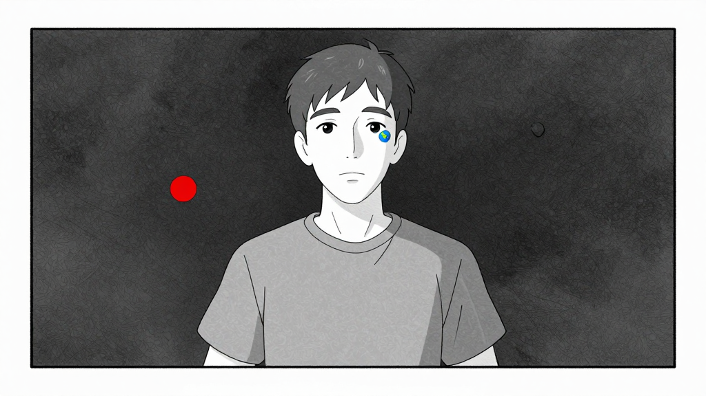 | **s13** | 7d The break | MCU, 85 mm | 72f (3.0s) | HIM, plain. No gesture. | HIM: People live there. | **deadpan** | Absurd literal-mindedness stops the game. |
| 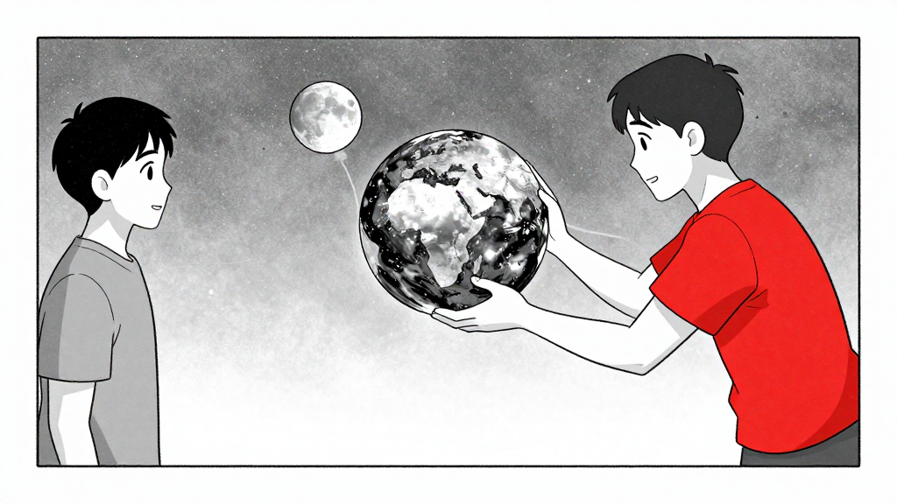 | **s14** | 7d The break | WIDE, locked off, 85 mm | 144f (6.0s) | The DOUBLE looks up at the city lights. Long beat. Then very carefully he flies the Earth back and sets it into orbit like a full glass. A small pat. It keeps turning. | HIM: Did anyone see? / DOUBLE: Everyone saw. | **deadpan** | Turn: rivals to truce. The careful set-down is the joke. |
| 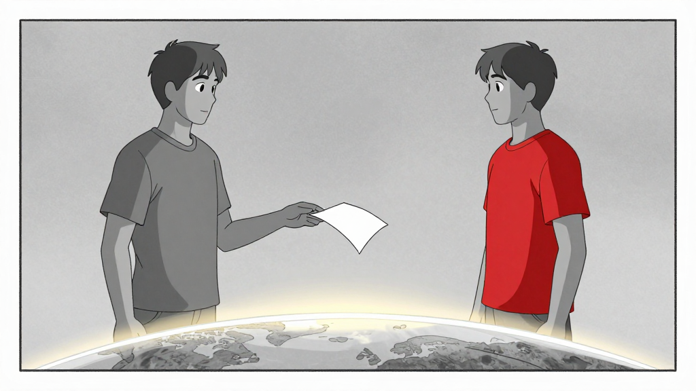 | **s15** | 8 The stop | TWO-SHOT, close, 85 mm (push in on the realisation) | 216f (9.0s) | Above Earth at sunrise, out of breath, face to face. 'Are you... the space ghost?' 'No, man. I'm you.' Pause. He looks at the double's face. 'You do have a face.' He looks at the drawing and lets it go. It drifts off toward the sunrise. | HIM: Are you... the space ghost? / DOUBLE: No, man. I'm you. / HIM: You do have a face. | **deadpan** | Turn (+): lonely to not alone. Payoff of 'she doesn't have a face'. The drawing released. |
| 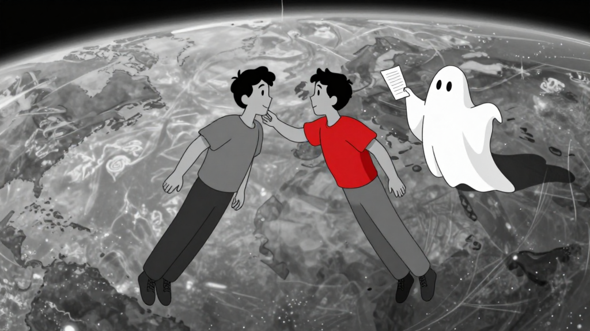 | **s16** | 8 The stop | WIDE then TO LENS, 35 mm | 168f (7.0s) | Side by side. The drawing drifts past the GHOST, who catches it, looks at it, and seems pleased. Neither notices. He starts to turn; the double turns his chin back. Then both turn to camera with TV smiles. | DOUBLE: Hey. Focus. (beat) Are you feeling like there's two of you? | **deadpan** | The ghost pays off for us, not him. The story becomes the ad. |

16 shots, 2040 frames = 85 s.
## Act 3: the commercial and the next day

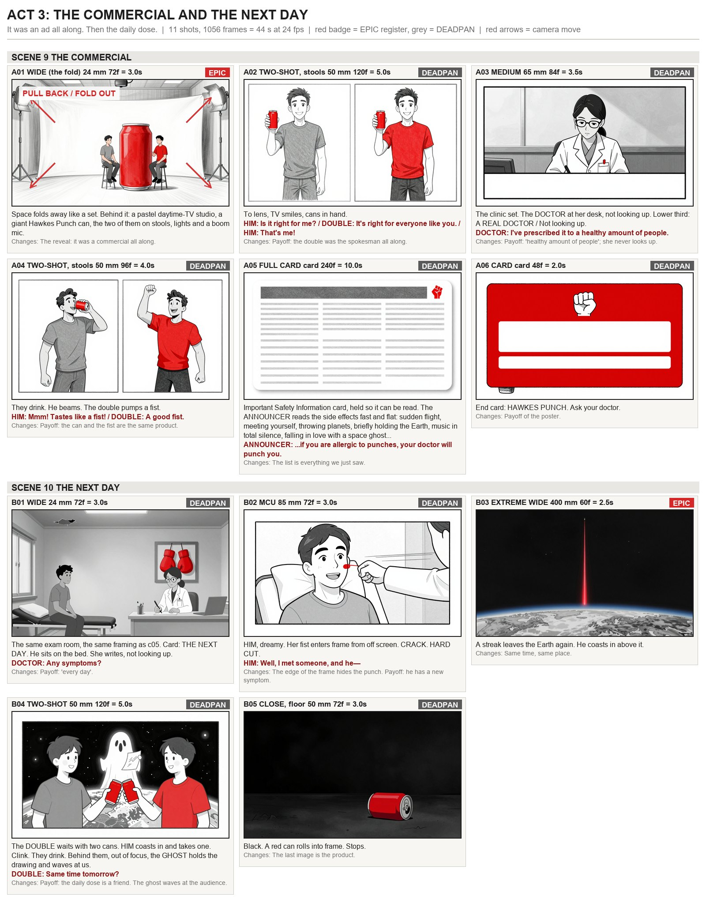

| panel | id | scene | size, lens | frames | action | line | register | what changes |
|---|---|---|---|---|---|---|---|---|
| 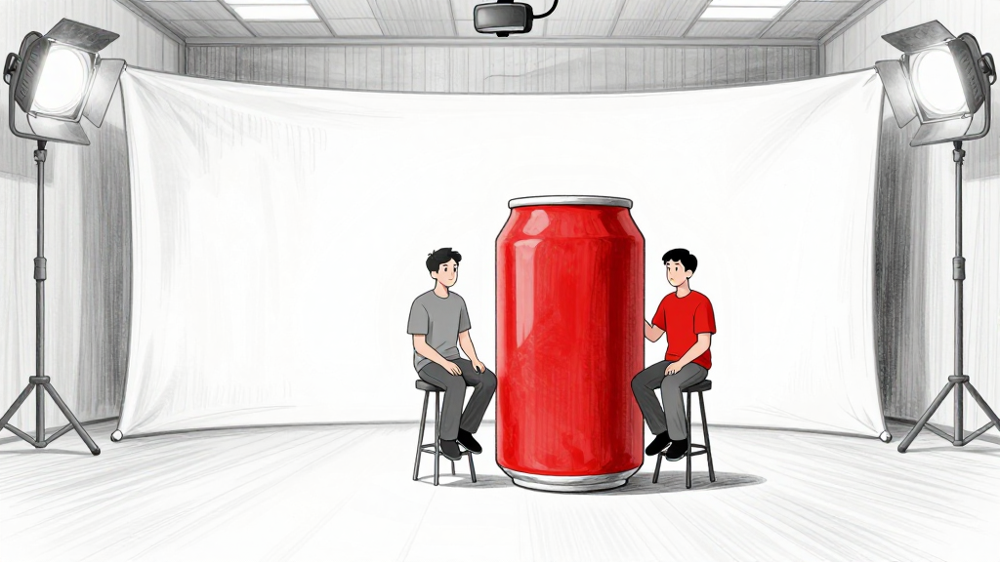 | **a01** | 9 The commercial | WIDE (the fold), 24 mm (pull back / fold) | 72f (3.0s) | Space folds away like a set. Behind it: a pastel daytime-TV studio, a giant Hawkes Punch can, the two of them on stools, lights and a boom mic. | - | **epic** | The reveal: it was a commercial all along. |
| 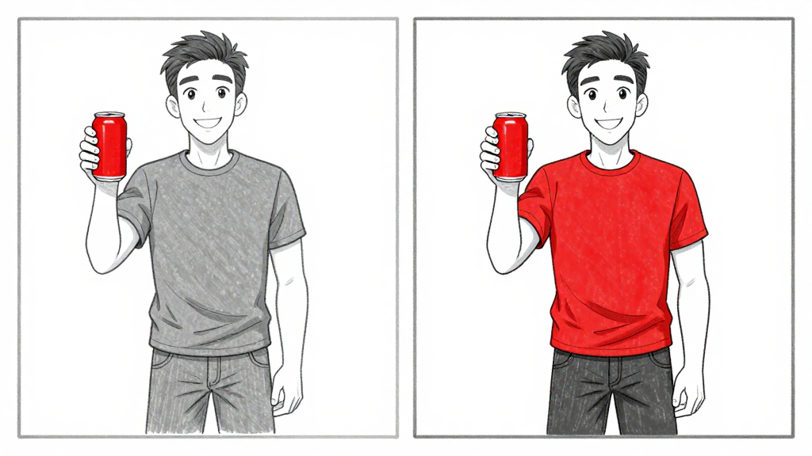 | **a02** | 9 The commercial | TWO-SHOT, stools, 50 mm | 120f (5.0s) | To lens, TV smiles, cans in hand. | HIM: Is it right for me? / DOUBLE: It's right for everyone like you. / HIM: That's me! | **deadpan** | Payoff: the double was the spokesman all along. |
| 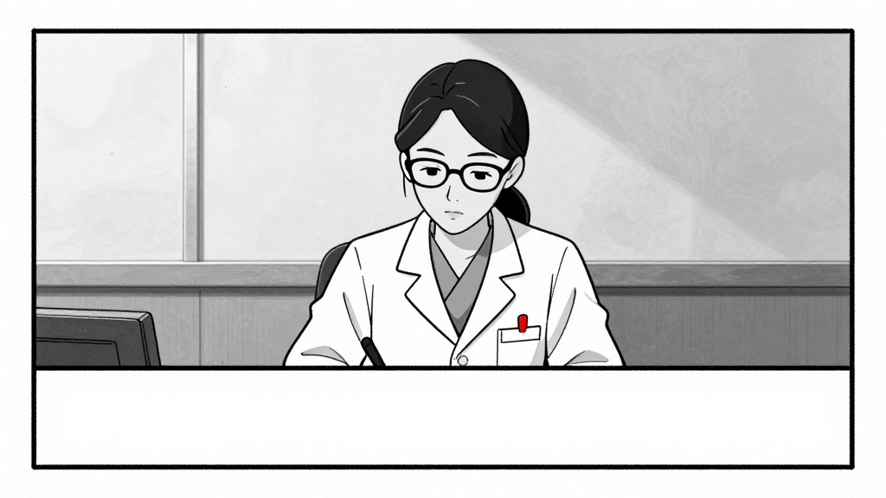 | **a03** | 9 The commercial | MEDIUM, 65 mm | 84f (3.5s) | The clinic set. The DOCTOR at her desk, not looking up. Lower third: A REAL DOCTOR / Not looking up. | DOCTOR: I've prescribed it to a healthy amount of people. | **deadpan** | Payoff: 'healthy amount of people'; she never looks up. |
| 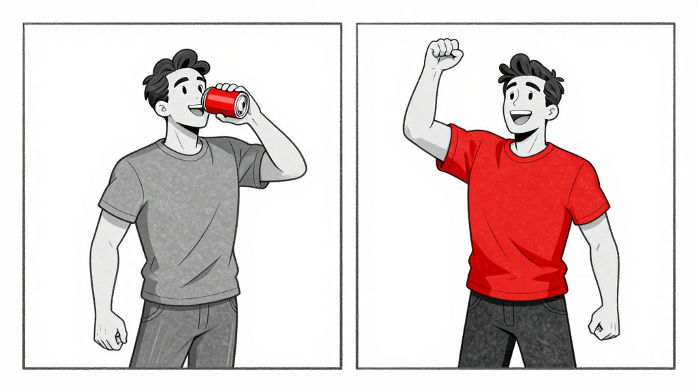 | **a04** | 9 The commercial | TWO-SHOT, stools, 50 mm | 96f (4.0s) | They drink. He beams. The double pumps a fist. | HIM: Mmm! Tastes like a fist! / DOUBLE: A good fist. | **deadpan** | Payoff: the can and the fist are the same product. |
| 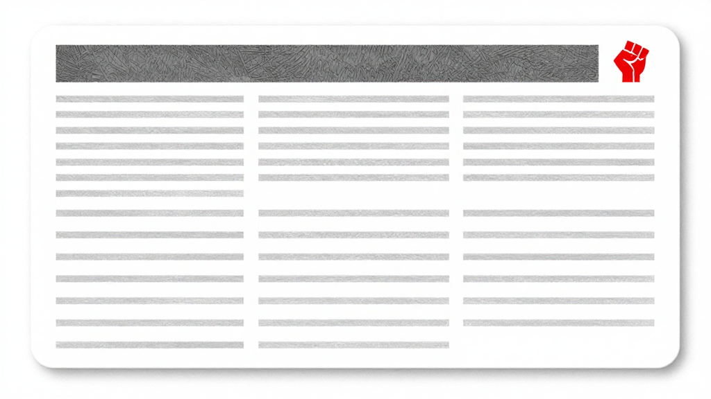 | **a05** | 9 The commercial | FULL CARD, card | 240f (10.0s) | Important Safety Information card, held so it can be read. The ANNOUNCER reads the side effects fast and flat: sudden flight, meeting yourself, throwing planets, briefly holding the Earth, music in total silence, falling in love with a space ghost... | ANNOUNCER: ...if you are allergic to punches, your doctor will punch you. | **deadpan** | The list is everything we just saw. |
|  | **a06** | 9 The commercial | CARD, card | 48f (2.0s) | End card: HAWKES PUNCH. Ask your doctor. | - | **deadpan** | Payoff of the poster. |
|  | **b01** | 10 The next day | WIDE, 24 mm | 72f (3.0s) | The same exam room, the same framing as c05. Card: THE NEXT DAY. He sits on the bed. She writes, not looking up. | DOCTOR: Any symptoms? | **deadpan** | Payoff: 'every day'. |
|  | **b02** | 10 The next day | MCU, 85 mm | 72f (3.0s) | HIM, dreamy. Her fist enters frame from off screen. CRACK. HARD CUT. | HIM: Well, I met someone, and he— | **deadpan** | The edge of the frame hides the punch. Payoff: he has a new symptom. |
|  | **b03** | 10 The next day | EXTREME WIDE, 400 mm | 60f (2.5s) | A streak leaves the Earth again. He coasts in above it. | - | **epic** | Same time, same place. |
|  | **b04** | 10 The next day | TWO-SHOT, 50 mm | 120f (5.0s) | The DOUBLE waits with two cans. HIM coasts in and takes one. Clink. They drink. Behind them, out of focus, the GHOST holds the drawing and waves at us. | DOUBLE: Same time tomorrow? | **deadpan** | Payoff: the daily dose is a friend. The ghost waves at the audience. |
|  | **b05** | 10 The next day | CLOSE, floor, 50 mm | 72f (3.0s) | Black. A red can rolls into frame. Stops. | - | **deadpan** | The last image is the product. |

11 shots, 1056 frames = 44 s.

## Production notes

- **Scale.** Space is real scale (`space_epic` set): contact shots are at human scale with the planet as terrain (s06, s10, s11); disc shots show him
  as a lit figure or a speck with a trail (s01, s07, s09, s12, b03). One size per shot.
- **Limited animation.** Deadpan shots are a held `zg_neutral` float with gaze only; epic shots are keyed pose to pose (anticipation hold, a 2-4 frame
  strike, impact frame, hitstop, release) on the sheets in SPACE-EPIC.md. Acting on 3s for him, 2s for the double, 1s only inside strikes.
- **Sound.** No music. The only true silence is s01's ring plane to s02's "She's up here". Every impact gets its drop-out, then near silence, then one
  small sound (the pebble tick, the pat, the keyboard).
- **New lines** since SCRIPT.md are the ones SPACE-EPIC.md lists; "Hey! Are you her?!" / "No!" moves into the ring blast (s05).
- **Not in this board:** anything not approved. Panels are sketches for staging; the final look is the renderer's.
